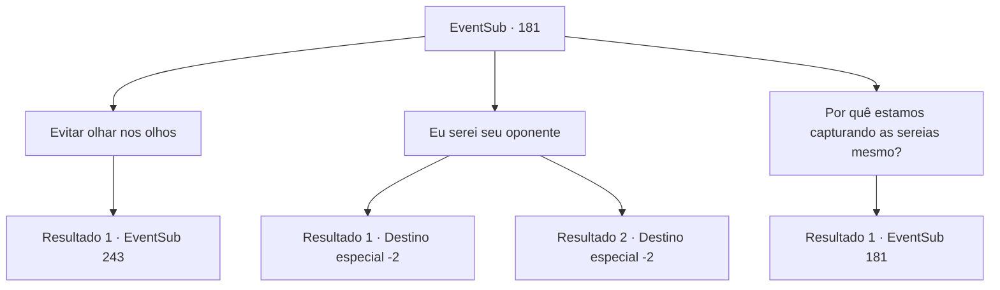

# Eventos secundários · 181

[Índice da tabela](index.md) · [Índice geral](../index.md)

ID: `pt:EventSub:181` · Fonte: `EventSub4` · Versão: 1.2.47.

Mapeamento estático dos arquivos; a disponibilidade e a execução dependem do estado da run.

## Texto do evento

*Sem texto no arquivo.*

## Dados de entrada

```json
{
  "id": 181,
  "grade": 1,
  "subEvent": "",
  "required": ""
}
```

## Mapa das escolhas



## Escolhas e resultados

### Escolha 1

Evitar olhar nos olhos

Requisitos e outros campos da escolha:

```json
{
  "required": ""
}
```

#### Resultado 1.1

Tentas evitar o olhar dele, tal como todos os outros. Parrie estala a língua, desviando o olhar de ti e encorajando os outros a avançarem. Olhas lentamente para a cena antes de sair do local com outras pessoas.

Continuação registrada: [Evento 243](0243.md) na mesma tabela.

```json
{
  "required": "",
  "chance": "1",
  "nextEvent": 243,
  "type": 2,
  "reward": "12_6_-1"
}
```

### Escolha 2

Eu serei seu oponente

Requisitos e outros campos da escolha:

```json
{
  "required": ""
}
```

#### Resultado 2.1

Você não evita o olhar de Parrie, se aproximando da mesa confiantemente e apresentando seu braço. O homem encapuzado, o vencedor da última batalha, bloqueia você e logo agarra seu braço. 

 "Pronto, preparar... Já!"

 Assim que a batalha começa, você vira o braço do homem encapuzado. Ele geme, segurando o braço, e você levanta os braços no ar, fazendo uma pose de vitória. Parrie aplaude você, se aproximando. 

 "Agora sim, alguém que eu chamaria de um verdadeiro homem! Você é digno de um lugar no Viúva do Amor!"

 Ele diz que você deve retornar pela manhã após alguns dias, pois é quando eles partirão. Você lembra do dia agendado e sai.

Continuação registrada: [Destino especial `-2`](../destinos-especiais.md).

```json
{
  "required": "",
  "chance": "1|0_5_1",
  "nextEvent": -2,
  "type": 0,
  "reward": "12_6_1|0_2_1"
}
```

#### Resultado 2.2

Você não evita o olhar de Parrie, se aproximando da mesa confiantemente e apresentando seu braço. O homem encapuzado, o vencedor da última batalha, bloqueia você e logo agarra seu braço. 

 "Pronto, preparar...Já!"

 Mas assim que a batalha começa, seu braço é esmagado pelo homem encapuzado. Parrie estala a língua, enquanto você ainda sente dor. 

 "Pfft, todos fracos e pequenos cachorrinhos."

 Você segura seu tornozelo torcido e sai apressadamente da área.

Continuação registrada: [Destino especial `-2`](../destinos-especiais.md).

```json
{
  "required": "",
  "chance": "8",
  "nextEvent": -2,
  "type": 1,
  "reward": "12_6_-1"
}
```

### Escolha 3

Por quê estamos capturando as sereias mesmo?

Requisitos e outros campos da escolha:

```json
{
  "required": "5_203_0"
}
```

#### Resultado 3.1

Parrie aplaude em resposta à sua pergunta, respondendo a você. 

 "Ah, agora essa é uma boa pergunta! Veja bem, essas sereias são tão raras que até eu, que navego há 20 anos, só as avistei uma vez na minha vida. Mas há um tempo atrás, coloquei minhas mãos em um mapa que mostra a localização delas. Se pudermos pegá-las, definitivamente seremos 'MUITO' ricos."

 Depois de terminar sua frase, Parrie se olha novamente.

Continuação registrada: [Evento 181](0181.md) na mesma tabela.

```json
{
  "required": "",
  "chance": "1",
  "nextEvent": 181,
  "type": 2,
  "reward": "5_203_1"
}
```

## Referências que chegam a este evento

- [Evento 178 · escolha 1 · resultado 1](0178.md#escolha-1)
- [Evento 181 · escolha 3 · resultado 1](0181.md#escolha-3)
