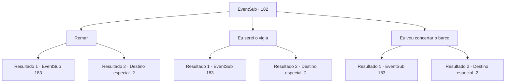

# Eventos secundários · 182

[Índice da tabela](index.md) · [Índice geral](../index.md)

ID: `pt:EventSub:182` · Fonte: `EventSub4` · Versão: 1.2.47.

Mapeamento estático dos arquivos; a disponibilidade e a execução dependem do estado da run.

## Texto do evento

Durante a viagem, você percebe que é quase o dia que prometeu a Parrie. Você corre para Levantium, onde felizmente chega a tempo. Quando você chega à Viúva do Amor, os marinheiros já estão ocupados transportando suprimentos para a viagem. Parrie, gritando ordens para seus marinheiros, se aproxima de você com uma gargalhada ao vê-lo. 

 "Ah, você está aqui! Vamos zarpar à tarde! Pronto para fazer uma fortuna?"

 Ele então tira um mapa de seu casaco, apresentando-o com confiança para você. No mapa há um desenho de um oceano largo, locais conhecidos de alguns monstros marinhos que habitam lá e três ilhas rochosas. As ilhas rochosas também são circuladas. 

 "Acho que vou precisar de seus serviços, pilotando a nave."


## Dados de entrada

```json
{
  "id": 182,
  "grade": 1,
  "subEvent": "",
  "required": "12_6_1"
}
```

## Mapa das escolhas



## Escolhas e resultados

### Escolha 1

Remar

Requisitos e outros campos da escolha:

```json
{
  "required": ""
}
```

#### Resultado 1.1

Você decide remar com os marinheiros. Remar acaba sendo bastante difícil. A galera se move pegando o vento com suas velas, então os marinheiros geralmente passam o tempo conversando entre si, remando tranquilamente. Mas nos casos de encontrar recifes subaquáticos ou navios piratas, eles tiveram que remar com todas as suas forças. Depois de algum tempo no oceano, a Viúva do Amor chega no meio das Três Ilhas, de acordo com o mapa de Parrie. Mas não há sereias à vista, e o mar está calmo.

Continuação registrada: [Evento 183](0183.md) na mesma tabela.

```json
{
  "required": "",
  "chance": "1|0_5_1",
  "nextEvent": 183,
  "type": 0,
  "reward": "0_2_1"
}
```

#### Resultado 1.2

Você decide remar com os marinheiros. Remar acaba sendo bastante difícil. Então, um dia, um dos marinheiros grita apressadamente que encontrou um navio pirata. Você rema e rema. Mas logo fica exausto e perde o controle do remo. Seu remo se mistura com os remos dos outros marinheiros e quebra. Felizmente, o navio pirata perdeu o rastro do seu navio e você foi deixado em um porto aleatório para reabastecer. Mas a Viúva do Amor te abandona e vai embora.

Continuação registrada: [Destino especial `-2`](../destinos-especiais.md).

```json
{
  "required": "",
  "chance": "10",
  "nextEvent": -2,
  "type": 1,
  "reward": "12_6_-1"
}
```

### Escolha 2

Eu serei o vigia

Requisitos e outros campos da escolha:

```json
{
  "required": ""
}
```

#### Resultado 2.1

Você diz que vai assumir outro papel, em vez de remar. Parrie te examina de cima a baixo e fala. 

 "Tudo bem. Adoro seu entusiasmo. Então você será o vigia."

 Assim, você foi designado para o papel de vigia, observando o horizonte com um telescópio. É um trabalho difícil, tendo que trabalhar dia e noite. E também é importante, porque evitar os navios piratas e os recifes subaquáticos depende de você e de sua manobra do navio. O Capitão Parrie às vezes te presenteia com rum para ajudar no trabalho árduo, e o rum definitivamente ajuda a combater a fadiga. Depois de muito tempo no mar, a Viúva do Amor chega no meio das Três Ilhas. Mas as sereias não estão em lugar algum, e o mar ainda está calmo.

Continuação registrada: [Evento 183](0183.md) na mesma tabela.

```json
{
  "required": "",
  "chance": "1|0_7_1",
  "nextEvent": 183,
  "type": 0,
  "reward": "0_2_1"
}
```

#### Resultado 2.2

Você diz que vai assumir outro papel, em vez de remar. Parrie te examina de cima a baixo e fala. 

 "Tudo bem. Adoro seu entusiasmo. Então você será o vigia."

 Assim, você foi designado para o papel de vigia, observando o horizonte com um telescópio. É um trabalho difícil, tendo que trabalhar dia e noite. E também é importante, porque evitar os navios piratas e os recifes subaquáticos depende de você e de sua manobra do navio. Mas o cansaço te vence. Sua falta de atenção quase faz o navio colidir algumas vezes, quase atingindo recifes subaquáticos. Então, no próximo porto, onde o navio atracou para reabastecer, você é abandonado.

Continuação registrada: [Destino especial `-2`](../destinos-especiais.md).

```json
{
  "required": "",
  "chance": "10",
  "nextEvent": -2,
  "type": 1,
  "reward": "12_6_-1"
}
```

### Escolha 3

Eu vou concertar o barco

Requisitos e outros campos da escolha:

```json
{
  "required": ""
}
```

#### Resultado 3.1

A bordo do navio, você é designado para manter o navio em plenas condições. A cozinha, com suprimentos muito acima de sua capacidade devido às longas viagens que passaria, constantemente grita de dor. Você é obrigado a carregar uma bolsa cheia de ferramentas de reparo, correndo pelo navio a cada segundo para verificar partes perigosas e consertá-las. Depois de muito tempo passado, a Viúva do Amor finalmente chega às Três Ilhas, de acordo com o mapa. Mas as sereias não estão em lugar algum, e o mar está calmo. A Viúva do Amor te abandona e vai embora.

Continuação registrada: [Evento 183](0183.md) na mesma tabela.

```json
{
  "required": "",
  "chance": "1|0_6_1",
  "nextEvent": 183,
  "type": 0,
  "reward": "0_2_1"
}
```

#### Resultado 3.2

A bordo do navio, você é designado para manter o navio em plenas condições. A cozinha, com suprimentos muito acima de sua capacidade devido às longas viagens que passaria, constantemente grita de dor. Você é obrigado a carregar uma bolsa cheia de ferramentas de reparo, correndo pelo navio a cada segundo para verificar partes perigosas e consertá-las. Um dia, você descobre que o volante do navio está a um segundo de se despedaçar. Você tenta consertá-lo, mas com sua habilidade duvidosa, apenas piora a situação. Então, no próximo porto em que o navio atracou para reparos, você é abandonado. A Viúva do Amor te abandona e vai embora.

Continuação registrada: [Destino especial `-2`](../destinos-especiais.md).

```json
{
  "required": "",
  "chance": "10",
  "nextEvent": -2,
  "type": 1,
  "reward": "12_6_-1"
}
```

## Referências que chegam a este evento

Nenhum `nextEvent` positivo da mesma tabela aponta para este nó. Isso não prova que seja inacessível: sorteio e estado de história podem selecioná-lo.

