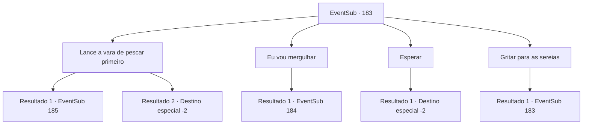

# Eventos secundários · 183

[Índice da tabela](index.md) · [Índice geral](../index.md)

ID: `pt:EventSub:183` · Fonte: `EventSub4` · Versão: 1.2.47.

Mapeamento estático dos arquivos; a disponibilidade e a execução dependem do estado da run.

## Texto do evento

*Sem texto no arquivo.*

## Dados de entrada

```json
{
  "id": 183,
  "grade": 1,
  "subEvent": "",
  "required": ""
}
```

## Mapa das escolhas



## Escolhas e resultados

### Escolha 1

Lance a vara de pescar primeiro

Requisitos e outros campos da escolha:

```json
{
  "required": "8_43_1"
}
```

#### Resultado 1.1

Você lança sua vara de pesca e espera que a sereia seja pega. Mas mesmo depois de muito tempo, nenhum sinal de sereia é sentido, e você se estica para combater o tédio. É nesse momento que algo morde a vara de pesca com grande força. Você e a tripulação puxam a vara com toda a força, e logo a identidade da criatura é revelada. É um grande tubarão branco, conhecido por ser o mais brutal dos tubarões. O grande tubarão se debate no convés e joga você e alguns outros marinheiros ao mar. Você se debate na água, mas não há tempo a perder. O grande tubarão, já escapado do navio, está nadando em sua direção com a boca bem aberta.

Continuação registrada: [Evento 185](0185.md) na mesma tabela.

```json
{
  "required": "",
  "chance": "1|0_5_1",
  "nextEvent": 185,
  "type": 0,
  "reward": "6_0_106",
  "place": 3
}
```

#### Resultado 1.2

Você lança sua vara de pesca e espera que a sereia seja pega. Mas mesmo depois de muito tempo, nenhum sinal de sereia é sentido, e você se estica para combater o tédio. É nesse momento que algo morde a vara de pesca com grande força. Você aperta o cabo da vara, mas acaba tendo que soltar. Logo, ao pôr do sol, o Capitão Parrie rapidamente chega a uma conclusão, embora pareça um pouco desapontado. 

 "Voltamos para o continente e atracamos por enquanto! Precisamos encontrar uma maneira de atrair essas sereias."

 Ouvindo as ordens de Parrie, os marinheiros rapidamente voltam para seus lugares e conduzem o navio. Alguns dias depois, os marinheiros se dividem em alguns grupos, esperando o capitão chamá-los novamente.

Continuação registrada: [Destino especial `-2`](../destinos-especiais.md).

```json
{
  "required": "",
  "chance": "12",
  "nextEvent": -2,
  "type": 1,
  "reward": "12_6_2|4_43_1"
}
```

### Escolha 2

Eu vou mergulhar

Requisitos e outros campos da escolha:

```json
{
  "required": ""
}
```

#### Resultado 2.1

Você diz a Parrie que vai mergulhar e procurar pelos seres do mar. Ele te encara com uma expressão preocupada e fala. 

 "Hm... espere aí. Estamos perdendo luz, e vai ficar bem escuro embaixo d'água.... Você tem visão noturna ou algo assim? Para poder enxergar bem no escuro?"


Continuação registrada: [Evento 184](0184.md) na mesma tabela.

```json
{
  "required": "",
  "chance": "1",
  "nextEvent": 184,
  "type": 2,
  "reward": ""
}
```

### Escolha 3

Esperar

Requisitos e outros campos da escolha:

```json
{
  "required": ""
}
```

#### Resultado 3.1

Você espera em branco pelo aparecimento dos tritões. Mas apesar da sua espera, não há sinal dos tritões. Logo, ao pôr do sol, o Capitão Parrie rapidamente chega a sua conclusão, embora pareça um pouco desapontado. 

 "Voltamos para o continente e atracamos por enquanto! Devemos encontrar uma maneira de atrair esses tritões."

 Ouvindo as ordens de Parrie, os marinheiros rapidamente voltam para seus lugares e conduzem o navio. Alguns dias depois, os marinheiros se dividem em alguns grupos, esperando o capitão chamá-los novamente.

Continuação registrada: [Destino especial `-2`](../destinos-especiais.md).

```json
{
  "required": "",
  "chance": "1",
  "nextEvent": -2,
  "type": 2,
  "reward": "12_6_2"
}
```

### Escolha 4

Gritar para as sereias

Requisitos e outros campos da escolha:

```json
{
  "required": "5_204_0"
}
```

#### Resultado 4.1

Você grita pelos seres do mar, mas eles nunca aparecem. Apenas o som das ondas calmas ecoam em seus ouvidos.

Continuação registrada: [Evento 183](0183.md) na mesma tabela.

```json
{
  "required": "",
  "chance": "1",
  "nextEvent": 183,
  "type": 2,
  "reward": "5_204_1"
}
```

## Referências que chegam a este evento

- [Evento 182 · escolha 1 · resultado 1](0182.md#escolha-1)
- [Evento 182 · escolha 2 · resultado 1](0182.md#escolha-2)
- [Evento 182 · escolha 3 · resultado 1](0182.md#escolha-3)
- [Evento 183 · escolha 4 · resultado 1](0183.md#escolha-4)
