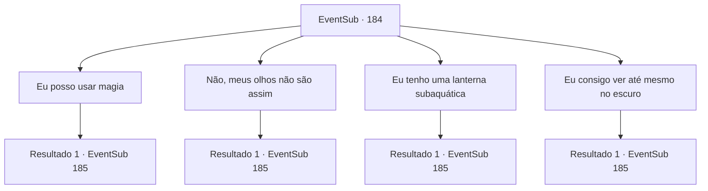

# Eventos secundários · 184

[Índice da tabela](index.md) · [Índice geral](../index.md)

ID: `pt:EventSub:184` · Fonte: `EventSub4` · Versão: 1.2.47.

Mapeamento estático dos arquivos; a disponibilidade e a execução dependem do estado da run.

## Texto do evento

*Sem texto no arquivo.*

## Dados de entrada

```json
{
  "id": 184,
  "grade": 1,
  "subEvent": "",
  "required": ""
}
```

## Mapa das escolhas



## Escolhas e resultados

### Escolha 1

Eu posso usar magia

Requisitos e outros campos da escolha:

```json
{
  "required": "20_0_1"
}
```

#### Resultado 1.1

Você evoca uma pequena luz com sua magia. Ele assente e amarra uma corda na cintura. 

 "Agora, boa sorte em sua pesquisa, Firefly."

 Você aperta a corda e pula na água fria. |drawing_dive| Você mergulha profundamente. De repente, você vê algo grande comovente em sua visão. Você olha mais de perto, pensando que pode ser Merfolk, mas é uma espécie totalmente diferente, 'grande tubarão branco'. Descobrindo sua identidade, você pega a superfície, a fim de nadar. Mas o infame predador do oceano acaba sendo mais rápido.

Continuação registrada: [Evento 185](0185.md) na mesma tabela.

```json
{
  "required": "",
  "chance": "1",
  "nextEvent": 185,
  "type": 2,
  "reward": "6_0_106",
  "place": 3
}
```

### Escolha 2

Não, meus olhos não são assim

Requisitos e outros campos da escolha:

```json
{
  "required": ""
}
```

#### Resultado 2.1

Ele assente e entra na cabine do capitão. Ele logo sai com uma lâmpada emitindo uma luz azul, que ele entrega para você. 

 "Aqui. Uma lâmpada submarina."

 Você pega a lâmpada mágica, amarra uma corda longa na cintura e pula na água fria. O mar está escuro e aparentemente interminável, mas graças à luz da lâmpada mágica, o caminho para baixo não é muito difícil. |drawing_dive| Você mergulha profundamente. De repente, você vê algo grande comovente em sua visão. Você olha mais de perto, pensando que pode ser Merfolk, mas é uma espécie totalmente diferente, 'grande tubarão branco'. Descobrindo sua identidade, você pega a superfície, a fim de nadar. Mas o infame predador do oceano acaba sendo mais rápido.

Continuação registrada: [Evento 185](0185.md) na mesma tabela.

```json
{
  "required": "",
  "chance": "1",
  "nextEvent": 185,
  "type": 2,
  "reward": "6_0_106|3_210_1",
  "place": 3
}
```

### Escolha 3

Eu tenho uma lanterna subaquática

Requisitos e outros campos da escolha:

```json
{
  "required": "8_210_1"
}
```

#### Resultado 3.1

Ouvindo sua resposta, o capitão assente satisfatoriamente. 

 "Você está bem preparado."

 Você pega a lâmpada mágica, amarra uma corda longa na cintura e pula na água fria. O mar está escuro e aparentemente interminável, mas graças à luz da lâmpada mágica, o caminho para baixo não é muito difícil. |drawing_dive| Você mergulha profundamente. De repente, você vê algo grande comovente em sua visão. Você olha mais de perto, pensando que pode ser Merfolk, mas é uma espécie totalmente diferente, 'grande tubarão branco'. Descobrindo sua identidade, você pega a superfície, a fim de nadar. Mas o infame predador do oceano acaba sendo mais rápido.

Continuação registrada: [Evento 185](0185.md) na mesma tabela.

```json
{
  "required": "",
  "chance": "1",
  "nextEvent": 185,
  "type": 2,
  "reward": "6_0_106",
  "place": 3
}
```

### Escolha 4

Eu consigo ver até mesmo no escuro

Requisitos e outros campos da escolha:

```json
{
  "required": "20_26_1"
}
```

#### Resultado 4.1

Ele assente e amarra uma corda na cintura.  

 "Agora, boa sorte em sua pesquisa."

  Você aperta a corda e pula na água fria.  |drawing_dive|  Você mergulha profundamente.  De repente, você vê algo grande comovente em sua visão.  Você olha mais de perto, pensando que pode ser Merfolk, mas é uma espécie totalmente diferente, 'grande tubarão branco'.  Descobrindo sua identidade, você pega a superfície, a fim de nadar.  Mas o infame predador do oceano acaba sendo mais rápido.

Continuação registrada: [Evento 185](0185.md) na mesma tabela.

```json
{
  "required": "",
  "chance": "1",
  "nextEvent": 185,
  "type": 2,
  "reward": "6_0_106",
  "place": 3
}
```

## Referências que chegam a este evento

- [Evento 183 · escolha 2 · resultado 1](0183.md#escolha-2)
