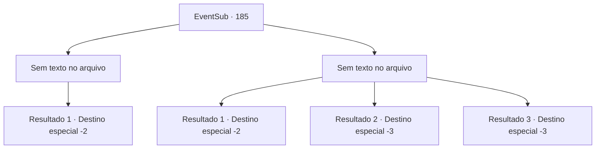

# Eventos secundários · 185

[Índice da tabela](index.md) · [Índice geral](../index.md)

ID: `pt:EventSub:185` · Fonte: `EventSub4` · Versão: 1.2.47.

Mapeamento estático dos arquivos; a disponibilidade e a execução dependem do estado da run.

## Texto do evento

*Sem texto no arquivo.*

## Dados de entrada

```json
{
  "id": 185,
  "grade": 1,
  "subEvent": "",
  "required": ""
}
```

## Mapa das escolhas



## Escolhas e resultados

### Escolha 1

*Sem texto no arquivo; o papel dessa opção depende da interface do jogo.*

Requisitos e outros campos da escolha:

```json
{
  "required": ""
}
```

#### Resultado 1.1

Você soca o nariz do grande tubarão branco, triunfando sobre ele. Finalmente, o tubarão cospe sangue e você nada para cima para respirar. Parrie diz, enquanto lava seu corpo com um pano. 

 "Isso foi por pouco. Voltamos para o continente e atracamos por agora! Precisamos encontrar uma maneira de atrair essas sereias para fora."

 Ouvindo as ordens de Parrie, os marinheiros rapidamente voltam para seus lugares e conduzem o navio. Você encara as chamadas águas natais das sereias, mas o mar está tão calmo como sempre. Alguns dias depois, os marinheiros se dividem em alguns grupos, esperando o capitão chamá-los novamente.

Continuação registrada: [Destino especial `-2`](../destinos-especiais.md).

```json
{
  "required": "",
  "chance": "1",
  "nextEvent": -2,
  "type": 2,
  "reward": "12_6_2"
}
```

### Escolha 2

*Sem texto no arquivo; o papel dessa opção depende da interface do jogo.*

Requisitos e outros campos da escolha:

```json
{
  "required": ""
}
```

#### Resultado 2.1

Você se debate debaixo d'água, mas acaba sendo mordido pelo tubarão. Você consegue repeli-lo depois de socar seu nariz, mas não está mais em condições de procurar pelos seres do mar. De volta ao navio, você ouve a voz de Parrie, enquanto é tratado pelo médico do navio. 

 "A conversa sobre os seres do mar deve ter sido uma mentira. Voltamos para a terra!"

 Ouvindo as ordens de Parrie, os marinheiros rapidamente retornam aos seus lugares e conduzem o navio. Mais tarde, Parrie te expulsa do navio assim que eles voltam para a terra, por causa do ferimento que você sofreu no ataque do tubarão. A Viúva do Amor te abandona e vai embora.

Continuação registrada: [Destino especial `-2`](../destinos-especiais.md).

```json
{
  "required": "1_0_2|1_1_2",
  "chance": "1",
  "nextEvent": -2,
  "type": 2,
  "reward": "12_6_-1|0_0_-1|0_1_-1"
}
```

#### Resultado 2.2

Você se debate debaixo d'água, mas acaba sendo mordido pelo tubarão. Assim que ele sente o gosto do sangue, ele te morde inquieto, e você pode sentir a água fluindo para os seus pulmões enquanto você morre.

Continuação registrada: [Destino especial `-3`](../destinos-especiais.md).

```json
{
  "required": "2_0_2",
  "chance": "1",
  "nextEvent": -3,
  "type": 2,
  "reward": "0_0_-1|0_1_-1"
}
```

#### Resultado 2.3

Você se debate debaixo d'água, mas acaba sendo mordido pelo tubarão. Assim que ele sente o gosto do sangue, ele te morde inquieto, e você pode sentir a água fluindo para os seus pulmões enquanto você morre.

Continuação registrada: [Destino especial `-3`](../destinos-especiais.md).

```json
{
  "required": "2_1_2",
  "chance": "1",
  "nextEvent": -3,
  "type": 2,
  "reward": "0_0_-1|0_1_-1"
}
```

## Referências que chegam a este evento

- [Evento 183 · escolha 1 · resultado 1](0183.md#escolha-1)
- [Evento 184 · escolha 1 · resultado 1](0184.md#escolha-1)
- [Evento 184 · escolha 2 · resultado 1](0184.md#escolha-2)
- [Evento 184 · escolha 3 · resultado 1](0184.md#escolha-3)
- [Evento 184 · escolha 4 · resultado 1](0184.md#escolha-4)
