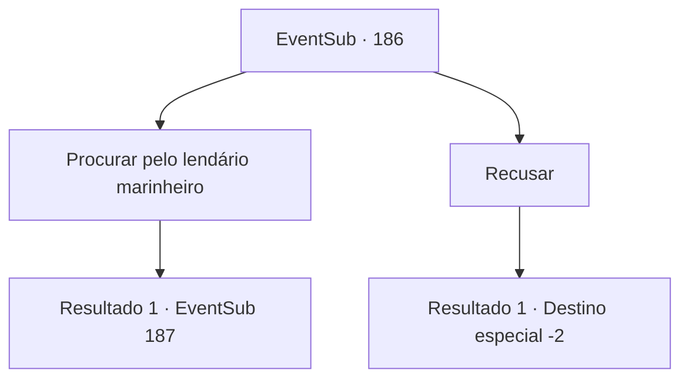

# Eventos secundários · 186

[Índice da tabela](index.md) · [Índice geral](../index.md)

ID: `pt:EventSub:186` · Fonte: `EventSub4` · Versão: 1.2.47.

Mapeamento estático dos arquivos; a disponibilidade e a execução dependem do estado da run.

## Texto do evento

Você volta para Levantium, onde a Viúva do Amor atracou. Capitão da Viúva, Parrie, reconhece você e se aproxima de você para cumprimentá-lo. 

 "Bom te ver de novo. Arr... Peço desculpas pelo suspiro... mas as coisas estão ruins. O lendário marinheiro, você poderia procurá-lo? Certamente aquele homem saberá como nos levar até os tritões."

 De acordo com Parrie, o lendário marinheiro costuma visitar Levantium para passar o tempo no pub local.

## Dados de entrada

```json
{
  "id": 186,
  "grade": 1,
  "subEvent": "",
  "required": "12_6_2"
}
```

## Mapa das escolhas



## Escolhas e resultados

### Escolha 1

Procurar pelo lendário marinheiro

Requisitos e outros campos da escolha:

```json
{
  "required": ""
}
```

#### Resultado 1.1

Após aceitar o pedido de Parrie, você imediatamente começa sua busca pelo lendário marinheiro. Levantium é realmente uma cidade grande, mas encontrar uma celebridade como essa não foi tão difícil. Você o encontra no maior pub da cidade. Ele tem rugas por todo o rosto, mas com braços musculosos e grossos, e sua barba amarela quase virou prata. O casaco esfarrapado que ele está usando já perdeu todos os botões, e através disso seu magnífico e redondo ventre pode ser visto. Assim que você o vê, tenta trazer à tona a história sobre as sereias, mas ele balança as mãos e aponta para o enorme barril de carvalho no canto da loja. 

 "Se você quer falar comigo, amigo, ou me vence em um concurso de bebida, ou me paga."


Continuação registrada: [Evento 187](0187.md) na mesma tabela.

```json
{
  "required": "",
  "chance": "1",
  "nextEvent": 187,
  "type": 2,
  "reward": ""
}
```

### Escolha 2

Recusar

Requisitos e outros campos da escolha:

```json
{
  "required": ""
}
```

#### Resultado 2.1

Você recusa o pedido de Parrie e vai para outro lugar.

Continuação registrada: [Destino especial `-2`](../destinos-especiais.md).

```json
{
  "required": "",
  "chance": "1",
  "nextEvent": -2,
  "type": 2,
  "reward": "12_6_-1"
}
```

## Referências que chegam a este evento

Nenhum `nextEvent` positivo da mesma tabela aponta para este nó. Isso não prova que seja inacessível: sorteio e estado de história podem selecioná-lo.

