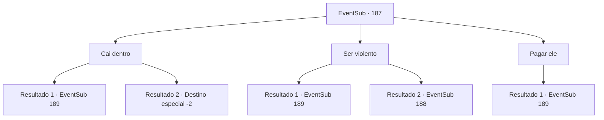

# Eventos secundários · 187

[Índice da tabela](index.md) · [Índice geral](../index.md)

ID: `pt:EventSub:187` · Fonte: `EventSub4` · Versão: 1.2.47.

Mapeamento estático dos arquivos; a disponibilidade e a execução dependem do estado da run.

## Texto do evento

*Sem texto no arquivo.*

## Dados de entrada

```json
{
  "id": 187,
  "grade": 1,
  "subEvent": "",
  "required": ""
}
```

## Mapa das escolhas



## Escolhas e resultados

### Escolha 1

Cai dentro

Requisitos e outros campos da escolha:

```json
{
  "required": "1_4_50"
}
```

#### Resultado 1.1

Você aceita o desafio do marinheiro, sentado no lado oposto. Ele ordena que o barman traga a bebida e sorri. 

 "Nome é 'Mopier'. Eu perco, vou te dizer o que você quer saber. Se eu vencer, porém, todas as bebidas estão em você esta noite."

 Redia de cerveja como um oceano profundo, cheio do limiar do barril. Depois de gritar aplausos, vocês dois começam a rir. Sempre que ele bebe, você bebe também e sempre que ele pede uma bebida nova, você faz o mesmo. A batalha se destaca durante a noite.

 Quanto tempo passou desde então. Finalmente no nascer do sol, Mopier cai na mesa, incapaz de controlar seu rosto, agora vermelho da bebida. O dono do pub lhe entrega alguns lanches em silêncio, parabenizando você pela vitória. 

 Naquela noite, você pergunta a Mopier sobre como se pode atrair o Merfolk. Ele bebe um pouco de água fria, limpa a boca e fala. 

 "Ai, minha cabeça... Ah sim, os merfolk ... merfolk são atraídos por belos sons. Em breve, um item chamado 'The Fantastique Harp' estará no leilão. Jogue isso e o Merfolk chegará até você."


Continuação registrada: [Evento 189](0189.md) na mesma tabela.

```json
{
  "required": "",
  "chance": "1|0_13_1",
  "nextEvent": 189,
  "type": 0,
  "reward": "0_2_1"
}
```

#### Resultado 1.2

Você aceita o desafio do marinheiro, sentado no lado oposto. Ele ordena que o barman traga a bebida e sorri. 

 "Nome é 'Mopier'. Eu perco, vou te dizer o que você quer saber. Se eu vencer, porém, todas as bebidas estão em você esta noite."

 Redia de cerveja como um oceano profundo, cheio do limiar do barril. Depois de gritar aplausos, vocês dois começam a rir. Sempre que ele bebe, você bebe também e sempre que ele pede uma bebida nova, você faz o mesmo. Quanto tempo passou desde então. Você não consegue controlar sua consciência e desmoronar para a mesa. O lendário marinheiro solta uma risada saudável, anunciando sua vitória. 

 Você acorda depois que o menos metade do dia passou, mas Mopier não está em lugar algum. Infelizmente, você volte à viúva do amor e conta o que aconteceu. Parrie, depois de ouvir sua história, solta um suspiro e fala. 

 "*suspiro*.... boa tentativa. Infelizmente, parece que nossa busca pelo Merfolk está em um beco sem saída."

 Dizendo isso, Parrie vira as costas para você e sai.

Continuação registrada: [Destino especial `-2`](../destinos-especiais.md).

```json
{
  "required": "",
  "chance": "14",
  "nextEvent": -2,
  "type": 1,
  "reward": "12_6_-1|0_4_-50"
}
```

### Escolha 2

Ser violento

Requisitos e outros campos da escolha:

```json
{
  "required": ""
}
```

#### Resultado 2.1

Você chuta a cadeira em que ele está sentado e se envolve fisicamente com o marinheiro. Após uma luta sangrenta, ele cede e lhe conta as informações que você precisa. 

 "Ugh... ugh.. p.. pare.. os seres do mar são atraídos por sons bonitos... Há um leilão acontecendo, onde eles estão fazendo lances pela 'Harpa Fantástica'... toque-a no mar e os seres do mar aparecerão."

 Você o solta e limpa o sangue das mãos.

Continuação registrada: [Evento 189](0189.md) na mesma tabela.

```json
{
  "required": "",
  "chance": "1|0_5_1",
  "nextEvent": 189,
  "type": 0,
  "reward": "0_2_1|5_205_1|0_3_-2"
}
```

#### Resultado 2.2

Você chuta a cadeira em que ele está sentado, mas ele não se move. Ele se levanta de sua cadeira, claramente desgostoso. 

 "Eu posso ser velho e aposentado, mas ainda sou muito capaz de ensinar uma lição a pessoas como você."

 Ele revela seus dentes dourados e puxa sua espada de sua cintura.

Continuação registrada: [Evento 188](0188.md) na mesma tabela.

```json
{
  "required": "",
  "chance": "14",
  "nextEvent": 188,
  "type": 1,
  "reward": "6_0_107",
  "place": 10
}
```

### Escolha 3

Pagar ele

Requisitos e outros campos da escolha:

```json
{
  "required": "1_4_100"
}
```

#### Resultado 3.1

Você entrega a ele uma bolsa cheia de moedas de ouro. O lendário marinheiro sorri satisfeito e pergunta o que você quer saber. Você pergunta a ele como pode atrair os seres do mar, aos quais ele responde depois de beber sua cerveja. 

 "Os seres do mar são atraídos por sons bonitos. Em breve, um item chamado 'a Harpa Fantástica' estará em leilão. Toque isso e os seres do mar virão até você."


Continuação registrada: [Evento 189](0189.md) na mesma tabela.

```json
{
  "required": "",
  "chance": "1",
  "nextEvent": 189,
  "type": 2,
  "reward": "0_4_-100"
}
```

## Referências que chegam a este evento

- [Evento 186 · escolha 1 · resultado 1](0186.md#escolha-1)
