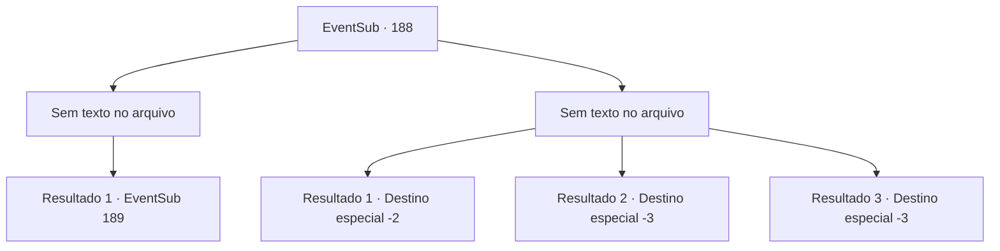

# Eventos secundários · 188

[Índice da tabela](index.md) · [Índice geral](../index.md)

ID: `pt:EventSub:188` · Fonte: `EventSub4` · Versão: 1.2.47.

Mapeamento estático dos arquivos; a disponibilidade e a execução dependem do estado da run.

## Texto do evento

*Sem texto no arquivo.*

## Dados de entrada

```json
{
  "id": 188,
  "grade": 1,
  "subEvent": "",
  "required": ""
}
```

## Mapa das escolhas



## Escolhas e resultados

### Escolha 1

*Sem texto no arquivo; o papel dessa opção depende da interface do jogo.*

Requisitos e outros campos da escolha:

```json
{
  "required": ""
}
```

#### Resultado 1.1

Você espanca o lendário marinheiro. Ele rola no chão de dor e, finalmente, lhe conta a informação. 

 "Ugh... ugh.. p.. pare.. os seres do mar são atraídos por sons bonitos... Há um leilão acontecendo, onde eles estão fazendo lances pela 'Harpa Fantástica'... toque-a no mar e os seres do mar aparecerão."

 Você o solta e limpa o sangue das suas mãos.

Continuação registrada: [Evento 189](0189.md) na mesma tabela.

```json
{
  "required": "",
  "chance": "1",
  "nextEvent": 189,
  "type": 2,
  "reward": "5_205_1|0_3_-2"
}
```

### Escolha 2

*Sem texto no arquivo; o papel dessa opção depende da interface do jogo.*

Requisitos e outros campos da escolha:

```json
{
  "required": ""
}
```

#### Resultado 2.1

O marinheiro ensina-lhe uma lição aprendida com dificuldade, e você tem que fugir dele. Você volta para Parrie e conta-lhe a verdade. Depois de ouvir a sua história, Parrie solta um suspiro e responde. 

 "Hoo... Bom esforço. Embora eu acho que nossa busca pelos seres do mar chegou a um beco sem saída."

 Após terminar a sua frase, Parrie vira as costas para você e vai embora.

Continuação registrada: [Destino especial `-2`](../destinos-especiais.md).

```json
{
  "required": "1_0_2|1_1_2",
  "chance": "1",
  "nextEvent": -2,
  "type": 2,
  "reward": "0_0_-1|0_1_-1|0_3_-2|12_6_-1"
}
```

#### Resultado 2.2

Apparentemente, você subestimou muito o lendário marinheiro. Você aprende uma lição com ele e cai no chão. E você falha em acordar.

Continuação registrada: [Destino especial `-3`](../destinos-especiais.md).

```json
{
  "required": "2_0_2",
  "chance": "1",
  "nextEvent": -3,
  "type": 2,
  "reward": "0_0_-1|0_1_-1"
}
```

#### Resultado 2.3

Aparentemente, você subestimou muito o lendário marinheiro. Você aprende uma lição com ele e cai. E você falha em acordar.

Continuação registrada: [Destino especial `-3`](../destinos-especiais.md).

```json
{
  "required": "2_1_2",
  "chance": "1",
  "nextEvent": -3,
  "type": 2,
  "reward": "0_0_-1|0_1_-1"
}
```

## Referências que chegam a este evento

- [Evento 187 · escolha 2 · resultado 2](0187.md#escolha-2)
