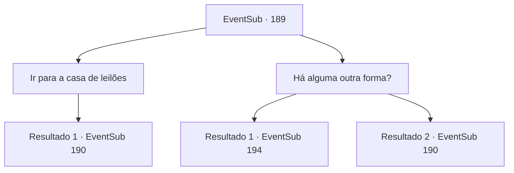

# Eventos secundários · 189

[Índice da tabela](index.md) · [Índice geral](../index.md)

ID: `pt:EventSub:189` · Fonte: `EventSub4` · Versão: 1.2.47.

Mapeamento estático dos arquivos; a disponibilidade e a execução dependem do estado da run.

## Texto do evento

*Sem texto no arquivo.*

## Dados de entrada

```json
{
  "id": 189,
  "grade": 1,
  "subEvent": "",
  "required": ""
}
```

## Mapa das escolhas



## Escolhas e resultados

### Escolha 1

Ir para a casa de leilões

Requisitos e outros campos da escolha:

```json
{
  "required": ""
}
```

#### Resultado 1.1

Após sair do pub, você se apressa para o leilão. O timing é perfeito; o leilão está prestes a começar, e as pessoas no leilão estão conversando, animadas com os itens.

Continuação registrada: [Evento 190](0190.md) na mesma tabela.

```json
{
  "required": "",
  "chance": "1",
  "nextEvent": 190,
  "type": 2,
  "reward": ""
}
```

### Escolha 2

Há alguma outra forma?

Requisitos e outros campos da escolha:

```json
{
  "required": ""
}
```

#### Resultado 2.1

Você pergunta a ele se há alguma outra maneira além de obter a Harpa Fantástica. O lendário marinheiro pensa por um momento, coça a barba e responde. 

 "Como eu disse, os seres do mar são atraídos por sons bonitos. Dizem que as pessoas dos tempos antigos capturaram os seres do mar com uma bela canção... Mishel pode conhecer essa música."

 Você pergunta onde Mishel pode ser encontrada. O lendário marinheiro levanta o polegar, apontando para a senhora atrás dele no palco, se preparando para o seu concerto.

Continuação registrada: [Evento 194](0194.md) na mesma tabela.

```json
{
  "required": "18_205_1",
  "chance": "1",
  "nextEvent": 194,
  "type": 2,
  "reward": ""
}
```

#### Resultado 2.2

Você pergunta a ele se há alguma outra maneira além de obter a Harpa Fantástica. Mas o lendário marinheiro já está desmaiado. Você não tem escolha a não ser ir para o leilão.

Continuação registrada: [Evento 190](0190.md) na mesma tabela.

```json
{
  "required": "5_205_1",
  "chance": "1",
  "nextEvent": 190,
  "type": 2,
  "reward": ""
}
```

## Referências que chegam a este evento

- [Evento 187 · escolha 1 · resultado 1](0187.md#escolha-1)
- [Evento 187 · escolha 2 · resultado 1](0187.md#escolha-2)
- [Evento 187 · escolha 3 · resultado 1](0187.md#escolha-3)
- [Evento 188 · escolha 1 · resultado 1](0188.md#escolha-1)
