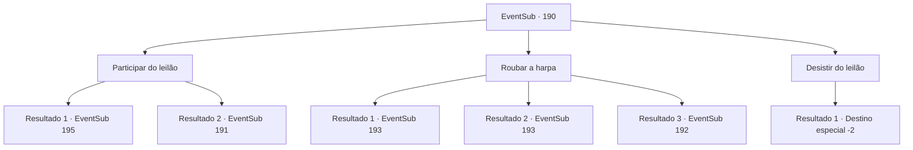

# Eventos secundários · 190

[Índice da tabela](index.md) · [Índice geral](../index.md)

ID: `pt:EventSub:190` · Fonte: `EventSub4` · Versão: 1.2.47.

Mapeamento estático dos arquivos; a disponibilidade e a execução dependem do estado da run.

## Texto do evento

*Sem texto no arquivo.*

## Dados de entrada

```json
{
  "id": 190,
  "grade": 1,
  "subEvent": "",
  "required": ""
}
```

## Mapa das escolhas



## Escolhas e resultados

### Escolha 1

Participar do leilão

Requisitos e outros campos da escolha:

```json
{
  "required": "1_4_150"
}
```

#### Resultado 1.1

Você participa do leilão, esperando que a Harpa Fantastique apareça. Itens como um ovo enorme, um escudo com o rosto de alguém gravado nele e uma arma de aparência estranha, todos aparecem no leilão. Depois de tudo isso, a harpa finalmente aparece. Você compete com outros clientes, fazendo lances agressivos. O tempo passa e, finalmente, você vence o leilão pela Harpa Fantastique. Assim que sai do leilão, você volta para Parrie, capitão da Viúva do Amor, e mostra a ele a harpa, explicando tudo o que aconteceu. 

 "Oh... então podemos chamar os seres do mar com essa harpa? Entendi. Obrigado. Vamos tentar então!"

 Ele ordena a um de seus oficiais que traga seus marinheiros, dizendo que eles devem começar a se preparar para zarpar. Em seguida, ele dá um gole no rum em sua mão. 

 "Ah, sim. Vamos precisar de alguns dias para nos prepararmos, então volte depois de algum tempo."


Continuação registrada: [Evento 195](0195.md) na mesma tabela.

```json
{
  "required": "",
  "chance": "1|0_14_1",
  "nextEvent": 195,
  "type": 0,
  "reward": "0_2_1|0_4_-150|3_211_1|12_6_3"
}
```

#### Resultado 1.2

Você participa do leilão, esperando que a Fantastique Harp apareça. Itens como um ovo enorme, um escudo com o rosto de alguém inscrito nele e uma arma de aparência estranha, todos aparecem no leilão. Depois de tudo isso, a harpa finalmente aparece. Você compete com outros clientes, fazendo lances agressivos, e declara 150 ouro para resolver tudo. 

 "300 ouro."

 Mas outro senhor idoso faz um lance duas vezes maior que o seu.

Continuação registrada: [Evento 191](0191.md) na mesma tabela.

```json
{
  "required": "",
  "chance": "12",
  "nextEvent": 191,
  "type": 1,
  "reward": ""
}
```

### Escolha 2

Roubar a harpa

Requisitos e outros campos da escolha:

```json
{
  "required": ""
}
```

#### Resultado 2.1

Você decide roubar a Harpa Fantástica. Assim que o leilão começa, você aproveita esse momento para se infiltrar nos fundos do prédio usado para armazenar todos os itens do leilão. Você encontra os mercenários guardando um enorme cofre. Aparentemente, eles não estavam esperando nenhum intruso, pois estão conversando despreocupadamente. Movendo-se furtivamente após uma observação cuidadosa, você consegue chegar com sucesso ao cofre, sem alertar nenhum dos guardas. O cofre é feito de metal resistente e reforçado com um mecanismo de fechadura, então não será fácil abri-lo.

Continuação registrada: [Evento 193](0193.md) na mesma tabela.

```json
{
  "required": "",
  "chance": "1|0_6_1",
  "nextEvent": 193,
  "type": 0,
  "reward": "0_3_-2"
}
```

#### Resultado 2.2

Você decide roubar a Harpa Fantástica. Assim que o leilão começa, você aproveita esse momento para se infiltrar nos fundos do prédio usado para armazenar todos os itens do leilão. Você encontra os mercenários guardando um enorme cofre. Aparentemente, eles não estavam esperando nenhum intruso, pois estão conversando despreocupadamente. Movendo-se furtivamente após uma observação cuidadosa, você consegue chegar com sucesso ao cofre, sem alertar nenhum dos guardas. O cofre é feito de metal resistente e reforçado com um mecanismo de fechadura, então não será fácil abri-lo.

Continuação registrada: [Evento 193](0193.md) na mesma tabela.

```json
{
  "required": "20_5_2",
  "chance": "1|0_6_1",
  "nextEvent": 193,
  "type": 0,
  "reward": "0_3_-2"
}
```

#### Resultado 2.3

Você decide roubar a Harpa Fantástica. Assim que o leilão começa, você aproveita esse momento para se infiltrar nos fundos do prédio usado para armazenar todos os itens do leilão. Você encontra os mercenários guardando um enorme cofre. Aparentemente, eles não estavam esperando nenhum intruso, pois estão conversando despreocupadamente. Você se aproxima furtivamente do cofre após uma observação cuidadosa. Mas os mercenários percebem você, sacam suas armas e gritam. 

 "Você aí! O que diabos está fazendo aqui!"


Continuação registrada: [Evento 192](0192.md) na mesma tabela.

```json
{
  "required": "",
  "chance": "1",
  "nextEvent": 192,
  "type": 1,
  "reward": "6_0_91|0_3_-2",
  "place": 10
}
```

### Escolha 3

Desistir do leilão

Requisitos e outros campos da escolha:

```json
{
  "required": ""
}
```

#### Resultado 3.1

Você sai do leilão, volta para a Viúva do Amor e conta a Parrie o que aconteceu. Após ouvir sua história, Parrie solta um suspiro e responde. 

 "Hoo... Bom esforço. Embora eu acredite que nossa busca pelos seres do mar tenha chegado a um beco sem saída."

 Após terminar sua frase, Parrie vira as costas para você e vai embora.

Continuação registrada: [Destino especial `-2`](../destinos-especiais.md).

```json
{
  "required": "",
  "chance": "1",
  "nextEvent": -2,
  "type": 2,
  "reward": "12_6_5"
}
```

## Referências que chegam a este evento

- [Evento 189 · escolha 1 · resultado 1](0189.md#escolha-1)
- [Evento 189 · escolha 2 · resultado 2](0189.md#escolha-2)
- [Evento 194 · escolha 1 · resultado 2](0194.md#escolha-1)
- [Evento 194 · escolha 3 · resultado 2](0194.md#escolha-3)
- [Evento 194 · escolha 4 · resultado 1](0194.md#escolha-4)
