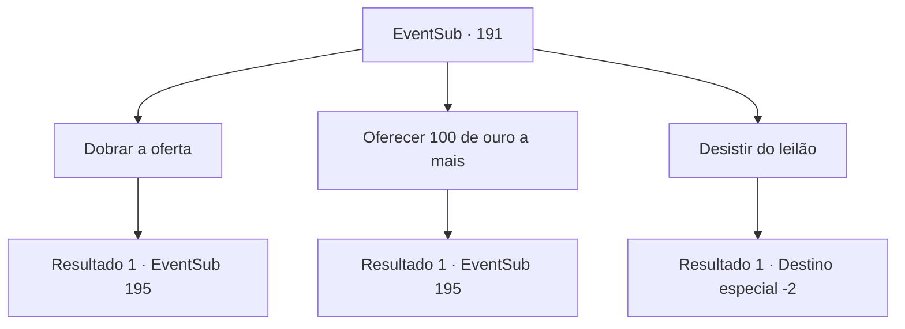

# Eventos secundários · 191

[Índice da tabela](index.md) · [Índice geral](../index.md)

ID: `pt:EventSub:191` · Fonte: `EventSub4` · Versão: 1.2.47.

Mapeamento estático dos arquivos; a disponibilidade e a execução dependem do estado da run.

## Texto do evento

*Sem texto no arquivo.*

## Dados de entrada

```json
{
  "id": 191,
  "grade": 1,
  "subEvent": "",
  "required": ""
}
```

## Mapa das escolhas



## Escolhas e resultados

### Escolha 1

Dobrar a oferta

Requisitos e outros campos da escolha:

```json
{
  "required": "1_4_600"
}
```

#### Resultado 1.1

Você tem ouro suficiente para pisar no velho cavalheiro, sem mencionar as bolas para apostar essa quantia. Você aceita o preço do cavalheiro e adiciona 100 ouros a isso, fazendo o lance de 400 ouros. A multidão fica em silêncio. 

 "Temos 400 ouros. 400 ouros... Nenhuma oferta a mais? Uma vez, duas vezes..."

 O leiloeiro verifica a opinião da multidão. Não há mais lances, e o velho cavalheiro abaixa sua placa e sai calmamente do local do leilão. Você recebe a harpa. Assim que sai do leilão, você volta para Parrie, capitão da Viúva do Amor, e mostra a ele a harpa, explicando tudo o que aconteceu. 

 "Ah... então podemos chamar os seres do mar com essa harpa? Entendi. Obrigado. Vamos tentar então!"

 Ele ordena a um de seus oficiais que traga seus marinheiros, dizendo que eles devem começar a se preparar para zarpar. Ele então dá um gole no rum em sua mão. 

 "Ah, sim. Precisaremos de alguns dias para nos prepararmos, então volte depois de algum tempo."


Continuação registrada: [Evento 195](0195.md) na mesma tabela.

```json
{
  "required": "",
  "chance": "1",
  "nextEvent": 195,
  "type": 2,
  "reward": "3_211_1|12_6_3|0_12_1|0_4_-600"
}
```

### Escolha 2

Oferecer 100 de ouro a mais

Requisitos e outros campos da escolha:

```json
{
  "required": "1_4_400"
}
```

#### Resultado 2.1

Você tem ouro suficiente para pisar no velho cavalheiro, sem mencionar as bolas para apostar essa quantia. Você aceita o preço do cavalheiro e adiciona 100 ouros a isso, fazendo o lance de 400 ouros. A multidão fica em silêncio. 

 "Temos 400 ouros. 400 ouros... Nenhuma oferta a mais? Uma vez, duas vezes..."

 O leiloeiro verifica a opinião da multidão. Não há mais lances, e o velho cavalheiro abaixa sua placa e sai calmamente do local do leilão. Você recebe a harpa. Assim que sai do leilão, você volta para Parrie, capitão da Viúva do Amor, e mostra a ele a harpa, explicando tudo o que aconteceu. 

 "Ah... então podemos chamar os seres do mar com essa harpa? Entendi. Obrigado. Vamos tentar então!"

 Ele ordena a um de seus oficiais que traga seus marinheiros, dizendo que eles devem começar a se preparar para zarpar. Ele então dá um gole no rum em sua mão. 

 "Ah, sim. Precisaremos de alguns dias para nos prepararmos, então volte depois de algum tempo."


Continuação registrada: [Evento 195](0195.md) na mesma tabela.

```json
{
  "required": "",
  "chance": "1",
  "nextEvent": 195,
  "type": 2,
  "reward": "3_211_1|12_6_3|0_4_-400"
}
```

### Escolha 3

Desistir do leilão

Requisitos e outros campos da escolha:

```json
{
  "required": ""
}
```

#### Resultado 3.1

Você desiste. 

 "300 ouro... Uma vez, duas vezes...!"

 Enquanto o leiloeiro bate o martelo três vezes, o leilão chega ao fim, e o senhor idoso sai do leilão com a harpa. Você sai do local, retorna para a Viúva do Amor e conta o que aconteceu. Parrie, depois de ouvir sua história, solta um suspiro e fala. 

 "*suspiro*.... Boa tentativa. Infelizmente, parece que nossa busca pelos seres do mar chegou a um beco sem saída."

 Dizendo isso, Parrie vira as costas para você e vai embora.

Continuação registrada: [Destino especial `-2`](../destinos-especiais.md).

```json
{
  "required": "",
  "chance": "1",
  "nextEvent": -2,
  "type": 2,
  "reward": "12_6_5"
}
```

## Referências que chegam a este evento

- [Evento 190 · escolha 1 · resultado 2](0190.md#escolha-1)
