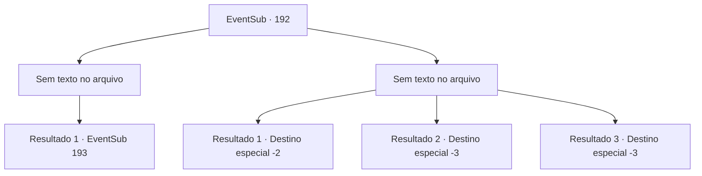

# Eventos secundários · 192

[Índice da tabela](index.md) · [Índice geral](../index.md)

ID: `pt:EventSub:192` · Fonte: `EventSub4` · Versão: 1.2.47.

Mapeamento estático dos arquivos; a disponibilidade e a execução dependem do estado da run.

## Texto do evento

*Sem texto no arquivo.*

## Dados de entrada

```json
{
  "id": 192,
  "grade": 1,
  "subEvent": "",
  "required": ""
}
```

## Mapa das escolhas



## Escolhas e resultados

### Escolha 1

*Sem texto no arquivo; o papel dessa opção depende da interface do jogo.*

Requisitos e outros campos da escolha:

```json
{
  "required": ""
}
```

#### Resultado 1.1

Você rapidamente neutraliza os mercenários e dá uma olhada no depósito que contém os itens para o leilão. O cofre é feito de metal resistente e reforçado com um mecanismo de fechadura, então não vai abrir facilmente.

Continuação registrada: [Evento 193](0193.md) na mesma tabela.

```json
{
  "required": "",
  "chance": "1",
  "nextEvent": 193,
  "type": 2,
  "reward": ""
}
```

### Escolha 2

*Sem texto no arquivo; o papel dessa opção depende da interface do jogo.*

Requisitos e outros campos da escolha:

```json
{
  "required": ""
}
```

#### Resultado 2.1

Os mercenários reagem calmamente e rapidamente, mesmo quando enfrentam sua emboscada. Eles alertam os outros enquanto batem em sua arma, e você não pode fazer nada além de fugir quando vê outros mercenários se reunindo. Depois de conseguir fugir com sucesso, você volta para a Viúva do Amor e conta tudo o que aconteceu para Parrie. Parrie, depois de ouvir sua história, solta um suspiro e fala. 

 "*suspiro*.... Boa tentativa. Infelizmente, parece que nossa busca pelos seres do mar chegou a um beco sem saída."

 Dizendo isso, Parrie vira as costas para você e vai embora.

Continuação registrada: [Destino especial `-2`](../destinos-especiais.md).

```json
{
  "required": "1_0_2|1_1_2",
  "chance": "1",
  "nextEvent": -2,
  "type": 2,
  "reward": "12_6_5|0_0_-1|0_1_-1"
}
```

#### Resultado 2.2

Os mercenários reagem calmamente e rapidamente, mesmo quando enfrentando sua emboscada. Eles alertam os outros enquanto batem em sua arma, e por fim você desaba sob o ataque colaborativo de outros mercenários. Eles te batem como um cachorro, e infelizmente, você é forçado a deixar escapar seu último fio de consciência.

Continuação registrada: [Destino especial `-3`](../destinos-especiais.md).

```json
{
  "required": "2_0_2",
  "chance": "1",
  "nextEvent": -3,
  "type": 2,
  "reward": "0_0_-1|0_1_-1"
}
```

#### Resultado 2.3

Os mercenários reagem calmamente e rapidamente, mesmo quando enfrentando sua emboscada. Eles alertam os outros enquanto batem em sua arma, e por fim você desaba sob o ataque colaborativo de outros mercenários. Eles te batem como um cachorro, e infelizmente, você é forçado a deixar escapar seu último fio de consciência.

Continuação registrada: [Destino especial `-3`](../destinos-especiais.md).

```json
{
  "required": "2_1_2",
  "chance": "1",
  "nextEvent": -3,
  "type": 2,
  "reward": "0_0_-1|0_1_-1"
}
```

## Referências que chegam a este evento

- [Evento 190 · escolha 2 · resultado 3](0190.md#escolha-2)
