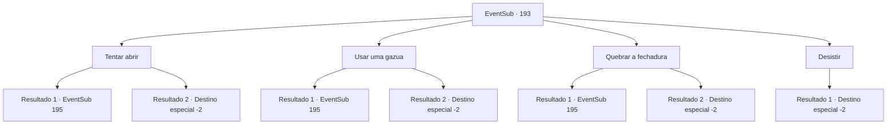

# Eventos secundários · 193

[Índice da tabela](index.md) · [Índice geral](../index.md)

ID: `pt:EventSub:193` · Fonte: `EventSub4` · Versão: 1.2.47.

Mapeamento estático dos arquivos; a disponibilidade e a execução dependem do estado da run.

## Texto do evento

*Sem texto no arquivo.*

## Dados de entrada

```json
{
  "id": 193,
  "grade": 1,
  "subEvent": "",
  "required": ""
}
```

## Mapa das escolhas



## Escolhas e resultados

### Escolha 1

Tentar abrir

Requisitos e outros campos da escolha:

```json
{
  "required": ""
}
```

#### Resultado 1.1

Você decide desbloquear o cofre. Você traz os ouvidos perto do cofre, girando o mostrador lentamente e procurando ruídos ligeiramente diferentes.
 Marque, tick, tique -tique, crack. Com o seu foco, você pode desbloquear o cofre e faz sua rápida fuga com a harpa. Assim que você sai do local do leilão, você retorna a Parrie, capitão da viúva do amor, e mostra a ele a harpa, explicando tudo o que aconteceu. 

 "Oh ... para que possamos trazer à tona o Merfolk com esta harpa? Eu vejo. Obrigada. Vamos tentar então!"

 Ele ordena que um de seus oficiais traga seus marinheiros, dizendo que eles deveriam começar a se preparar para começar a velejar. Ele então tira um rum na mão. 

 "Ah sim. Precisamos de alguns dias para nos preparar, então volte depois de algum tempo."


Continuação registrada: [Evento 195](0195.md) na mesma tabela.

```json
{
  "required": "",
  "chance": "1|0_6_1",
  "nextEvent": 195,
  "type": 0,
  "reward": "3_211_1|12_6_3"
}
```

#### Resultado 1.2

Você decide abrir o cofre. Você aproxima seus ouvidos do cofre, girando o mostrador lentamente e procurando por ruídos ligeiramente diferentes. Mas não importa o quanto você tente, a porta do cofre não se abre e logo você é cercado por um grupo de passos. Você é forçado a fugir, desistindo da harpa. Depois de conseguir fugir com sucesso, você volta para a Viúva do Amor e conta tudo o que aconteceu para Parrie. Parrie, depois de ouvir sua história, solta um suspiro e fala. 

 "*suspiro*.... Boa tentativa. Infelizmente, parece que nossa busca pelos seres do mar chegou a um beco sem saída."

 Dizendo isso, Parrie vira as costas para você e vai embora.

Continuação registrada: [Destino especial `-2`](../destinos-especiais.md).

```json
{
  "required": "",
  "chance": "16",
  "nextEvent": -2,
  "type": 1,
  "reward": "12_6_5"
}
```

### Escolha 2

Usar uma gazua

Requisitos e outros campos da escolha:

```json
{
  "required": "8_41_1"
}
```

#### Resultado 2.1

Tentas desbloquear o cofre com uma ganzua. Em breve, a porta do cofre abre com um *clique*, e rapidamente fazes a tua fuga com a harpa. Assim que sais do local do leilão, regressas a Parrie, capitão da Viúva do Amor, e mostras-lhe a harpa, explicando tudo o que aconteceu. 

 "Oh... então podemos atrair os seres do mar com esta harpa? Entendi. Obrigado. Vamos experimentar então!"

 Ele ordena a um dos seus oficiais que traga os marinheiros, dizendo que devem começar a preparar-se para zarpar. Em seguida, ele dá um gole no rum que tem na mão. 

 "Ah, sim. Vamos precisar de alguns dias para nos prepararmos, então volte depois de algum tempo."


Continuação registrada: [Evento 195](0195.md) na mesma tabela.

```json
{
  "required": "",
  "chance": "1|0_6_1",
  "nextEvent": 195,
  "type": 0,
  "reward": "3_211_1|12_6_3"
}
```

#### Resultado 2.2

Tentas desbloquear o cofre com uma ganzua. Mas o cofre não abre. Apenas a ganzua quebra, e em breve estás rodeado por um grupo de passos. És forçado a fugir, desistindo da harpa. Depois de conseguires fugir com sucesso, regressas à Viúva do Amor e contas tudo o que aconteceu a Parrie. Parrie, depois de ouvir a tua história, solta um suspiro e fala. 

 "*suspiro*.... Boa tentativa. Infelizmente, parece que a nossa busca pelos seres do mar chegou a um beco sem saída."

 Dizendo isso, Parrie vira as costas para ti e vai embora.

Continuação registrada: [Destino especial `-2`](../destinos-especiais.md).

```json
{
  "required": "",
  "chance": "8",
  "nextEvent": -2,
  "type": 1,
  "reward": "12_6_5|4_41_1"
}
```

### Escolha 3

Quebrar a fechadura

Requisitos e outros campos da escolha:

```json
{
  "required": ""
}
```

#### Resultado 3.1

Você decide arrombar o cofre. Depois de golpear o mecanismo de travamento com toda a sua força várias vezes, você percebe a porta finalmente se abrindo. Você rapidamente pega a Harpa Fantástica e retorna para a Viúva do Amor, onde Parrie está esperando. Quando Parrie te vê, ele se levanta de sua cadeira na frente do navio. Você mostra a harpa para Parrie e explica o que aconteceu. 

 "Oh... então podemos chamar os seres do mar com essa harpa? Entendi. Obrigado. Vamos tentar então!"

 Ele ordena a um de seus oficiais que traga seus marinheiros, dizendo que eles devem começar a se preparar para zarpar. Ele então dá um gole no rum em sua mão. 

 "Ah, sim. Vamos precisar de alguns dias para nos prepararmos, então volte depois de algum tempo."


Continuação registrada: [Evento 195](0195.md) na mesma tabela.

```json
{
  "required": "",
  "chance": "1|0_5_1",
  "nextEvent": 195,
  "type": 0,
  "reward": "3_211_1|12_6_3"
}
```

#### Resultado 3.2

Você decide arrombar o cofre. Cofres são resistentes, mas o mecanismo de travamento, onde é necessária uma funcionalidade precisa, deve ser mais fraco do que outras partes do cofre. Mas, apesar de seus melhores golpes, o mecanismo não se move, e logo você está cercado por um grupo de passos. Você é forçado a fugir, desistindo da harpa. Depois de conseguir fugir com sucesso, você volta para a Viúva do Amor e conta tudo o que aconteceu para Parrie. Parrie, depois de ouvir sua história, solta um suspiro e fala. 

 "*suspiro*.... Boa tentativa. Infelizmente, parece que nossa busca pelos seres do mar chegou a um beco sem saída."

 Dizendo isso, Parrie vira as costas para você e vai embora.

Continuação registrada: [Destino especial `-2`](../destinos-especiais.md).

```json
{
  "required": "",
  "chance": "20",
  "nextEvent": -2,
  "type": 1,
  "reward": "12_6_5"
}
```

### Escolha 4

Desistir

Requisitos e outros campos da escolha:

```json
{
  "required": ""
}
```

#### Resultado 4.1

Você desiste de abrir o cofre e volta para a Viúva do Amor. Parrie, depois de ouvir sua história, solta um suspiro e fala. 

 "*suspiro*.... Boa tentativa. Infelizmente, parece que nossa busca pelos seres do mar chegou a um beco sem saída."

 Dizendo isso, Parrie vira as costas para você e vai embora.

Continuação registrada: [Destino especial `-2`](../destinos-especiais.md).

```json
{
  "required": "",
  "chance": "1",
  "nextEvent": -2,
  "type": 2,
  "reward": "12_6_5"
}
```

## Referências que chegam a este evento

- [Evento 190 · escolha 2 · resultado 1](0190.md#escolha-2)
- [Evento 190 · escolha 2 · resultado 2](0190.md#escolha-2)
- [Evento 192 · escolha 1 · resultado 1](0192.md#escolha-1)
