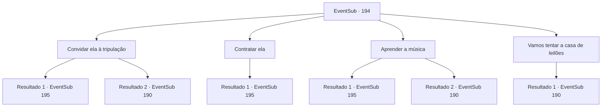

# Eventos secundários · 194

[Índice da tabela](index.md) · [Índice geral](../index.md)

ID: `pt:EventSub:194` · Fonte: `EventSub4` · Versão: 1.2.47.

Mapeamento estático dos arquivos; a disponibilidade e a execução dependem do estado da run.

## Texto do evento

*Sem texto no arquivo.*

## Dados de entrada

```json
{
  "id": 194,
  "grade": 1,
  "subEvent": "",
  "required": ""
}
```

## Mapa das escolhas



## Escolhas e resultados

### Escolha 1

Convidar ela à tripulação

Requisitos e outros campos da escolha:

```json
{
  "required": "5_206_0"
}
```

#### Resultado 1.1

Você pede a Mishel para se juntar à tripulação como marinheira. Ela parece surpresa com a proposta repentina, mas logo mostra um sorriso enorme, exibindo seus dentes brancos e claros. 

 "Tudo bem. Mas ainda tenho um concerto hoje. Estarei lá depois de terminá-lo."

 Você decide assistir ao show dela pessoalmente no pub. Como o lendário marinheiro disse, sua voz é tão bonita que encanta os seres do mar. Após o concerto, você segue para a Viúva do Amor com Mishel. Parrie parece surpreso ao ver um convidado inesperado, mas quando você explica que ela será capaz de chamar os seres do mar, ele a recebe com felicidade. 

 "Entendo. Claro, uma bela melodia requer uma bela cantora."

 Ele ordena a um de seus oficiais que traga os marinheiros, dizendo que eles devem começar a se preparar para zarpar. Em seguida, ele dá um gole no rum em sua mão. 

 "Ah, sim. Vamos precisar de alguns dias para nos prepararmos, então volte depois de algum tempo."


Continuação registrada: [Evento 195](0195.md) na mesma tabela.

```json
{
  "required": "",
  "chance": "1|0_12_1",
  "nextEvent": 195,
  "type": 0,
  "reward": "0_2_1|12_6_3|5_206_1"
}
```

#### Resultado 1.2

Você pede a Mishel para se juntar à tripulação como marinheira. Ela parece surpresa com a proposta repentina, mas logo balança a cabeça e educadamente recusa. 

 "Eu prefiro cantar aqui, do que buscar aventuras perigosas."

 Você a pergunta várias vezes, mas a resposta dela não muda. Ela está ocupada se preparando para o concerto. Você desiste de convencer Mishel e segue para a casa de leilões. O momento é ótimo. O leilão está prestes a começar e as pessoas no leilão estão conversando, animadas com os itens.

Continuação registrada: [Evento 190](0190.md) na mesma tabela.

```json
{
  "required": "",
  "chance": "14",
  "nextEvent": 190,
  "type": 1,
  "reward": "5_206_2"
}
```

### Escolha 2

Contratar ela

Requisitos e outros campos da escolha:

```json
{
  "required": "1_4_80"
}
```

#### Resultado 2.1

Você pede a Mishel para se juntar à tripulação como marinheira. Ela parece surpresa com a proposta repentina, mas logo responde com algumas condições. 

 "Um... 80 ouros. Então eu consideraria acompanhar seu grupo. E você terá que esperar o fim do meu concerto."

 Você dá a ela o ouro e decide esperar até o fim do concerto. Como o lendário marinheiro disse, sua voz é tão bonita que encanta os seres do mar. Após o concerto, você segue para a Viúva do Amor com Mishel. Parrie parece surpreso ao ver um convidado inesperado, mas quando você explica que ela será capaz de chamar os seres do mar, ele a recebe felizmente. 

 "Entendo. Claro, uma bela melodia requer uma bela cantora."

 Ele ordena a um de seus oficiais que traga seus marinheiros, dizendo que eles devem começar a se preparar para zarpar. Em seguida, ele dá um gole no rum em sua mão. 

 "Ah, sim. Precisaremos de alguns dias para nos prepararmos, então volte depois de algum tempo."


Continuação registrada: [Evento 195](0195.md) na mesma tabela.

```json
{
  "required": "",
  "chance": "1",
  "nextEvent": 195,
  "type": 2,
  "reward": "0_4_-80|12_6_3|5_206_1"
}
```

### Escolha 3

Aprender a música

Requisitos e outros campos da escolha:

```json
{
  "required": ""
}
```

#### Resultado 3.1

Você explica sua história para Mishel e pede a ela para te ensinar uma música bonita o suficiente para cativar os seres do mar. Ela parece perdida em pensamentos por um minuto e diz que vai te ensinar depois do concerto, caminhando até o palco. Logo, o concerto começa e a plateia do pub fica completamente hipnotizada pela sua performance. Depois de presentear a plateia com música requintada, ela sai do palco com aplausos ensurdecedores. Ela te chama para os bastidores do palco. Então, ela começa a te ensinar a música que acabou de cantar no palco. Você absorve seus ensinamentos como uma esponja e ela até te entrega a partitura da música, elogiando seu talento para cantar. 

 "Isso não vai cativar apenas os seres do mar, você. Tome cuidado para não cativar também os humanos."

 Você agradece a ela e segue para a Viúva do Amor. Você conta tudo o que aconteceu para Parrie e ele responde, coçando a barba. 

 "Hm.... então você pode chamar os seres do mar do fundo do mar? Certo... vamos ver."

 Ele ordena a um de seus oficiais que traga seus marinheiros, dizendo que eles devem começar a se preparar para zarpar. Então, ele dá um gole no rum em sua mão. 

 "Ah, sim. Vamos precisar de alguns dias para nos prepararmos, então volte depois de algum tempo."


Continuação registrada: [Evento 195](0195.md) na mesma tabela.

```json
{
  "required": "",
  "chance": "1|0_7_1",
  "nextEvent": 195,
  "type": 0,
  "reward": "0_2_1|12_6_3|3_212_1"
}
```

#### Resultado 3.2

Você explica sua história para Mishel e pede a ela para te ensinar uma música bonita o suficiente para cativar os seres do mar. Ela parece perdida em pensamentos por um minuto e diz que vai te ensinar depois do concerto, caminhando até o palco. Logo, o concerto começa e a plateia do pub fica completamente hipnotizada pela sua performance. Depois de presentear a plateia com música requintada, ela sai do palco com aplausos ensurdecedores. Ela te chama para os bastidores do palco. Mas a aula de canto simplesmente não pode ser realizada adequadamente. Seu talento para cantar é miserável e ela simplesmente não pode ensinar um aluno tão terrível. 

 "Você deveria desistir de cantar. Você não tem nem um mínimo de talento?"

 Infelizmente, você desiste de aprender a música e segue para a casa de leilões. O momento é perfeito. O leilão está prestes a começar e as pessoas no leilão estão conversando, animadas com os itens.

Continuação registrada: [Evento 190](0190.md) na mesma tabela.

```json
{
  "required": "",
  "chance": "15",
  "nextEvent": 190,
  "type": 1,
  "reward": ""
}
```

### Escolha 4

Vamos tentar a casa de leilões

Requisitos e outros campos da escolha:

```json
{
  "required": ""
}
```

#### Resultado 4.1

Você desiste de convencer a cantora e segue para a casa de leilões. Saindo do pub, você se apressa em direção à casa de leilões. A hora é ótima. O leilão está prestes a começar e as pessoas no leilão estão conversando, animadas com os itens.

Continuação registrada: [Evento 190](0190.md) na mesma tabela.

```json
{
  "required": "",
  "chance": "1",
  "nextEvent": 190,
  "type": 2,
  "reward": ""
}
```

## Referências que chegam a este evento

- [Evento 189 · escolha 2 · resultado 1](0189.md#escolha-2)
