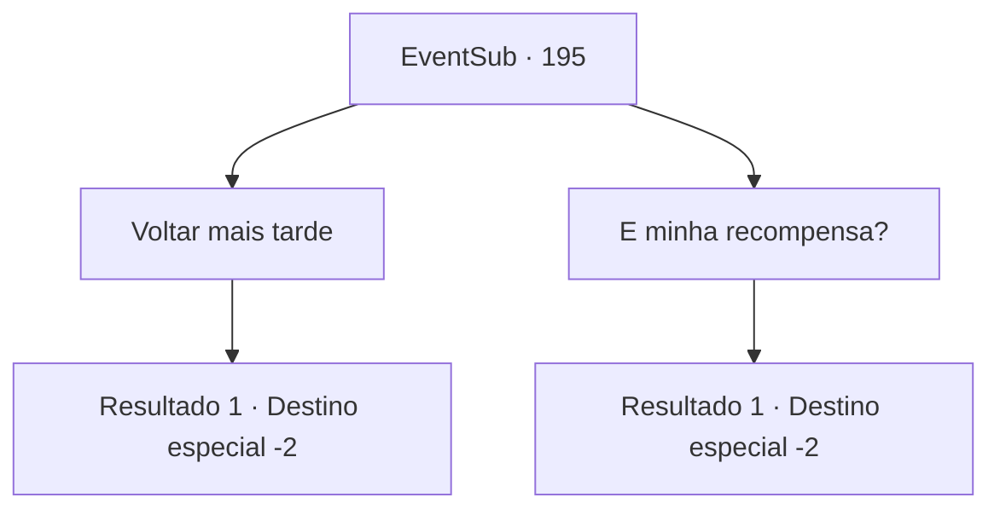

# Eventos secundários · 195

[Índice da tabela](index.md) · [Índice geral](../index.md)

ID: `pt:EventSub:195` · Fonte: `EventSub4` · Versão: 1.2.47.

Mapeamento estático dos arquivos; a disponibilidade e a execução dependem do estado da run.

## Texto do evento

*Sem texto no arquivo.*

## Dados de entrada

```json
{
  "id": 195,
  "grade": 1,
  "subEvent": "",
  "required": ""
}
```

## Mapa das escolhas



## Escolhas e resultados

### Escolha 1

Voltar mais tarde

Requisitos e outros campos da escolha:

```json
{
  "required": ""
}
```

#### Resultado 1.1

Você decide voltar mais tarde e deixar Levantium.

Continuação registrada: [Destino especial `-2`](../destinos-especiais.md).

```json
{
  "required": "",
  "chance": "1",
  "nextEvent": -2,
  "type": 2,
  "reward": "12_6_3"
}
```

### Escolha 2

E minha recompensa?

Requisitos e outros campos da escolha:

```json
{
  "required": ""
}
```

#### Resultado 2.1

Você pergunta ao capitão sobre sua recompensa. 

 "Desculpe, estamos um pouco escassos de suprimentos no momento. Mas vou garantir que eu te recompense, depois de pegarmos os seres do mar!"

 Então Parrie ordena apressadamente sua tripulação para se preparar para zarpar. Você decide voltar mais tarde e deixar o porto.

Continuação registrada: [Destino especial `-2`](../destinos-especiais.md).

```json
{
  "required": "",
  "chance": "1",
  "nextEvent": -2,
  "type": 2,
  "reward": "12_6_3"
}
```

## Referências que chegam a este evento

- [Evento 190 · escolha 1 · resultado 1](0190.md#escolha-1)
- [Evento 191 · escolha 1 · resultado 1](0191.md#escolha-1)
- [Evento 191 · escolha 2 · resultado 1](0191.md#escolha-2)
- [Evento 193 · escolha 1 · resultado 1](0193.md#escolha-1)
- [Evento 193 · escolha 2 · resultado 1](0193.md#escolha-2)
- [Evento 193 · escolha 3 · resultado 1](0193.md#escolha-3)
- [Evento 194 · escolha 1 · resultado 1](0194.md#escolha-1)
- [Evento 194 · escolha 2 · resultado 1](0194.md#escolha-2)
- [Evento 194 · escolha 3 · resultado 1](0194.md#escolha-3)
