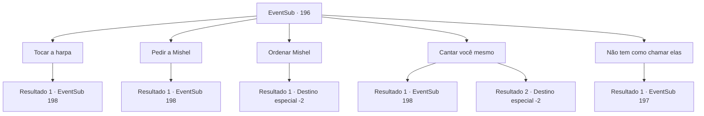

# Eventos secundários · 196

[Índice da tabela](index.md) · [Índice geral](../index.md)

ID: `pt:EventSub:196` · Fonte: `EventSub4` · Versão: 1.2.47.

Mapeamento estático dos arquivos; a disponibilidade e a execução dependem do estado da run.

## Texto do evento

Alguns dias se passam e você volta para a Viúva do Amor. Tendo concluído com sucesso os preparativos para a viagem, Parrie lhe dá as boas-vindas calorosamente. Com você a bordo, a Viúva do Amor ruge de volta à vida e logo chega às Três Ilhas, onde dizem que os tritões aparecem. Mesmo que você tenha voltado aqui depois de muito tempo, ainda está em silêncio.

## Dados de entrada

```json
{
  "id": 196,
  "grade": 1,
  "subEvent": "",
  "required": "12_6_3"
}
```

## Mapa das escolhas



## Escolhas e resultados

### Escolha 1

Tocar a harpa

Requisitos e outros campos da escolha:

```json
{
  "required": "8_211_1"
}
```

#### Resultado 1.1

Você toca as cordas da harpa. Então, a harpa começa a tocar belas melodias por si só. Um por um, os rostos da tripulação ficam tristes com a emocionante apresentação e logo as sereias do fundo do mar vêm até as ilhas rochosas, ouvindo a harpa. E finalmente, uma sereia com olhos azuis semelhantes a gemas emerge à superfície, e pelo comportamento das outras sereias, ela parece ser a líder do grupo. Um momento depois, quando a harpa para de tocar, ela abre a boca. 

 "Sua impecável performance nos guiou até aqui. Por quais motivos você nos convocou?"

 Sua voz é ouvida alta e clara, tanto por você quanto pelos outros marinheiros. Talvez eles tenham pensado que as sereias eram apenas mais uma espécie de animais. Então, quando percebem que as sereias falam a língua dos humanos, todos ficam assustados. O rosto de Parrie também escurece.

Continuação registrada: [Evento 198](0198.md) na mesma tabela.

```json
{
  "required": "",
  "chance": "1",
  "nextEvent": 198,
  "type": 2,
  "reward": "0_2_1"
}
```

### Escolha 2

Pedir a Mishel

Requisitos e outros campos da escolha:

```json
{
  "required": "5_206_1"
}
```

#### Resultado 2.1

Mishel limpa a garganta e começa a cantar. Sua bela voz arranca lágrimas dos olhos da tripulação e em breve as sereias do fundo do mar vêm até as ilhas rochosas, ouvindo sua canção. E finalmente, uma sereia com olhos azuis semelhantes a gemas emerge à superfície, e pelo comportamento das outras sereias, ela parece ser a líder do grupo. Um momento depois, quando a harpa para de tocar, ela abre a boca. 

 "Sua apresentação impecável nos guiou até aqui. Por quais motivos você nos convocou?"

 Sua voz é ouvida alta e clara, tanto por você quanto pelos outros marinheiros. Talvez eles tenham pensado que as sereias eram apenas mais uma espécie de animais. Então, quando percebem que as sereias falam a língua dos humanos, todos ficam assustados. O rosto de Parrie também escurece.

Continuação registrada: [Evento 198](0198.md) na mesma tabela.

```json
{
  "required": "",
  "chance": "1",
  "nextEvent": 198,
  "type": 2,
  "reward": "0_2_1"
}
```

### Escolha 3

Ordenar Mishel

Requisitos e outros campos da escolha:

```json
{
  "required": "5_206_3"
}
```

#### Resultado 3.1

Você ordena a Mishel para começar a cantar. Ela olha para você com preocupação e começa a cantar. Mas sua voz treme de medo e provavelmente não é suficiente para chamar a atenção dos seres do mar. Parrie olha para você com um olhar vazio e começa a rir como um idiota. Os outros marinheiros também parecem decepcionados. 

 "Haha, maldição tudo isso...! Chega. Os estúpidos seres do mar! Levantem a âncora. Estamos voltando para a terra."

 Após ouvir as ordens de Parrie, a tripulação retorna às suas posições, visivelmente decepcionada. E em breve, quando o navio chega a um porto, a tripulação se dispersa.

Continuação registrada: [Destino especial `-2`](../destinos-especiais.md).

```json
{
  "required": "",
  "chance": "1",
  "nextEvent": -2,
  "type": 2,
  "reward": "12_6_-1"
}
```

### Escolha 4

Cantar você mesmo

Requisitos e outros campos da escolha:

```json
{
  "required": "8_212_1"
}
```

#### Resultado 4.1

Você limpa a garganta e começa a cantar. Sua bela voz arranca lágrimas dos olhos da tripulação e logo as sereias do fundo do mar vêm até as ilhas rochosas, ouvindo o seu canto. E finalmente, uma sereia com olhos azuis semelhantes a gemas emerge à superfície, e pelo comportamento das outras sereias, ela parece ser a líder do grupo. Um momento depois, quando a harpa para de tocar, ela abre a boca. 

 "Sua apresentação impecável nos guiou até aqui. Por quais motivos você nos convocou?"

 Sua voz é ouvida alta e clara, tanto por você quanto pelos outros marinheiros. Talvez eles tenham pensado que as sereias eram apenas mais uma espécie de animais. Então, quando percebem que as sereias falam a língua dos humanos, todos ficam assustados. O rosto de Parrie também escurece.

Continuação registrada: [Evento 198](0198.md) na mesma tabela.

```json
{
  "required": "",
  "chance": "1|0_12_1",
  "nextEvent": 198,
  "type": 0,
  "reward": "0_2_1"
}
```

#### Resultado 4.2

Você pigarreia e começa a cantar a velha canção para cativar os seres do mar, mas de alguma forma soa estranho e instável. Os rostos da tripulação também ficam duvidosos e, é claro, os seres do mar não estão em lugar algum. Parrie olha para você com um olhar vazio e começa a rir como um idiota. Os outros marinheiros também parecem desapontados. 

 "Haha, maldição tudo isso...! Chega. Os estúpidos seres do mar! Levantem a âncora. Estamos voltando para a terra."

 Após ouvir as ordens de Parrie, a tripulação retorna às suas posições, visivelmente desapontada. E em breve, quando o navio chega a um porto, a tripulação se dispersa.

Continuação registrada: [Destino especial `-2`](../destinos-especiais.md).

```json
{
  "required": "",
  "chance": "14",
  "nextEvent": -2,
  "type": 1,
  "reward": "12_6_-1"
}
```

### Escolha 5

Não tem como chamar elas

Requisitos e outros campos da escolha:

```json
{
  "required": "10_211_1|18_206_1|10_212_1"
}
```

#### Resultado 5.1

Parrie pede para você trazer os tritões. Mas você percebe que não há como convocá-los e cuidadosamente conta a verdade para Parrie. Parrie olha para você com um olhar vazio e começa a rir como um idiota. 

 "Ahahahaha! Olhe para esse lunático...!"

 Furioso, ele avança em sua direção com sua arma em punho.

Continuação registrada: [Evento 197](0197.md) na mesma tabela.

```json
{
  "required": "",
  "chance": "1",
  "nextEvent": 197,
  "type": 2,
  "reward": "6_0_110",
  "place": 10
}
```

## Referências que chegam a este evento

Nenhum `nextEvent` positivo da mesma tabela aponta para este nó. Isso não prova que seja inacessível: sorteio e estado de história podem selecioná-lo.

