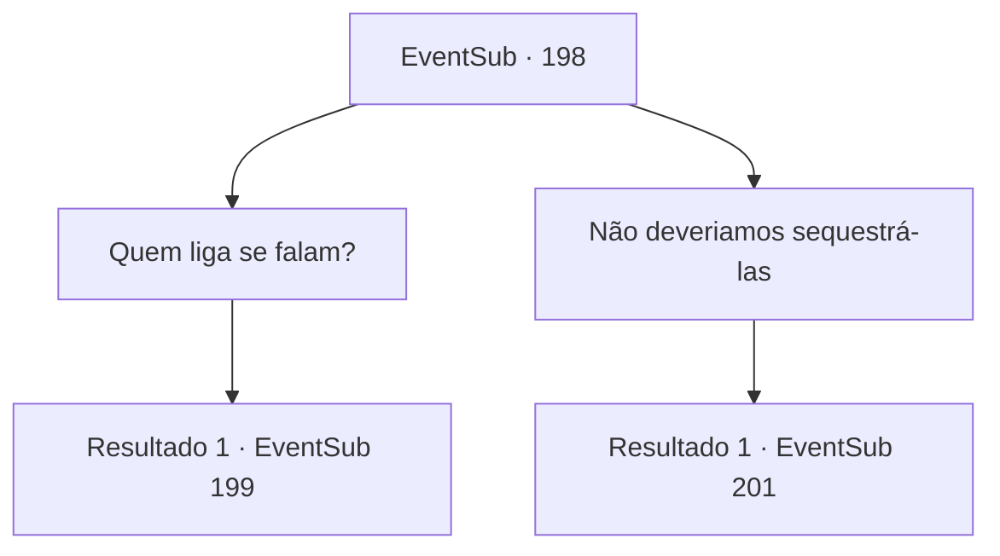

# Eventos secundários · 198

[Índice da tabela](index.md) · [Índice geral](../index.md)

ID: `pt:EventSub:198` · Fonte: `EventSub4` · Versão: 1.2.47.

Mapeamento estático dos arquivos; a disponibilidade e a execução dependem do estado da run.

## Texto do evento

*Sem texto no arquivo.*

## Dados de entrada

```json
{
  "id": 198,
  "grade": 1,
  "subEvent": "",
  "required": ""
}
```

## Mapa das escolhas



## Escolhas e resultados

### Escolha 1

Quem liga se falam?

Requisitos e outros campos da escolha:

```json
{
  "required": ""
}
```

#### Resultado 1.1

Você diz a todos que só porque os seres do mar sabem falar, não significa que o objetivo de capturá-los desapareça. Parrie concorda com a cabeça e fala. 

 "Aye. Estamos apenas um pouco surpresos. Todos! Capturem os seres do mar!!"

 A tripulação começa a atacar os seres do mar com ferramentas como redes e rastelos. Os seres do mar começam a nadar de volta com medo, mas quando aqueles que não escaparam começam a gritar de dor, todos começam a lutar de volta com tridentes.

Continuação registrada: [Evento 199](0199.md) na mesma tabela.

```json
{
  "required": "",
  "chance": "1",
  "nextEvent": 199,
  "type": 2,
  "reward": "6_0_111",
  "place": 3
}
```

### Escolha 2

Não deveriamos sequestrá-las

Requisitos e outros campos da escolha:

```json
{
  "required": ""
}
```

#### Resultado 2.1

Parrie parece perdido em pensamento por um segundo e depois grita com o Merfolk. 

 "Ei! Temos o nosso traseiro limpo muito tempo atingindo essa parte! Então você nos entrega seus tesouros, ou nós sequestramos cada um de vocês!"

 Mesmo antes das palavras intimidadoras de Parrie, a sereia de olhos azuis responde calmamente. 

 "Podemos lhe dar alguns tesouros, se é isso que você deseja, mas receio que tenhamos nossos termos também. Ajude -nos a derrubar o diabo do oceano, e nós lhe daremos nossos itens valiosos."

 Depois de ouvir a palavra 'O Diabo do Oceano', a tripulação começa a murmurar. Como resposta, Parrie se reúne seus homens.

Continuação registrada: [Evento 201](0201.md) na mesma tabela.

```json
{
  "required": "",
  "chance": "1",
  "nextEvent": 201,
  "type": 2,
  "reward": ""
}
```

## Referências que chegam a este evento

- [Evento 196 · escolha 1 · resultado 1](0196.md#escolha-1)
- [Evento 196 · escolha 2 · resultado 1](0196.md#escolha-2)
- [Evento 196 · escolha 4 · resultado 1](0196.md#escolha-4)
- [Evento 245 · escolha 1 · resultado 1](0245.md#escolha-1)
