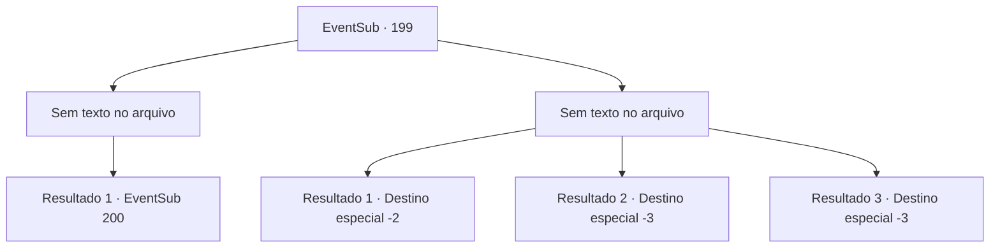

# Eventos secundários · 199

[Índice da tabela](index.md) · [Índice geral](../index.md)

ID: `pt:EventSub:199` · Fonte: `EventSub4` · Versão: 1.2.47.

Mapeamento estático dos arquivos; a disponibilidade e a execução dependem do estado da run.

## Texto do evento

*Sem texto no arquivo.*

## Dados de entrada

```json
{
  "id": 199,
  "grade": 1,
  "subEvent": "",
  "required": ""
}
```

## Mapa das escolhas



## Escolhas e resultados

### Escolha 1

*Sem texto no arquivo; o papel dessa opção depende da interface do jogo.*

Requisitos e outros campos da escolha:

```json
{
  "required": ""
}
```

#### Resultado 1.1

Você captura sereias vivas, trabalhando em conjunto com a tripulação. É um trabalho difícil capturá-las vivas, mas como as sereias são todas valiosas mercadorias, isso precisava ser feito. À medida que as coisas se acalmam, quando você se aproxima da sereia de olhos azuis, ela começa a falar algo que você não entende. Então, a água ao redor dela começa a ferver rapidamente, e um crustáceo de tamanho enorme aparece.

Continuação registrada: [Evento 200](0200.md) na mesma tabela.

```json
{
  "required": "",
  "chance": "1",
  "nextEvent": 200,
  "type": 2,
  "reward": "6_0_108",
  "place": 3
}
```

### Escolha 2

*Sem texto no arquivo; o papel dessa opção depende da interface do jogo.*

Requisitos e outros campos da escolha:

```json
{
  "required": ""
}
```

#### Resultado 2.1

A forte resistência dos tritões é encontrada com sua surpresa, enquanto você recua para o convés. O mesmo acontece com a tripulação, e Parrie grita desesperadamente. 

 "Retirada! Mova o maldito navio!"

 Como ordem do capitão, a Viúva do Amor rema rapidamente para longe. Parrie agarra seu braço direito, agora ferido da batalha, murmurando vagamente. 

 "Foda-se. Estou cansado pra caralho dos tritões agora..."

 Alguns dias depois, após chegar a um porto, a tripulação se dispersa e Parrie se afasta cambaleando.

Continuação registrada: [Destino especial `-2`](../destinos-especiais.md).

```json
{
  "required": "1_0_2|1_1_2",
  "chance": "1",
  "nextEvent": -2,
  "type": 2,
  "reward": "12_6_-1|0_0_-1|0_1_-1"
}
```

#### Resultado 2.2

A forte resistência dos tritões é encontrada com sua surpresa, enquanto você tenta se retirar para o convés. Mas um tridente voa em suas costas e você perde a consciência ao cair na água pela dor aguda.

Continuação registrada: [Destino especial `-3`](../destinos-especiais.md).

```json
{
  "required": "2_0_2",
  "chance": "1",
  "nextEvent": -3,
  "type": 2,
  "reward": "0_0_-1|0_1_-1"
}
```

#### Resultado 2.3

A forte resistência dos tritões é encontrada com sua surpresa, enquanto você tenta se retirar para o convés. Mas um tridente voa em suas costas e você perde a consciência ao cair na água pela dor aguda.

Continuação registrada: [Destino especial `-3`](../destinos-especiais.md).

```json
{
  "required": "2_1_2",
  "chance": "1",
  "nextEvent": -3,
  "type": 2,
  "reward": "0_0_-1|0_1_-1"
}
```

## Referências que chegam a este evento

- [Evento 198 · escolha 1 · resultado 1](0198.md#escolha-1)
- [Evento 201 · escolha 2 · resultado 1](0201.md#escolha-2)
