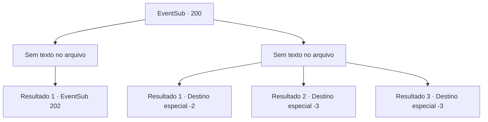

# Eventos secundários · 200

[Índice da tabela](index.md) · [Índice geral](../index.md)

ID: `pt:EventSub:200` · Fonte: `EventSub4` · Versão: 1.2.47.

Mapeamento estático dos arquivos; a disponibilidade e a execução dependem do estado da run.

## Texto do evento

*Sem texto no arquivo.*

## Dados de entrada

```json
{
  "id": 200,
  "grade": 1,
  "subEvent": "",
  "required": ""
}
```

## Mapa das escolhas



## Escolhas e resultados

### Escolha 1

*Sem texto no arquivo; o papel dessa opção depende da interface do jogo.*

Requisitos e outros campos da escolha:

```json
{
  "required": ""
}
```

#### Resultado 1.1

Após uma longa e exaustiva luta contra o caranguejo gigante, você desfere o golpe decisivo em sua carapaça semelhante a uma armadura. Com um som metálico, sua superfície começa a se romper e logo se espalha por todo o seu corpo, despedaçando-se. Os tritões parecem ter perdido toda a esperança e você os agarra pela cauda, um por um, e os coloca na rede. Os marinheiros puxam a rede cheia de tritões e o rosto de Parrie se ilumina ao vê-la. 

 "Bom trabalho, tripulação! Vamos ficar RICOS!!"

 Os outros marinheiros seguem o capitão, gritando de felicidade e levantando os braços para o alto. Ao contrário da tripulação, os tritões estão em um clima sombrio, presos dentro de um recipiente estreito. O recipiente está trancado com grades de aço e vocês se revezam com a tripulação para vigiar os tritões. Felizmente, os tritões estão todos deitados sem vida, como se tivessem desistido de resistir. A única que ainda parece funcional é a sereia de olhos azuis. Enquanto você observa os tritões, a sereia de olhos azuis de repente pede para ser libertada.

Continuação registrada: [Evento 202](0202.md) na mesma tabela.

```json
{
  "required": "",
  "chance": "1",
  "nextEvent": 202,
  "type": 2,
  "reward": ""
}
```

### Escolha 2

*Sem texto no arquivo; o papel dessa opção depende da interface do jogo.*

Requisitos e outros campos da escolha:

```json
{
  "required": ""
}
```

#### Resultado 2.1

Você é atingido pela pinça do caranguejo zangado, rolando para o convés. Ao ver sua tripulação ficando cada vez mais ferida, Parrie toma uma decisão rápida. 

 "Retirada! Mova o maldito navio! Apenas jogue os tritões de volta ao mar!"

 Obedecendo às suas ordens, a tripulação joga os tritões no mar e começa a conduzir o navio. Felizmente, os tritões não os perseguem depois de serem libertados. Parrie agarra seu braço direito, agora ferido da batalha, murmurando vagamente. 

 "Dane-se. Estou cansado pra caramba dos tritões agora..."

 Alguns dias depois, após chegar a um porto, a tripulação se dispersa e Parrie se afasta cambaleando.

Continuação registrada: [Destino especial `-2`](../destinos-especiais.md).

```json
{
  "required": "1_0_2|1_1_2",
  "chance": "1",
  "nextEvent": -2,
  "type": 2,
  "reward": "12_6_-1|0_0_-1|0_1_-1"
}
```

#### Resultado 2.2

Você pula para o ar, golpeando sua arma na carapaça do caranguejo, semelhante a uma armadura. Mas seu golpe nem sequer faz um arranhão nela, e você é jogado no convés, atingido pela pinça furiosa do caranguejo. Você tenta abrir os olhos, mas não consegue sentir nada.

Continuação registrada: [Destino especial `-3`](../destinos-especiais.md).

```json
{
  "required": "2_0_2",
  "chance": "1",
  "nextEvent": -3,
  "type": 2,
  "reward": "0_0_-1|0_1_-1"
}
```

#### Resultado 2.3

Você pula para o ar, golpeando sua arma na carapaça do caranguejo, semelhante a uma armadura. Mas seu golpe nem sequer faz um arranhão nela, e você é jogado no convés, atingido pela pinça furiosa do caranguejo. Você tenta abrir os olhos, mas não consegue sentir nada.

Continuação registrada: [Destino especial `-3`](../destinos-especiais.md).

```json
{
  "required": "2_1_2",
  "chance": "1",
  "nextEvent": -3,
  "type": 2,
  "reward": "0_0_-1|0_1_-1"
}
```

## Referências que chegam a este evento

- [Evento 199 · escolha 1 · resultado 1](0199.md#escolha-1)
