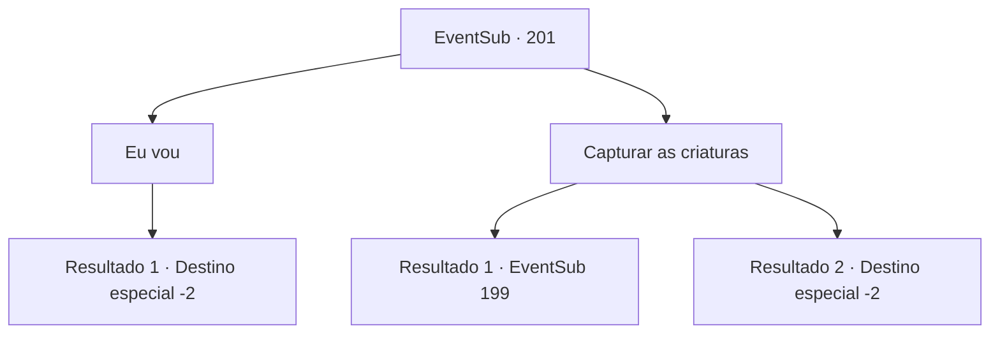

# Eventos secundários · 201

[Índice da tabela](index.md) · [Índice geral](../index.md)

ID: `pt:EventSub:201` · Fonte: `EventSub4` · Versão: 1.2.47.

Mapeamento estático dos arquivos; a disponibilidade e a execução dependem do estado da run.

## Texto do evento

*Sem texto no arquivo.*

## Dados de entrada

```json
{
  "id": 201,
  "grade": 1,
  "subEvent": "",
  "required": ""
}
```

## Mapa das escolhas



## Escolhas e resultados

### Escolha 1

Eu vou

Requisitos e outros campos da escolha:

```json
{
  "required": ""
}
```

#### Resultado 1.1

Você diz que tentará sugerir que Parrie sugeriu. Ele parece emocionado e fala com você, agarrando seu ombro. 

 "Eu sabia que tive um ótimo sentimento sobre você ...! Você realmente é um homem! Agora, se você quiser."

 Você desce para o recife, com a tripulação aplaudindo sua bravura. A sereia de olhos azuis se aproxima de você, pede que você pegue a mão dela e fala. 

 "Espere. Segure minha mão."

 Ela agarra sua mão e dá uma concha. 

 "É uma concha mágica. Todos nós precisaremos de preparação para lutar contra o diabo, então ligue para nós quando estiver preparado. E pergunte aos moradores da terra se algum deles quiser ajudar. Quanto mais mão de obra, melhor."

 Depois de transmitir sua mensagem, ela retorna ao fundo do mar com os outros Merfolk. Você retorna à viúva do amor e entrega a mensagem da sereia. Parrie olha em volta e depois fala. 

 "Entendo ... esses tesouros devem ser muito mais valiosos do que os próprios merfolk, mas um diabo ... hmm .."

 Ele decide primeiro retornar ao porto, já que apenas esperar nas Ilhas Rochosas não era uma opção. 

 Alguns dias depois, de volta ao Levante, Parrie ordena que seus homens estocassem armas e reforcem o navio. Você decide voltar aqui depois de alguns dias, quando todos estão preparados.

Continuação registrada: [Destino especial `-2`](../destinos-especiais.md).

```json
{
  "required": "",
  "chance": "1",
  "nextEvent": -2,
  "type": 2,
  "reward": "12_6_4|3_213_1"
}
```

### Escolha 2

Capturar as criaturas

Requisitos e outros campos da escolha:

```json
{
  "required": ""
}
```

#### Resultado 2.1

Você diz a Parrie para capturar os tritões. Parrie, ouvindo você, ordena que seus homens ataquem. A tripulação começa a atacar os tritões com ferramentas como redes e ancinhos. Os tritões começam a nadar de volta com medo, mas quando aqueles que não conseguiram escapar começam a gritar de dor, todos começam a lutar de volta com tridentes. Vendo isso, você também prepara sua arma.

Continuação registrada: [Evento 199](0199.md) na mesma tabela.

```json
{
  "required": "",
  "chance": "1|0_7_1",
  "nextEvent": 199,
  "type": 0,
  "reward": "6_0_111",
  "place": 3
}
```

#### Resultado 2.2

Você diz que é muito perigoso e peça a Parrie apenas atacar o merfolk. Mas ele não ouve você. Ele então empurra você nas costas. 

 "Ha... eu sabia que tive um ótimo sentimento sobre você! Você realmente é um homem! Agora, se você quiser."

 Você acaba indo para o recife.  A sereia de olhos azuis agarra sua mão e dá uma concha.  

 "É uma concha mágica. Todos nós precisaremos de preparação para lutar contra o diabo, então ligue para nós quando estiver preparado. E pergunte aos moradores da terra se algum deles quiser ajudar. Quanto mais mão de obra, melhor."

  Depois de transmitir sua mensagem, ela retorna ao fundo do mar com os outros Merfolk.  Você retorna à viúva do amor e entrega a mensagem da sereia.  Parrie olha em volta e depois fala.  

 "Entendo ... esses tesouros devem ser muito mais valiosos do que os próprios merfolk, mas um diabo ... hmm .."

  Ele decide primeiro retornar ao porto, já que apenas esperar nas Ilhas Rochosas não era uma opção.  

  Alguns dias depois, de volta ao Levante, Parrie ordena que seus homens estocassem armas e reforcem o navio.  Você decide voltar aqui depois de alguns dias, quando todos estão preparados.

Continuação registrada: [Destino especial `-2`](../destinos-especiais.md).

```json
{
  "required": "",
  "chance": "14",
  "nextEvent": -2,
  "type": 1,
  "reward": "12_6_4|3_213_1"
}
```

## Referências que chegam a este evento

- [Evento 198 · escolha 2 · resultado 1](0198.md#escolha-2)
