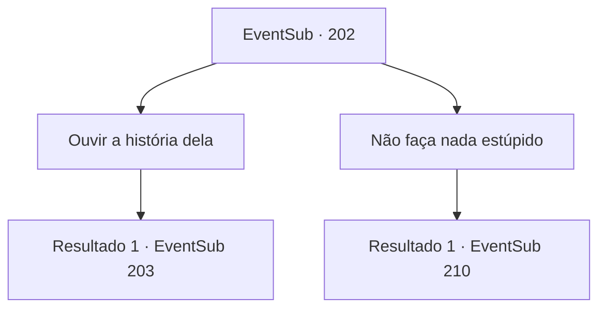

# Eventos secundários · 202

[Índice da tabela](index.md) · [Índice geral](../index.md)

ID: `pt:EventSub:202` · Fonte: `EventSub4` · Versão: 1.2.47.

Mapeamento estático dos arquivos; a disponibilidade e a execução dependem do estado da run.

## Texto do evento

*Sem texto no arquivo.*

## Dados de entrada

```json
{
  "id": 202,
  "grade": 1,
  "subEvent": "",
  "required": ""
}
```

## Mapa das escolhas



## Escolhas e resultados

### Escolha 1

Ouvir a história dela

Requisitos e outros campos da escolha:

```json
{
  "required": ""
}
```

#### Resultado 1.1

Você decide questioná-la sobre algumas coisas, para ouvir a história completa.

Continuação registrada: [Evento 203](0203.md) na mesma tabela.

```json
{
  "required": "",
  "chance": "1",
  "nextEvent": 203,
  "type": 2,
  "reward": ""
}
```

### Escolha 2

Não faça nada estúpido

Requisitos e outros campos da escolha:

```json
{
  "required": ""
}
```

#### Resultado 2.1

Você diz à sereia para não fazer nada estúpido. 

 "Você vai se arrepender disso."

 Ela fala, então fecha a boca.
 Depois de alguns dias, a viúva do amor é recebida com uma tempestade repentina do nada. O clima severo rasga as velas e quebra o mastro, e o navio treme diante das enormes ondas. Os marinheiros correm em pânico, e é como uma sombra da morte pairando ao redor do navio, cercado pelo Mar Negro Pitch.

Continuação registrada: [Evento 210](0210.md) na mesma tabela.

```json
{
  "required": "",
  "chance": "1",
  "nextEvent": 210,
  "type": 2,
  "reward": ""
}
```

## Referências que chegam a este evento

- [Evento 200 · escolha 1 · resultado 1](0200.md#escolha-1)
