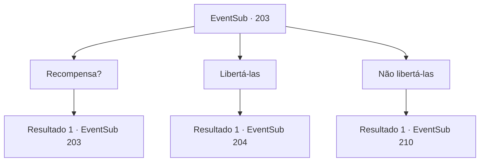

# Eventos secundários · 203

[Índice da tabela](index.md) · [Índice geral](../index.md)

ID: `pt:EventSub:203` · Fonte: `EventSub4` · Versão: 1.2.47.

Mapeamento estático dos arquivos; a disponibilidade e a execução dependem do estado da run.

## Texto do evento

*Sem texto no arquivo.*

## Dados de entrada

```json
{
  "id": 203,
  "grade": 1,
  "subEvent": "",
  "required": ""
}
```

## Mapa das escolhas



## Escolhas e resultados

### Escolha 1

Recompensa?

Requisitos e outros campos da escolha:

```json
{
  "required": "5_207_0"
}
```

#### Resultado 1.1

Você pergunta a ela o que ela pode conseguir para você se eles fossem libertados. Seus olhos azuis parecem estar brilhando em uma cor diferente. 

 "O tesouro do oceano. O mais valioso de todos será seu."

 Ela encontra seu olhar com um olhar firme, garantindo que você vai amá-lo.

Continuação registrada: [Evento 203](0203.md) na mesma tabela.

```json
{
  "required": "",
  "chance": "1",
  "nextEvent": 203,
  "type": 2,
  "reward": "5_207_1"
}
```

### Escolha 2

Libertá-las

Requisitos e outros campos da escolha:

```json
{
  "required": "5_207_1"
}
```

#### Resultado 2.1

Você promete a ela que permitirá que as sereias voltem para o oceano. As sereias te encaram com olhos duvidosos. 

 "Depois que o sol se pôr, nos liberte. Isso garantirá que não sejamos pegos."

 Como sugerido pela sereia de olhos azuis, você espera até o sol se pôr. A lua mostra seu rosto, e a tripulação começa a adormecer um por um. As patrulhas noturnas estão fazendo o possível para ficarem acordadas, lutando contra a fadiga. Você observa cuidadosamente o convés, desliza para o depósito, abre a porta trancada e começa a mover o contêiner para a parte de trás do navio. Quando você está quase lá, se depara com Parrie.

Continuação registrada: [Evento 204](0204.md) na mesma tabela.

```json
{
  "required": "",
  "chance": "1",
  "nextEvent": 204,
  "type": 2,
  "reward": ""
}
```

### Escolha 3

Não libertá-las

Requisitos e outros campos da escolha:

```json
{
  "required": "5_207_1"
}
```

#### Resultado 3.1

Você decide não liberá -los. 

 "Você vai se arrepender disso."

  Ela fala, então fecha a boca.
  Depois de alguns dias, a viúva do amor é recebida com uma tempestade repentina do nada.  O clima severo rasga as velas e quebra o mastro, e o navio treme diante das enormes ondas.  Os marinheiros correm em pânico, e é como uma sombra da morte pairando ao redor do navio, cercado pelo Mar Negro Pitch.

Continuação registrada: [Evento 210](0210.md) na mesma tabela.

```json
{
  "required": "",
  "chance": "1",
  "nextEvent": 210,
  "type": 2,
  "reward": ""
}
```

## Referências que chegam a este evento

- [Evento 202 · escolha 1 · resultado 1](0202.md#escolha-1)
- [Evento 203 · escolha 1 · resultado 1](0203.md#escolha-1)
