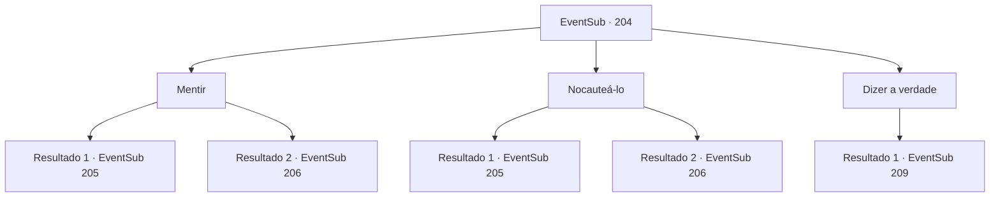

# Eventos secundários · 204

[Índice da tabela](index.md) · [Índice geral](../index.md)

ID: `pt:EventSub:204` · Fonte: `EventSub4` · Versão: 1.2.47.

Mapeamento estático dos arquivos; a disponibilidade e a execução dependem do estado da run.

## Texto do evento

*Sem texto no arquivo.*

## Dados de entrada

```json
{
  "id": 204,
  "grade": 1,
  "subEvent": "",
  "required": ""
}
```

## Mapa das escolhas



## Escolhas e resultados

### Escolha 1

Mentir 

Requisitos e outros campos da escolha:

```json
{
  "required": ""
}
```

#### Resultado 1.1

Você diz a ele que, para manter a qualidade da mercadoria, é importante expor os tritões à brisa do oceano de vez em quando. Parrie obviamente está muito bêbado e responde gaguejando. 

 "V-você está certo. Mas não os deixe se aproximar demais. Eles podem simplesmente pular no oceano."

 Depois de terminar, ele vai embora para patrulhar outras áreas. Quando você se certifica de que ele foi embora, você rapidamente tira os tritões um por um, de volta para a água. Os tritões começam a se libertar novamente, com sons de respingos, e a sereia de olhos azuis, o último tritão no recipiente, pergunta a você. 

 "O que você vai fazer agora? Eles certamente vão perceber que você nos libertou."

 Dizendo isso, ela estende a mão para você, pedindo para que você os siga.

Continuação registrada: [Evento 205](0205.md) na mesma tabela.

```json
{
  "required": "",
  "chance": "1|0_7_1",
  "nextEvent": 205,
  "type": 0,
  "reward": "0_2_1"
}
```

#### Resultado 1.2

Você diz que os tritões pareciam estar com dor, então você ia deixá-los ver o oceano. Mas logo Parrie grita com você, preparando sua arma. 

 "Traidor! Os tritões te lavaram o cérebro?! Você vai fazer todo o nosso esforço ir por água abaixo!"

 Parrie aponta sua espada furiosamente para você. Sua única opção é retaliar, preparando sua própria arma e enfrentando seu ataque.

Continuação registrada: [Evento 206](0206.md) na mesma tabela.

```json
{
  "required": "",
  "chance": "20",
  "nextEvent": 206,
  "type": 1,
  "reward": "6_0_110",
  "place": 10
}
```

### Escolha 2

Nocauteá-lo

Requisitos e outros campos da escolha:

```json
{
  "required": ""
}
```

#### Resultado 2.1

Você se aproxima rapidamente de Parrie e acerta seu queixo. Aquele golpe o nocauteia imediatamente, e você rapidamente retira o tritão do recipiente, para o oceano. Os tritões começam a se libertar novamente, com sons de respingos, e a sereia de olhos azuis, o último tritão no recipiente, pergunta a você. 

 "O que você vai fazer agora? Eles certamente vão perceber que você nos libertou."

 Dizendo isso, ela estende a mão para você, pedindo para que você os siga.

Continuação registrada: [Evento 205](0205.md) na mesma tabela.

```json
{
  "required": "",
  "chance": "1|0_5_1",
  "nextEvent": 205,
  "type": 0,
  "reward": "0_2_1"
}
```

#### Resultado 2.2

Você se aproxima rapidamente de Parrie e soca sua mandíbula. Mas ele desvia do seu ataque e se afasta, gritando com você com sua arma em punho. 

 "Traidor! Os seres do mar te lavaram o cérebro?! Você vai fazer todo o nosso esforço ir por água abaixo!"

 Parrie aponta sua espada furiosamente para você. Sua única opção é retaliar, preparando sua própria arma e enfrentando seu ataque.

Continuação registrada: [Evento 206](0206.md) na mesma tabela.

```json
{
  "required": "",
  "chance": "16",
  "nextEvent": 206,
  "type": 1,
  "reward": "6_0_110",
  "place": 10
}
```

### Escolha 3

Dizer a verdade

Requisitos e outros campos da escolha:

```json
{
  "required": ""
}
```

#### Resultado 3.1

Você conta a verdade para Parrie. Ele obviamente fica surpreso, mas logo fala com você em uma voz calma. 

 "Isso é claramente um ato de traição. Mas, considerando tudo o que você fez por nós, vou te dar uma chance. Tudo o que você precisa fazer é colocar aquele recipiente de volta onde ele pertence, como se nada tivesse acontecido. Certo?"

 O ser marinho balança a cabeça depois de ouvir a voz de Parrie e olha para você com olhos suplicantes.

Continuação registrada: [Evento 209](0209.md) na mesma tabela.

```json
{
  "required": "",
  "chance": "1",
  "nextEvent": 209,
  "type": 2,
  "reward": ""
}
```

## Referências que chegam a este evento

- [Evento 203 · escolha 2 · resultado 1](0203.md#escolha-2)
