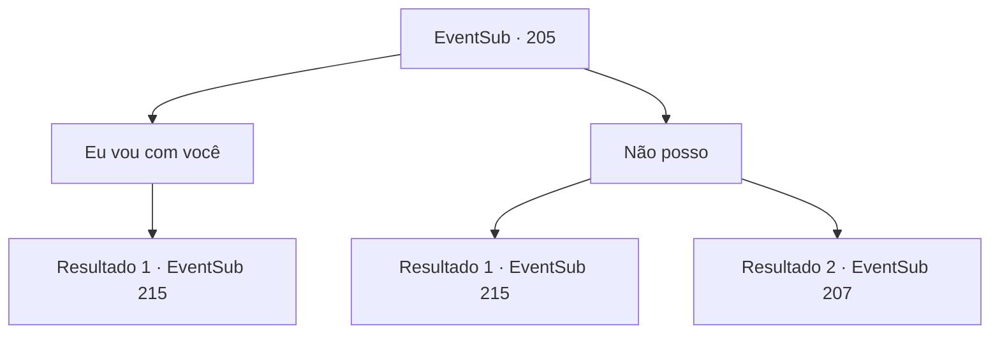

# Eventos secundários · 205

[Índice da tabela](index.md) · [Índice geral](../index.md)

ID: `pt:EventSub:205` · Fonte: `EventSub4` · Versão: 1.2.47.

Mapeamento estático dos arquivos; a disponibilidade e a execução dependem do estado da run.

## Texto do evento

*Sem texto no arquivo.*

## Dados de entrada

```json
{
  "id": 205,
  "grade": 1,
  "subEvent": "",
  "required": ""
}
```

## Mapa das escolhas



## Escolhas e resultados

### Escolha 1

Eu vou com você

Requisitos e outros campos da escolha:

```json
{
  "required": ""
}
```

#### Resultado 1.1

Você agarra a mão dela. Ela então sorri alegremente e o puxa debaixo d'água. Você sente o ar fluindo para os pulmões, entregue de seus lábios. 

 "Os moradores da terra parecem não saber como respirar debaixo d'água. Você deve ficar bem agora. Devemos?"

 A tripulação olha ao redor do convés com tochas, provavelmente acordou com os ruídos. Eles descobrem que os Merfolk se foram, mas é tarde demais. Você escapa para o oceano profundo, juntamente com a sereia de olhos azuis. Depois de seguir o Merfolk por um longo tempo, você vê uma cidade enorme, construída debaixo d'água. A vista é magnífica, com toda a cidade brilhando com brilhos do mar. |drawing_underwaterCity| A sereia de olhos azuis monta a corrente, guiando você em torno de 'Ikene' a cidade subaquática. Qualquer um que não o veja pessoalmente nunca acreditará nas coisas que estão acontecendo aqui, desde as estruturas de construção impossíveis em terra, itens que você nunca viu antes e os merfolk alimentando as baleias. Depois de apresentar a cidade a você, ela monta uma corrente diferente, levando você a uma fenda subaquática. Ela solta sua mão e fala com você com uma voz muito graciosa. 

 "Agora, eu, Madellin, a rainha dos merfolk, pergunto. Derrote a personificação do próprio mal, selado lá longe."

 Você vê um vórtice giratório em onde ela aponta.

Continuação registrada: [Evento 215](0215.md) na mesma tabela.

```json
{
  "required": "",
  "chance": "1",
  "nextEvent": 215,
  "type": 2,
  "reward": ""
}
```

### Escolha 2

Não posso

Requisitos e outros campos da escolha:

```json
{
  "required": ""
}
```

#### Resultado 2.1

Você recusa. Mas ela te arrasta debaixo d'água de qualquer maneira. 

 "Você provavelmente não vai ficar sozinho de qualquer maneira. Você precisa de nossa ajuda desta vez, e é certo que nos ajudemos."

 Ela sorri e puxa você para baixo, e você sente o ar fluindo para os pulmões, entregue de seus lábios. 

 "Os moradores da terra parecem não saber como respirar debaixo d'água. Você deve ficar bem agora. Devemos?"

 A tripulação olha ao redor do convés com tochas, provavelmente acordou com os ruídos. Eles descobrem que os Merfolk se foram, mas é tarde demais. Você escapa para o oceano profundo, juntamente com a sereia de olhos azuis. Depois de seguir o Merfolk por um longo tempo, você vê uma cidade enorme, construída debaixo d'água. A vista é magnífica, com toda a cidade brilhando com brilhos do mar. |drawing_underwaterCity| A sereia de olhos azuis monta a corrente, guiando você em torno de 'Ikene' a cidade subaquática. Qualquer um que não o veja pessoalmente nunca acreditará nas coisas que estão acontecendo aqui, desde as estruturas de construção impossíveis em terra, itens que você nunca viu antes e os merfolk alimentando as baleias. Depois de apresentar a cidade a você, ela monta uma corrente diferente, levando você a uma fenda subaquática. Ela solta sua mão e fala com você com uma voz muito graciosa. 

 "Agora, eu, Madellin, a rainha dos merfolk, pergunto. Derrote a personificação do próprio mal, selado lá longe."

 Você vê um vórtice giratório em onde ela aponta.

Continuação registrada: [Evento 215](0215.md) na mesma tabela.

```json
{
  "required": "18_208_1",
  "chance": "1",
  "nextEvent": 215,
  "type": 2,
  "reward": ""
}
```

#### Resultado 2.2

Você se recusa. Sem hesitação, ela pula de volta para o oceano completamente escuro. A tripulação olha ao redor do convés com tochas, provavelmente acordada pelos barulhos de respingos. Eles te veem em pé no convés e se aproximam de você. A tripulação descobre que a sereia desapareceu, e o Primeiro Oficial 'o Rato' te questiona sobre o paradeiro dela.

Continuação registrada: [Evento 207](0207.md) na mesma tabela.

```json
{
  "required": "5_208_1",
  "chance": "1",
  "nextEvent": 207,
  "type": 2,
  "reward": ""
}
```

## Referências que chegam a este evento

- [Evento 204 · escolha 1 · resultado 1](0204.md#escolha-1)
- [Evento 204 · escolha 2 · resultado 1](0204.md#escolha-2)
- [Evento 206 · escolha 1 · resultado 1](0206.md#escolha-1)
- [Evento 209 · escolha 2 · resultado 1](0209.md#escolha-2)
