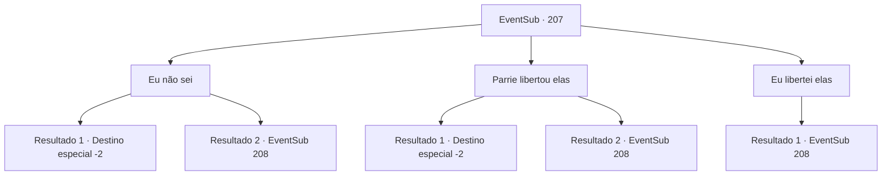

# Eventos secundários · 207

[Índice da tabela](index.md) · [Índice geral](../index.md)

ID: `pt:EventSub:207` · Fonte: `EventSub4` · Versão: 1.2.47.

Mapeamento estático dos arquivos; a disponibilidade e a execução dependem do estado da run.

## Texto do evento

*Sem texto no arquivo.*

## Dados de entrada

```json
{
  "id": 207,
  "grade": 1,
  "subEvent": "",
  "required": ""
}
```

## Mapa das escolhas



## Escolhas e resultados

### Escolha 1

Eu não sei

Requisitos e outros campos da escolha:

```json
{
  "required": ""
}
```

#### Resultado 1.1

Você balança a cabeça, agindo inocente. Alguns membros da tripulação olham para você com olhos desconfiados, mas logo esquecem disso. Assim que a Viúva do Amor chega ao porto, com Parrie fora, a tripulação concorda em vender o navio. O lucro é dividido igualmente entre a tripulação, e você também sai com sua parte do ouro.

Continuação registrada: [Destino especial `-2`](../destinos-especiais.md).

```json
{
  "required": "",
  "chance": "1|0_14_1",
  "nextEvent": -2,
  "type": 0,
  "reward": "12_6_-1|0_4_100|5_209_1"
}
```

#### Resultado 1.2

Você diz que não sabe o que está acontecendo, mas ninguém acredita em sua atuação estranha. O Primeiro Mate 'o Rato' se aproxima de você e fala com você de forma cínica. 

 "Seus pais não te ensinaram que mentir é ruim?"

 Ele coloca uma adaga afiada em seu pescoço, e a luta começa com você a empurrando para longe.

Continuação registrada: [Evento 208](0208.md) na mesma tabela.

```json
{
  "required": "",
  "chance": "15",
  "nextEvent": 208,
  "type": 1,
  "reward": "6_0_109",
  "place": 10
}
```

### Escolha 2

Parrie libertou elas

Requisitos e outros campos da escolha:

```json
{
  "required": "2_3_-10"
}
```

#### Resultado 2.1

Você insiste que Parrie libertou os seres do mar ele mesmo e escapou com eles. Não é tão difícil enganar a tripulação. Alguns membros da tripulação olham para você com olhos desconfiados, mas ainda assim estão convencidos, expressando ressentimento pelo ex-capitão. O Primeiro Oficial 'o Rato' grita de maneira especialmente acalorada. 

 "Aquele maldito bastardo!! Eu sabia! Eu não gostava dele nem um pouco pela forma como ele falava! Vamos voltar para o porto!"

 A tripulação retorna aos seus lugares. Alguns dias depois, você retorna a Levantium e, com Parrie fora, a tripulação concorda em vender o navio. O lucro é dividido igualmente entre a tripulação, e você também parte com sua parte do ouro.

Continuação registrada: [Destino especial `-2`](../destinos-especiais.md).

```json
{
  "required": "",
  "chance": "1|0_12_1",
  "nextEvent": -2,
  "type": 0,
  "reward": "0_4_100|12_6_-1|5_209_1"
}
```

#### Resultado 2.2

Você insiste que Parrie libertou os tritões ele mesmo e escapou com eles. Alguns da tripulação parecem convencidos, mas a maioria não parece concordar com você. O Primeiro Oficial 'o Rato' se aproxima de você e fala de forma cínica. 

 "Seus pais não te ensinaram que mentir é ruim?"

 Ele coloca uma adaga afiada em seu pescoço, e a luta começa com você a empurrando para longe.

Continuação registrada: [Evento 208](0208.md) na mesma tabela.

```json
{
  "required": "",
  "chance": "13",
  "nextEvent": 208,
  "type": 1,
  "reward": "6_0_109",
  "place": 10
}
```

### Escolha 3

Eu libertei elas

Requisitos e outros campos da escolha:

```json
{
  "required": ""
}
```

#### Resultado 3.1

Você diz a eles que matou o capitão e libertou os tritões. A tripulação começa a murmurar e o Primeiro Oficial 'o Rato' grita com raiva para você. 

 "O quê? Você está nos dizendo para acreditar nessa besteira? Então você libertou todos os tritões valiosos e matou nosso capitão?"

 Ele dá um passo para trás e arruma o cabelo. Ele coloca uma adaga afiada em seu pescoço e a luta começa com você a empurrando para longe.

Continuação registrada: [Evento 208](0208.md) na mesma tabela.

```json
{
  "required": "",
  "chance": "1",
  "nextEvent": 208,
  "type": 2,
  "reward": "6_3_109",
  "place": 10
}
```

## Referências que chegam a este evento

- [Evento 205 · escolha 2 · resultado 2](0205.md#escolha-2)
