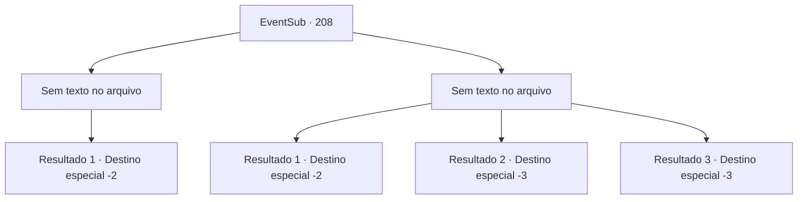

# Eventos secundários · 208

[Índice da tabela](index.md) · [Índice geral](../index.md)

ID: `pt:EventSub:208` · Fonte: `EventSub4` · Versão: 1.2.47.

Mapeamento estático dos arquivos; a disponibilidade e a execução dependem do estado da run.

## Texto do evento

*Sem texto no arquivo.*

## Dados de entrada

```json
{
  "id": 208,
  "grade": 1,
  "subEvent": "",
  "required": ""
}
```

## Mapa das escolhas



## Escolhas e resultados

### Escolha 1

*Sem texto no arquivo; o papel dessa opção depende da interface do jogo.*

Requisitos e outros campos da escolha:

```json
{
  "required": ""
}
```

#### Resultado 1.1

O Rato agora se ajoelha diante de você. Sua atitude muda consideravelmente, agindo leal, esfregando as mãos e sorrindo. 

 "Eu... Perdoe minhas maneiras. Peço seu perdão, senhor. Conheço bem as águas, então farei questão de levá-lo com segurança até Levantium... hehe..."

 Após terminar, o Rato ordena à tripulação que retorne às suas posições. Alguns dias depois, você retorna a Levantium e, com Parrie desaparecido, a tripulação concorda em vender o navio. O lucro é dividido igualmente entre a tripulação, e você também parte com sua parte do ouro. A tripulação então se dispersa.

Continuação registrada: [Destino especial `-2`](../destinos-especiais.md).

```json
{
  "required": "",
  "chance": "1",
  "nextEvent": -2,
  "type": 2,
  "reward": "0_4_100|12_6_-1|5_209_1"
}
```

### Escolha 2

*Sem texto no arquivo; o papel dessa opção depende da interface do jogo.*

Requisitos e outros campos da escolha:

```json
{
  "required": ""
}
```

#### Resultado 2.1

Você é espancado pelo 'Rato' e pelos outros marinheiros, e então é jogado ao mar na escuridão total. As ondas fortes e a correnteza roubam sua consciência, mas felizmente você acorda em uma praia. Você se levanta, recupera a compostura e olha fixamente para o oceano antes de caminhar em direção à cidade mais próxima.

Continuação registrada: [Destino especial `-2`](../destinos-especiais.md).

```json
{
  "required": "1_0_2|1_1_2",
  "chance": "1",
  "nextEvent": -2,
  "type": 2,
  "reward": "0_0_-1|0_1_-1|12_6_-1"
}
```

#### Resultado 2.2

Você é espancado pelo 'Rato' e pelos outros marinheiros, e então é jogado ao mar na escuridão total. As ondas fortes e a correnteza roubam sua consciência.

Continuação registrada: [Destino especial `-3`](../destinos-especiais.md).

```json
{
  "required": "2_0_2",
  "chance": "1",
  "nextEvent": -3,
  "type": 2,
  "reward": "0_0_-1|0_1_-1"
}
```

#### Resultado 2.3

Você é espancado pelo 'Rato' e pelos outros marinheiros, e então é jogado ao mar na escuridão total. As ondas fortes e a correnteza roubam sua consciência.

Continuação registrada: [Destino especial `-3`](../destinos-especiais.md).

```json
{
  "required": "2_1_2",
  "chance": "1",
  "nextEvent": -3,
  "type": 2,
  "reward": "0_0_-1|0_1_-1"
}
```

## Referências que chegam a este evento

- [Evento 207 · escolha 1 · resultado 2](0207.md#escolha-1)
- [Evento 207 · escolha 2 · resultado 2](0207.md#escolha-2)
- [Evento 207 · escolha 3 · resultado 1](0207.md#escolha-3)
