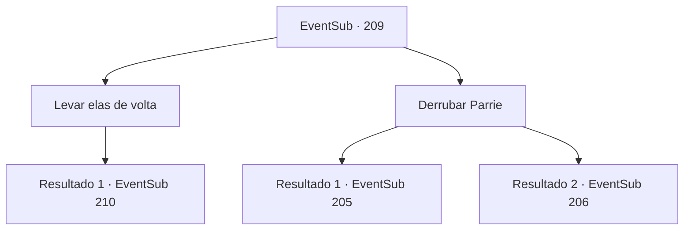

# Eventos secundários · 209

[Índice da tabela](index.md) · [Índice geral](../index.md)

ID: `pt:EventSub:209` · Fonte: `EventSub4` · Versão: 1.2.47.

Mapeamento estático dos arquivos; a disponibilidade e a execução dependem do estado da run.

## Texto do evento

*Sem texto no arquivo.*

## Dados de entrada

```json
{
  "id": 209,
  "grade": 1,
  "subEvent": "",
  "required": ""
}
```

## Mapa das escolhas



## Escolhas e resultados

### Escolha 1

Levar elas de volta

Requisitos e outros campos da escolha:

```json
{
  "required": ""
}
```

#### Resultado 1.1

Você decide levar o recipiente de volta para o armazenamento. A sereia de olhos azuis implora novamente, mas você consegue ignorá-la. No caminho de volta para o armazenamento, ela sussurra que você vai se arrepender. Após alguns dias, a Viúva do Amor é surpreendida por uma tempestade repentina do nada. O tempo severo rasga as velas e quebra o mastro, e o navio treme diante das ondas enormes. Os marinheiros correm em pânico, e é como uma sombra da morte pairando ao redor do navio, cercado pelo mar negro.

Continuação registrada: [Evento 210](0210.md) na mesma tabela.

```json
{
  "required": "",
  "chance": "1",
  "nextEvent": 210,
  "type": 2,
  "reward": ""
}
```

### Escolha 2

Derrubar Parrie

Requisitos e outros campos da escolha:

```json
{
  "required": ""
}
```

#### Resultado 2.1

Você embosca Parrie, que se aproxima com um olhar suspeito no rosto. Com um soco rápido no estômago, você consegue derrubar Parrie, e rapidamente começa a colocar os tritões na água um por um. Os tritões começam a se libertar novamente, com sons de respingos, e a sereia de olhos azuis, o último tritão no recipiente, pergunta a você. 

 "O que você vai fazer agora? Eles certamente vão perceber que você nos libertou."

 Dizendo isso, ela estende a mão para você, pedindo para que você os siga.

Continuação registrada: [Evento 205](0205.md) na mesma tabela.

```json
{
  "required": "",
  "chance": "1|0_5_1",
  "nextEvent": 205,
  "type": 0,
  "reward": "0_2_1"
}
```

#### Resultado 2.2

Você embosca Parrie, que se aproxima com um olhar suspeito no rosto. Mas ele desvia do seu ataque e se afasta, gritando com você com sua arma em punho. 

 "Traidor! Os tritões te lavaram o cérebro?! Você vai fazer todo o nosso esforço ir por água abaixo!"

 Parrie balança furiosamente seu cimitarra em sua direção.

Continuação registrada: [Evento 206](0206.md) na mesma tabela.

```json
{
  "required": "",
  "chance": "16",
  "nextEvent": 206,
  "type": 1,
  "reward": "6_0_110",
  "place": 10
}
```

## Referências que chegam a este evento

- [Evento 204 · escolha 3 · resultado 1](0204.md#escolha-3)
