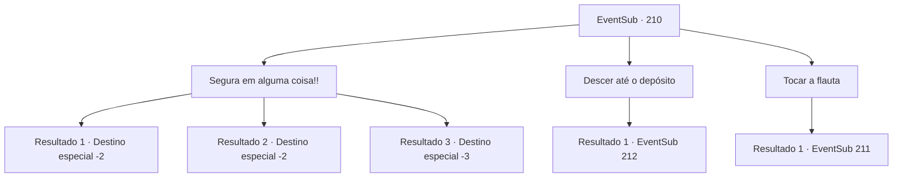

# Eventos secundários · 210

[Índice da tabela](index.md) · [Índice geral](../index.md)

ID: `pt:EventSub:210` · Fonte: `EventSub4` · Versão: 1.2.47.

Mapeamento estático dos arquivos; a disponibilidade e a execução dependem do estado da run.

## Texto do evento

*Sem texto no arquivo.*

## Dados de entrada

```json
{
  "id": 210,
  "grade": 1,
  "subEvent": "",
  "required": ""
}
```

## Mapa das escolhas



## Escolhas e resultados

### Escolha 1

Segura em alguma coisa!!

Requisitos e outros campos da escolha:

```json
{
  "required": ""
}
```

#### Resultado 1.1

O navio sacode como louco, mas você consegue se segurar na parte inferior do mastro. A água do mar entra rugindo no navio aqui e ali, e alguns marinheiros são até engolidos pela água, para o oceano. Os gritos dos marinheiros seguem os sons de raios, vento e o navio se despedaçando. Depois que a tempestade finalmente cessou, não havia mais a 'Viúva do Amor'. Você consegue chegar à terra, segurando o mastro destruído e surfando nas ondas. O mar está calmo como se nada tivesse acontecido, e você olha fixamente para o oceano.

Continuação registrada: [Destino especial `-2`](../destinos-especiais.md).

```json
{
  "required": "",
  "chance": "1|0_5_1",
  "nextEvent": -2,
  "type": 0,
  "reward": "0_2_1|14_6_0|12_6_-1"
}
```

#### Resultado 1.2

O navio treme como um louco. Você tenta segurar a parte inferior do mastro, mas é tomada pela água. Como muitos outros marinheiros, você é engolido pelas ondas da água do mar, atingindo seu corpo por todo o lugar nas partes do navio. 

 Você perde a consciência, mas felizmente você está lavado em terra. Você tosse com a água do mar nos pulmões e consegue puxar seu corpo cheio de feridas de volta. O mar está calmo como se nada tivesse acontecido, e você olhou fixamente para o oceano.

Continuação registrada: [Destino especial `-2`](../destinos-especiais.md).

```json
{
  "required": "1_0_2",
  "chance": "20",
  "nextEvent": -2,
  "type": 1,
  "reward": "0_2_1|14_6_0|0_0_-1|12_6_-1"
}
```

#### Resultado 1.3

O navio treme loucamente. Você tenta se segurar na parte inferior do mastro, mas é levado pela água. Como muitos outros marinheiros, você é engolido pelas ondas de água do mar, atingindo seu corpo em todos os lugares contra as partes do navio. Incapaz de se controlar, você sente uma dor aguda nas costas e perde a consciência.

Continuação registrada: [Destino especial `-3`](../destinos-especiais.md).

```json
{
  "required": "2_0_2",
  "chance": "20",
  "nextEvent": -3,
  "type": 1,
  "reward": "0_0_-1"
}
```

### Escolha 2

Descer até o depósito

Requisitos e outros campos da escolha:

```json
{
  "required": "1_14_10"
}
```

#### Resultado 2.1

Você percebe que a tempestade é conjurada pelo encanto da sereia e se apressa em descer para o depósito. Os olhos da sereia de olhos azuis não parecem normais e ela está gritando de dor, com seu corpo ficando preto, como se estivesse queimando.

Continuação registrada: [Evento 212](0212.md) na mesma tabela.

```json
{
  "required": "",
  "chance": "1",
  "nextEvent": 212,
  "type": 2,
  "reward": ""
}
```

### Escolha 3

Tocar a flauta

Requisitos e outros campos da escolha:

```json
{
  "required": "8_90_1"
}
```

#### Resultado 3.1

Quando você toca sua flauta, Parrie olha para você, surpreso. 

 "Ei! Talvez agora não seja a hora para música?!"

 Mas à medida que a tempestade começa a diminuir, seu rosto se torna mais perplexo e confuso. Conforme o mar volta à calma, ele olha para você com olhos curiosos. 

 "O que... o que diabos você fez?"


Continuação registrada: [Evento 211](0211.md) na mesma tabela.

```json
{
  "required": "",
  "chance": "1",
  "nextEvent": 211,
  "type": 2,
  "reward": ""
}
```

## Referências que chegam a este evento

- [Evento 202 · escolha 2 · resultado 1](0202.md#escolha-2)
- [Evento 203 · escolha 3 · resultado 1](0203.md#escolha-3)
- [Evento 209 · escolha 1 · resultado 1](0209.md#escolha-1)
