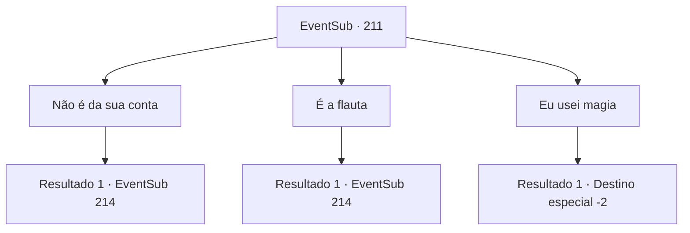

# Eventos secundários · 211

[Índice da tabela](index.md) · [Índice geral](../index.md)

ID: `pt:EventSub:211` · Fonte: `EventSub4` · Versão: 1.2.47.

Mapeamento estático dos arquivos; a disponibilidade e a execução dependem do estado da run.

## Texto do evento

*Sem texto no arquivo.*

## Dados de entrada

```json
{
  "id": 211,
  "grade": 1,
  "subEvent": "",
  "required": ""
}
```

## Mapa das escolhas



## Escolhas e resultados

### Escolha 1

Não é da sua conta

Requisitos e outros campos da escolha:

```json
{
  "required": ""
}
```

#### Resultado 1.1

Ele mexe a cabeça em resposta. Então ele grita, como se tivesse descoberto a resposta. 

 "...Sim. A flauta! A flauta acalmou a tempestade! Você. Não venderia essa flauta para mim? Eu farei valer a pena para você."

 Ele grita para você, animado. Você ainda consegue sentir o cheiro do rum e da água salgada do mar vindo dele.

Continuação registrada: [Evento 214](0214.md) na mesma tabela.

```json
{
  "required": "",
  "chance": "1",
  "nextEvent": 214,
  "type": 2,
  "reward": ""
}
```

### Escolha 2

É a flauta

Requisitos e outros campos da escolha:

```json
{
  "required": ""
}
```

#### Resultado 2.1

Ele acena em resposta. 

 "Claro! A flauta! Você. Você não venderia essa flauta para mim? Eu farei valer a pena."

 Ele grita para você, animado. Você ainda consegue sentir o cheiro do rum e da água salgada do mar dele.

Continuação registrada: [Evento 214](0214.md) na mesma tabela.

```json
{
  "required": "",
  "chance": "1",
  "nextEvent": 214,
  "type": 2,
  "reward": ""
}
```

### Escolha 3

Eu usei magia

Requisitos e outros campos da escolha:

```json
{
  "required": ""
}
```

#### Resultado 3.1

Ele assente em resposta. 

 "Entendo ... você, eu não sabia que você era tão capaz, mas você se mostra um ótimo mágico. Acalmando uma tempestade desse tamanho ..."

 Ele olha para você, mudou -se, Antes de retornar à tripulação e gritar. 

 "O grande mágico {1} nos salvou da tempestade!"

 A tripulação então aplaude seu nome, jogando os braços no ar. <link=shake> 

 "hurrah !!! {1}! {1}! {1}!"

 </link> Você os responde levantando a mão um pouco. Com o alívio de escapar da tempestade incólume e a emoção de ficar rica depois de vender o Merfolk, motiva a tripulação a remar com todo o seu poder. Portanto, a viúva do amor retorna ao Levântio mais cedo do que o esperado. Somente depois de chegar ao porto, a tripulação percebe que um dos corpos de Merfolk é preto como cinza, mas ninguém realmente prestou atenção. Os Merfolk são vendidos para a casa de leilões e cada um é vendido com muita disposição. O capitão chama a tripulação, divide o ouro e fala. 

 "Homens, você tem sido uma ótima equipe para trabalhar. Agora descanse!"

 Ele então se aproxima de você e sussurra em silêncio. 

 "Fiz questão de tornar sua bolsa mais pesada. Não teríamos conseguido sem a sua ajuda!"

 Ele lhe entrega um baú cheio de ouro depois de terminar. Você pega e deixa a viúva do amor.

Continuação registrada: [Destino especial `-2`](../destinos-especiais.md).

```json
{
  "required": "",
  "chance": "1",
  "nextEvent": -2,
  "type": 2,
  "reward": "0_4_300|12_6_-1|14_6_1|0_2_1"
}
```

## Referências que chegam a este evento

- [Evento 210 · escolha 3 · resultado 1](0210.md#escolha-3)
