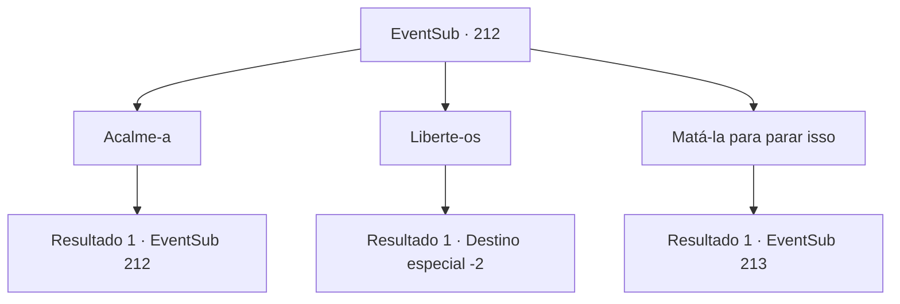

# Eventos secundários · 212

[Índice da tabela](index.md) · [Índice geral](../index.md)

ID: `pt:EventSub:212` · Fonte: `EventSub4` · Versão: 1.2.47.

Mapeamento estático dos arquivos; a disponibilidade e a execução dependem do estado da run.

## Texto do evento

*Sem texto no arquivo.*

## Dados de entrada

```json
{
  "id": 212,
  "grade": 1,
  "subEvent": "",
  "required": ""
}
```

## Mapa das escolhas



## Escolhas e resultados

### Escolha 1

Acalme-a

Requisitos e outros campos da escolha:

```json
{
  "required": "5_210_0"
}
```

#### Resultado 1.1

Você pede à sereia de olhos azuis para se acalmar e parar a tempestade. Ela responde tossindo sangue. 

 "*tosse*...! Ah... Eu te disse. Você vai se arrepender. Deixe-nos ir e eu vou parar isso."


Continuação registrada: [Evento 212](0212.md) na mesma tabela.

```json
{
  "required": "",
  "chance": "1",
  "nextEvent": 212,
  "type": 2,
  "reward": "5_210_1"
}
```

### Escolha 2

Liberte-os

Requisitos e outros campos da escolha:

```json
{
  "required": ""
}
```

#### Resultado 2.1

Você rapidamente move o recipiente para a parte de trás do navio. Um por um, você joga os tritões de volta ao mar. Por fim, quando a sereia de olhos azuis está livre novamente, a tempestade cessa. Após o fim da tempestade, Parrie e sua tripulação procuram pelos tritões. Quando percebem que o recipiente está completamente vazio, ele responde com um suspiro. 

 "Maldita tempestade... todos os tritões escaparam... Merda..."

 Ele se senta perto da parede, mal conseguindo se manter firme. Então ele fala com uma voz decepcionada. 

 "Voltamos para o porto. Estou cansado de lidar com os tritões..."

 Alguns dias depois, a tripulação se dispersa após retornar à terra, e Parrie também se afasta.

Continuação registrada: [Destino especial `-2`](../destinos-especiais.md).

```json
{
  "required": "",
  "chance": "1",
  "nextEvent": -2,
  "type": 2,
  "reward": "12_6_-1|0_3_1"
}
```

### Escolha 3

Matá-la para parar isso

Requisitos e outros campos da escolha:

```json
{
  "required": ""
}
```

#### Resultado 3.1

Você quebra o recipiente com a sereia de olhos azuis dentro. Ela rola violentamente para o chão, e as outras sereias gritam, se debatendo, Você corta imediatamente a sereia de olhos azuis. Com sua vida se foi, a tempestade acaba imediatamente, e os marinheiros sobreviventes se abraçam aliviados. Parrie desce apressadamente até o recipiente e te vê. 

 "As sereias... Elas estão seguras?"

 Ele percebe as sereias chorando de horror, parece confuso, e depois de descobrir que a sereia de olhos azuis está morta, ele começa a falar. 

 "Ah... Entendi... Mas por que você matou aquela sereia específica?"


Continuação registrada: [Evento 213](0213.md) na mesma tabela.

```json
{
  "required": "",
  "chance": "1",
  "nextEvent": 213,
  "type": 2,
  "reward": "0_3_-3"
}
```

## Referências que chegam a este evento

- [Evento 210 · escolha 2 · resultado 1](0210.md#escolha-2)
- [Evento 212 · escolha 1 · resultado 1](0212.md#escolha-1)
