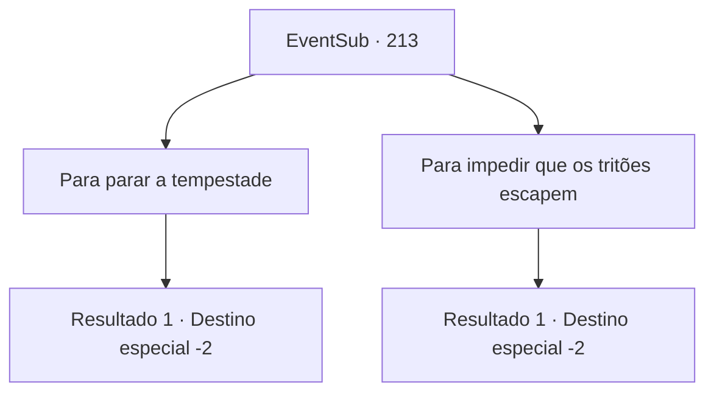

# Eventos secundários · 213

[Índice da tabela](index.md) · [Índice geral](../index.md)

ID: `pt:EventSub:213` · Fonte: `EventSub4` · Versão: 1.2.47.

Mapeamento estático dos arquivos; a disponibilidade e a execução dependem do estado da run.

## Texto do evento

*Sem texto no arquivo.*

## Dados de entrada

```json
{
  "id": 213,
  "grade": 1,
  "subEvent": "",
  "required": ""
}
```

## Mapa das escolhas



## Escolhas e resultados

### Escolha 1

Para parar a tempestade

Requisitos e outros campos da escolha:

```json
{
  "required": ""
}
```

#### Resultado 1.1


 "Os seres do mar podem invocar a tempestade...?"

 Ele responde de maneira duvidosa. Ele então inspeciona o corpo da sereia mais de perto. 

 "Hm... Entendi. Seu corpo está queimado por toda parte, mesmo quando estava submerso na água. Provavelmente os efeitos colaterais da maldição."

 Depois de observar a sereia morta por mais tempo, Parrie finalmente concorda com a cabeça. Ele então te dá tapinhas no ombro. 

 "Obrigado. Foi uma boa decisão ter você a bordo."

 Após olhar para os outros seres do mar, ele retorna ao convés e ordena que seus homens retornem ao porto. Com o alívio de escapar da tempestade ileso e a empolgação de enriquecer após vender os seres do mar, a tripulação se motiva a remar com toda a sua força. Assim, a Viúva do Amor retorna a Levantium mais cedo do que o esperado. Os seres do mar são imediatamente vendidos na casa de leilões e, embora você não ouça o preço exato deles, são vendidos a preços altos. O capitão chama a tripulação, divide o ouro e fala. 

 "Homens, vocês foram uma ótima tripulação para trabalhar. Agora descansem!"

 Ele então se aproxima de você e sussurra baixinho. 

 "Garanti que sua bolsa ficasse mais pesada. Não teríamos conseguido sem a sua ajuda!"

 Ele te entrega um baú cheio de ouro ao terminar. Você pega e deixa a Viúva do Amor.

Continuação registrada: [Destino especial `-2`](../destinos-especiais.md).

```json
{
  "required": "",
  "chance": "1",
  "nextEvent": -2,
  "type": 2,
  "reward": "0_4_300|12_6_-1|14_6_1|0_2_1"
}
```

### Escolha 2

Para impedir que os tritões escapem

Requisitos e outros campos da escolha:

```json
{
  "required": ""
}
```

#### Resultado 2.1

O capitão acena em resposta. 

 "Hm... Entendo. Ela realmente parecia ser a líder deles. É importante ensiná-los uma lição. Mas talvez você não precisasse matá-la...?"

 Após olhar para os outros seres do mar, ele retorna ao convés e ordena que seus homens retornem ao porto. Com o alívio de escapar da tempestade ileso e a empolgação de enriquecer após vender os seres do mar, a tripulação se motiva a remar com toda a sua força. Assim, a Viúva do Amor retorna a Levantium mais cedo do que o esperado. Os seres do mar são imediatamente vendidos na casa de leilões e, embora você não ouça o preço exato deles, são vendidos a preços altos. O capitão chama a tripulação, divide o ouro e fala. 

 "Homens, vocês foram uma ótima tripulação para trabalhar. Agora descansem!"

 Ele então se aproxima de você e sussurra baixinho. 

 "Garanti que sua bolsa ficasse mais pesada. Não teríamos conseguido sem a sua ajuda!"

 Ele lhe entrega um baú cheio de ouro ao terminar. Você o pega e deixa a Viúva do Amor.

Continuação registrada: [Destino especial `-2`](../destinos-especiais.md).

```json
{
  "required": "",
  "chance": "1",
  "nextEvent": -2,
  "type": 2,
  "reward": "0_4_250|12_6_-1|14_6_1|0_2_1"
}
```

## Referências que chegam a este evento

- [Evento 212 · escolha 3 · resultado 1](0212.md#escolha-3)
