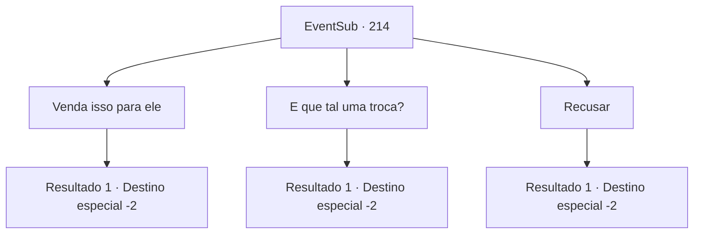

# Eventos secundários · 214

[Índice da tabela](index.md) · [Índice geral](../index.md)

ID: `pt:EventSub:214` · Fonte: `EventSub4` · Versão: 1.2.47.

Mapeamento estático dos arquivos; a disponibilidade e a execução dependem do estado da run.

## Texto do evento

*Sem texto no arquivo.*

## Dados de entrada

```json
{
  "id": 214,
  "grade": 1,
  "subEvent": "",
  "required": ""
}
```

## Mapa das escolhas



## Escolhas e resultados

### Escolha 1

Venda isso para ele

Requisitos e outros campos da escolha:

```json
{
  "required": "8_90_1"
}
```

#### Resultado 1.1

Você entrega a ele a flauta. Ele sorri felizmente e fala. 

 "Obrigado. Vou te pagar em ouro quando atracarmos no porto. Foi uma boa decisão ter você a bordo."

 Ele então grita para os homens retornarem ao porto. Com o alívio de escapar da tempestade ileso e a empolgação de enriquecer após vender os seres do mar, motiva a tripulação a remar com toda a sua força. Assim, a Viúva do Amor retorna a Levantium mais cedo do que o esperado. Os seres do mar são imediatamente vendidos na casa de leilões e, embora você não ouça o preço exato deles, são vendidos a preços altos. O capitão chama a tripulação, divide o ouro e fala. 

 "Homens, vocês foram uma ótima tripulação para trabalhar. Agora descansem!"

 Ele então se aproxima de você e sussurra baixinho. 

 "Eu me certifiquei de deixar sua bolsa mais pesada. Vou garantir que a flauta seja bem utilizada."

 Ele te entrega um baú cheio de ouro ao terminar. Você pega e deixa a Viúva do Amor.

Continuação registrada: [Destino especial `-2`](../destinos-especiais.md).

```json
{
  "required": "",
  "chance": "1",
  "nextEvent": -2,
  "type": 2,
  "reward": "0_4_500|12_6_-1|14_6_1|0_2_1|4_90_1"
}
```

### Escolha 2

E que tal uma troca?

Requisitos e outros campos da escolha:

```json
{
  "required": "8_90_1"
}
```

#### Resultado 2.1

Você pede por algum outro item valioso, em troca. Ele coça a barba por um momento e então assente. 

 "Eu lhe darei o item mais valioso do meu inventário."

 Ele retorna dos aposentos do capitão com uma arma contundente de aparência estranha em mãos. Ele diz que obteve o item do outro lado do oceano e que não sabe como é chamado. O que parecia ser uma arma contundente acaba sendo uma espada, com sua lâmina forjada em esmeralda e seu centro decorado com madeira e ouro. 

 "Parece ser algum tipo de item para um ritual, usado por xamãs. Eu presumo que você possa descobrir como usá-lo, sendo um mago e tudo mais."

 Após concluir a transação com você, Parrie retorna ao convés e ordena que seus homens retornem ao porto. Com o alívio de escapar da tempestade ileso e a empolgação de enriquecer após vender os seres do mar, a tripulação se motiva a remar com toda a sua força. Assim, a Viúva do Amor retorna a Levantium mais cedo do que o esperado. Os seres do mar são imediatamente vendidos na casa de leilões e, embora você não ouça o preço exato deles, são vendidos a preços altos. O capitão chama a tripulação, divide o ouro e fala. 

 "Homens, vocês foram uma ótima tripulação para trabalhar. Agora descansem!"

 Ele então se aproxima de você e sussurra baixinho. 

 "Eu me certifiquei de deixar sua bolsa mais pesada. Vou garantir que a flauta seja bem utilizada."

 Ele lhe entrega um baú cheio de ouro ao terminar. Você o pega e deixa a Viúva do Amor.

Continuação registrada: [Destino especial `-2`](../destinos-especiais.md).

```json
{
  "required": "",
  "chance": "1",
  "nextEvent": -2,
  "type": 2,
  "reward": "0_4_300|12_6_-1|14_6_1|0_2_1|4_90_1|3_216_1"
}
```

### Escolha 3

Recusar

Requisitos e outros campos da escolha:

```json
{
  "required": ""
}
```

#### Resultado 3.1

Você decide não entregar a flauta para ele. Parrie parece desapontado, mas ele não insiste mais no assunto. Ele ordena que seu homem retorne ao porto. Com o alívio de escapar da tempestade ileso e a empolgação de enriquecer após vender os seres do mar, a tripulação se motiva a remar com toda a sua força. Assim, a Viúva do Amor retorna a Levantium mais cedo do que o esperado. Os seres do mar são imediatamente vendidos na casa de leilões e, embora você não ouça o preço exato deles, eles são vendidos a preços altos. O capitão chama a tripulação, divide o ouro e fala. 

 "Homens, vocês foram uma ótima tripulação para trabalhar. Agora descansem!"

 Ele então se aproxima de você e sussurra baixinho. 

 "Eu me certifiquei de deixar sua bolsa mais pesada. Não teríamos conseguido sem a sua ajuda!"

 Ele lhe entrega um baú cheio de ouro ao terminar. Você o pega e deixa a Viúva do Amor.

Continuação registrada: [Destino especial `-2`](../destinos-especiais.md).

```json
{
  "required": "",
  "chance": "1",
  "nextEvent": -2,
  "type": 2,
  "reward": "0_4_300|12_6_-1|14_6_1|0_2_1"
}
```

## Referências que chegam a este evento

- [Evento 211 · escolha 1 · resultado 1](0211.md#escolha-1)
- [Evento 211 · escolha 2 · resultado 1](0211.md#escolha-2)
