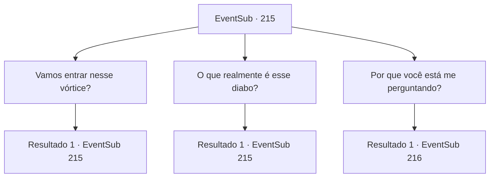

# Eventos secundários · 215

[Índice da tabela](index.md) · [Índice geral](../index.md)

ID: `pt:EventSub:215` · Fonte: `EventSub4` · Versão: 1.2.47.

Mapeamento estático dos arquivos; a disponibilidade e a execução dependem do estado da run.

## Texto do evento

*Sem texto no arquivo.*

## Dados de entrada

```json
{
  "id": 215,
  "grade": 1,
  "subEvent": "",
  "required": ""
}
```

## Mapa das escolhas



## Escolhas e resultados

### Escolha 1

Vamos entrar nesse vórtice?

Requisitos e outros campos da escolha:

```json
{
  "required": "5_211_0"
}
```

#### Resultado 1.1

Você aponta para o redemoinho, perguntando a ela se é ali que você vai entrar. A rainha sereia balança a cabeça e responde. 

 "Claro, esse redemoinho em si é perigoso, mas é apenas um obstáculo bloqueando a entrada. Além disso, há um santuário dedicado à adoração do Diabo do Mar. Ir até lá seria nosso primeiro objetivo."

 Falando calmamente, a rainha sereia não nega que atravessar esse redemoinho será uma tarefa perigosa. Não importa quanto tempo você olhe para ele, o redemoinho não parece parar de girar.

Continuação registrada: [Evento 215](0215.md) na mesma tabela.

```json
{
  "required": "",
  "chance": "1",
  "nextEvent": 215,
  "type": 2,
  "reward": "5_211_1"
}
```

### Escolha 2

O que realmente é esse diabo?

Requisitos e outros campos da escolha:

```json
{
  "required": "5_211_1"
}
```

#### Resultado 2.1

Você pergunta a ela sobre o Diabo do Mar do qual ela falou. Madellin treme ao responder, como se nem mesmo quisesse dizer seu nome. 

 "Aquele... diabo é chamado por muitos nomes entre os humanos. Kraken, Krayken e... uh... Cricket? De qualquer forma."

 Com um rosto sério, ela volta seu olhar para o redemoinho turbulento.

Continuação registrada: [Evento 215](0215.md) na mesma tabela.

```json
{
  "required": "",
  "chance": "1",
  "nextEvent": 215,
  "type": 2,
  "reward": "5_211_2"
}
```

### Escolha 3

Por que você está me perguntando?

Requisitos e outros campos da escolha:

```json
{
  "required": "5_211_2"
}
```

#### Resultado 3.1

Você pergunta a ela por que ela está pedindo a você, de todas as pessoas, para fazer esse tipo de tarefa. Ela hesita por um momento e logo fala. 

 "Havia uma profecia. O demônio libertado só pode ser derrotado com a ajuda dos habitantes da terra e que o habitante da terra escolhido se apresentará diante de nós."

 Ela olha para você enquanto acrescenta. 

 "Eu sei que parece ridículo. Mas... estamos desesperados. Claro que não faremos você lutar contra essa coisa sozinho. Mas primeiro, devemos elaborar um plano para atravessar aquele maldito vórtice."


Continuação registrada: [Evento 216](0216.md) na mesma tabela.

```json
{
  "required": "",
  "chance": "1",
  "nextEvent": 216,
  "type": 2,
  "reward": ""
}
```

## Referências que chegam a este evento

- [Evento 205 · escolha 1 · resultado 1](0205.md#escolha-1)
- [Evento 205 · escolha 2 · resultado 1](0205.md#escolha-2)
- [Evento 215 · escolha 1 · resultado 1](0215.md#escolha-1)
- [Evento 215 · escolha 2 · resultado 1](0215.md#escolha-2)
