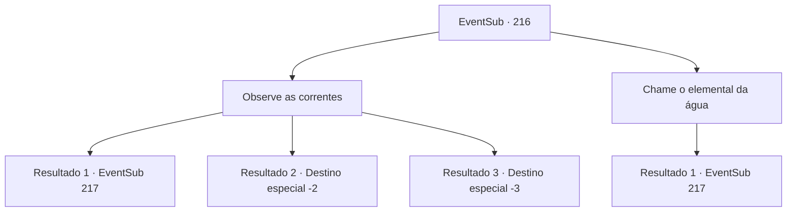

# Eventos secundários · 216

[Índice da tabela](index.md) · [Índice geral](../index.md)

ID: `pt:EventSub:216` · Fonte: `EventSub4` · Versão: 1.2.47.

Mapeamento estático dos arquivos; a disponibilidade e a execução dependem do estado da run.

## Texto do evento

*Sem texto no arquivo.*

## Dados de entrada

```json
{
  "id": 216,
  "grade": 1,
  "subEvent": "",
  "required": ""
}
```

## Mapa das escolhas



## Escolhas e resultados

### Escolha 1

Observe as correntes

Requisitos e outros campos da escolha:

```json
{
  "required": ""
}
```

#### Resultado 1.1

Você inspeciona o vórtice giratório, observando as correntes cuidadosamente. Você também descobre onde a corrente está começando e onde a corrente é mais fraca. Você rasteja na superfície com Madellin, seguindo cuidadosamente os pontos mais fracos do vórtice. Você então descobre uma rocha com um símbolo estranho inscrito nela. 

 "Presumo que seja isso que está alimentando o vórtice."

 Quando você pega a rocha, ela imediatamente se transforma em areia. Madellin encolhe os ombros, como se não tivesse esperado essa reviravolta, e o vórtice começa a enfraquecer. Quando o vórtice se foi, Madellin abre os olhos arregalados e fala. 

 "É claro...! O humano da profecia é definitivamente você. Vá primeiro. Vou trazer meu exército, para combater o diabo."

 Ela então nada de volta para a cidade, perfurando as correntes como Thunder. 

 Assim que você está fora do vórtice, você descobre uma enorme ruína, metade dela destruída, com sua entrada guardada por um grande pedaço de gelo. Você se depara com a coisa que guardava a entrada da ruína. Quando você o inspeciona de perto, não é apenas um pedaço de gelo, é um grande golem de gelo, emitindo uma aura fria. Seus olhos brilham para a vida e fazem barulho. 

 "Intrudadores detectados. Exterminar."


Continuação registrada: [Evento 217](0217.md) na mesma tabela.

```json
{
  "required": "",
  "chance": "1|0_7_1",
  "nextEvent": 217,
  "type": 0,
  "reward": "6_0_70",
  "place": 3
}
```

#### Resultado 1.2

Você nalha com cuidado ao redor do vórtice. Você consegue encontrar um caminho em que a corrente é fraca, encontrando um caminho através do vórtice. Você segue cuidadosamente sua rota dentro do vórtice. Mas talvez seu julgamento estivesse errado, porque assim que você entra no vórtice, uma força forte o puxa e você perde a consciência, engolido pelas correntes. 

 Depois de algum tempo se passou, você acorda em terra, em um lugar que não reconhece. Depois de tossir a água do mar de seus pulmões, você grita para o Merfolk muitas vezes, mas não há resposta.

Continuação registrada: [Destino especial `-2`](../destinos-especiais.md).

```json
{
  "required": "1_0_2",
  "chance": "19",
  "nextEvent": -2,
  "type": 1,
  "reward": "12_6_-1|0_2_1|0_0_-1"
}
```

#### Resultado 1.3

Você nada cuidadosamente ao redor do redemoinho. Você consegue encontrar um caminho onde a corrente é fraca, encontrando uma maneira de passar pelo redemoinho. Você segue cuidadosamente sua rota dentro do redemoinho. Mas talvez seu julgamento estivesse errado, porque assim que você entra no redemoinho, uma força forte te puxa para dentro e você perde a consciência, engolido pelas correntes.

Continuação registrada: [Destino especial `-3`](../destinos-especiais.md).

```json
{
  "required": "2_0_2",
  "chance": "19",
  "nextEvent": -3,
  "type": 1,
  "reward": "0_0_-1"
}
```

### Escolha 2

Chame o elemental da água

Requisitos e outros campos da escolha:

```json
{
  "required": "8_192_1"
}
```

#### Resultado 2.1

Você decide emprestar os poderes do elemental da água. À medida que o elemental minúsculo estende as mãos em direção ao vórtice, ele começa a desacelerar e as ruínas em ruínas se revelam. Você aproveita a oportunidade, nadando através da corrente enfraquecida em direção às ruínas. O elemental da água parece exausto da tarefa, pois logo se dissipa na água do mar. Quando o vórtice desaparece, Madellin abre os olhos bem abertos e fala. 

 "Claro...! O humano da profecia definitivamente é você. Vá primeiro. Eu trarei meu exército para lutar contra o diabo."

 Ela então nada de volta para sua cidade, atravessando as correntes como um trovão. Você se depara com a coisa que guarda a entrada das ruínas. Quando você a inspeciona de perto, não é apenas um pedaço de gelo, é um enorme Golem de Gelo, emitindo uma aura fria. Seus olhos se acendem e ele faz um barulho. 

 "Intrusos detectados. Exterminar."


Continuação registrada: [Evento 217](0217.md) na mesma tabela.

```json
{
  "required": "",
  "chance": "1",
  "nextEvent": 217,
  "type": 2,
  "reward": "4_192_1|6_0_70",
  "place": 3
}
```

## Referências que chegam a este evento

- [Evento 215 · escolha 3 · resultado 1](0215.md#escolha-3)
