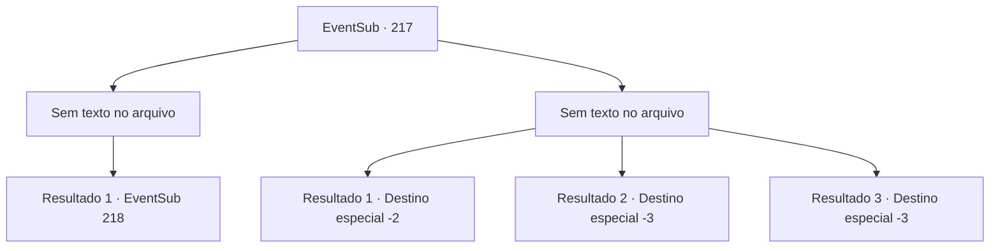

# Eventos secundários · 217

[Índice da tabela](index.md) · [Índice geral](../index.md)

ID: `pt:EventSub:217` · Fonte: `EventSub4` · Versão: 1.2.47.

Mapeamento estático dos arquivos; a disponibilidade e a execução dependem do estado da run.

## Texto do evento

*Sem texto no arquivo.*

## Dados de entrada

```json
{
  "id": 217,
  "grade": 1,
  "subEvent": "",
  "required": ""
}
```

## Mapa das escolhas



## Escolhas e resultados

### Escolha 1

*Sem texto no arquivo; o papel dessa opção depende da interface do jogo.*

Requisitos e outros campos da escolha:

```json
{
  "required": ""
}
```

#### Resultado 1.1

Você despedaça o golem de gelo em pedaços. Os fragmentos de gelo permanecem ao redor e ainda é possível sentir o frio, mas você ignora e entra na ruína. Ao passar pela entrada, você vê um ambiente completamente diferente. É um lugar completamente escuro, sem um único raio de luz, com algumas águas-vivas bioluminescentes servindo como fonte de luz.

Continuação registrada: [Evento 218](0218.md) na mesma tabela.

```json
{
  "required": "",
  "chance": "1",
  "nextEvent": 218,
  "type": 2,
  "reward": ""
}
```

### Escolha 2

*Sem texto no arquivo; o papel dessa opção depende da interface do jogo.*

Requisitos e outros campos da escolha:

```json
{
  "required": ""
}
```

#### Resultado 2.1

Apesar de sua aparência robusta, o golem de gelo nada livremente na água. Isso coloca você, que não está acostumado a se mover debaixo d'água, em uma situação difícil. Você é nocauteado pelo golem de gelo. Depois de algum tempo, você acorda na praia em um lugar que não reconhece. Você grita pelos seres do mar várias vezes, mas não há resposta.

Continuação registrada: [Destino especial `-2`](../destinos-especiais.md).

```json
{
  "required": "1_0_2|1_1_2",
  "chance": "1",
  "nextEvent": -2,
  "type": 2,
  "reward": "12_6_-1|0_0_-1|0_1_-1"
}
```

#### Resultado 2.2

Apesar de sua aparência robusta, o golem de gelo nada livremente na água. Isso coloca você, que não está acostumado a se mover debaixo d'água, em uma situação difícil. Você é nocauteado pelo golem de gelo.

Continuação registrada: [Destino especial `-3`](../destinos-especiais.md).

```json
{
  "required": "2_0_2",
  "chance": "1",
  "nextEvent": -3,
  "type": 2,
  "reward": "0_0_-1|0_1_-1"
}
```

#### Resultado 2.3

Apesar de sua aparência robusta, o golem de gelo nada livremente na água. Isso coloca você, que não está acostumado a se mover debaixo d'água, em uma situação difícil. Você é nocauteado pelo golem de gelo.

Continuação registrada: [Destino especial `-3`](../destinos-especiais.md).

```json
{
  "required": "2_1_2",
  "chance": "1",
  "nextEvent": -3,
  "type": 2,
  "reward": "0_0_-1|0_1_-1"
}
```

## Referências que chegam a este evento

- [Evento 216 · escolha 1 · resultado 1](0216.md#escolha-1)
- [Evento 216 · escolha 2 · resultado 1](0216.md#escolha-2)
