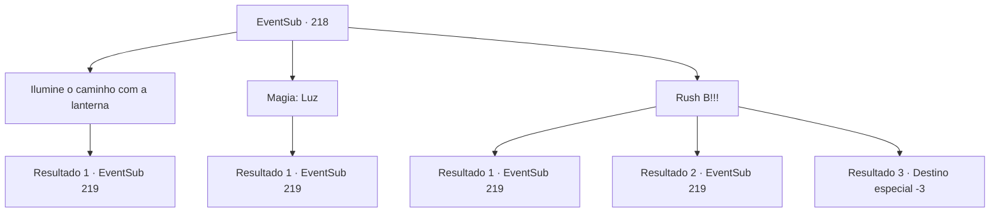

# Eventos secundários · 218

[Índice da tabela](index.md) · [Índice geral](../index.md)

ID: `pt:EventSub:218` · Fonte: `EventSub4` · Versão: 1.2.47.

Mapeamento estático dos arquivos; a disponibilidade e a execução dependem do estado da run.

## Texto do evento

*Sem texto no arquivo.*

## Dados de entrada

```json
{
  "id": 218,
  "grade": 1,
  "subEvent": "",
  "required": ""
}
```

## Mapa das escolhas



## Escolhas e resultados

### Escolha 1

Ilumine o caminho com a lanterna

Requisitos e outros campos da escolha:

```json
{
  "required": "8_210_1"
}
```

#### Resultado 1.1

Você puxa a lâmpada mágica. Emite uma luz sutil, iluminando o caminho. Formações geográficas maciças o cercam, e criaturas aquáticas de aparência estranha fogem depois de ver sua luz. Logo, você percebe que há um rio fluindo sob seus pés. |drawing_seaRiver| O rio parece tão branco quanto a névoa, e está fluindo muito rapidamente, arranhando a superfície. Uma etapa errada e provavelmente o consumirá. Você nada para o rio subaquático. Enquanto você continua a nadar, seguindo o rio, você se depara com uma enorme cavidade, também iluminada por cheiros de água -viva biolumiescent. Lá você vê um santuário em forma de pirâmide e alguns merfolk guardando-o. 

 "O que..?! Como um morador da terra chegou aqui?!"

 Quando o vêem, eles gritam surpreso. 

Continuação registrada: [Evento 219](0219.md) na mesma tabela.

```json
{
  "required": "",
  "chance": "1",
  "nextEvent": 219,
  "type": 2,
  "reward": ""
}
```

### Escolha 2

Magia: Luz

Requisitos e outros campos da escolha:

```json
{
  "required": "20_0_1"
}
```

#### Resultado 2.1

Você cria luz com sua magia. Emite uma luz sutil, iluminando o caminho. Formações geográficas maciças o cercam, e criaturas aquáticas de aparência estranha fogem depois de ver sua luz. Logo, você percebe que há um rio fluindo sob seus pés. |drawing_seaRiver| O rio parece tão branco quanto a névoa, e está fluindo muito rapidamente, arranhando a superfície. Uma etapa errada e provavelmente o consumirá. Você nada para o rio subaquático. Enquanto você continua a nadar, seguindo o rio, você se depara com uma enorme cavidade, também iluminada por batidas de água -peixes bioluminescentes. Lá você vê um santuário em forma de pirâmide e alguns merfolk guardando-o. 

 "O que..?! Como um morador da terra chegou aqui?!"

 Quando o vêem, eles gritam surpreso.

Continuação registrada: [Evento 219](0219.md) na mesma tabela.

```json
{
  "required": "",
  "chance": "1",
  "nextEvent": 219,
  "type": 2,
  "reward": ""
}
```

### Escolha 3

Rush B!!!

Requisitos e outros campos da escolha:

```json
{
  "required": ""
}
```

#### Resultado 3.1

Você nada às cegas pela escuridão. E logo, você é agarrado por algum tipo de força, fluindo rapidamente sob você. Você instintivamente se debate, mas isso só piora as coisas. Depois de se debater, machucando seu corpo, você finalmente escapa da correnteza. Então você chega a um enorme vazio, iluminado por golpes de águas-vivas bioluminescentes. A força que te trouxe até aqui é um rio subaquático, e ele cai para o vazio como uma cachoeira. Lá você vê um santuário em forma de pirâmide e alguns tritões guardando-o. 

 "O que..?! Como um habitante da terra chegou aqui?!"

 Quando eles te veem, eles gritam em espanto.

Continuação registrada: [Evento 219](0219.md) na mesma tabela.

```json
{
  "required": "",
  "chance": "1|0_13_1",
  "nextEvent": 219,
  "type": 0,
  "reward": ""
}
```

#### Resultado 3.2

Você nada às cegas pela escuridão. E logo, você é agarrado por algum tipo de força, fluindo rapidamente sob você. Você instintivamente se debate, mas isso só piora as coisas. Depois de se debater, machucando seu corpo, você finalmente escapa da correnteza. Então você chega a um enorme vazio, iluminado por golpes de águas-vivas bioluminescentes. A força que te trouxe até aqui é um rio subaquático, e ele cai para o vazio como uma cachoeira. Lá você vê um santuário em forma de pirâmide e alguns tritões guardando-o. 

 "O que..?! Como um habitante da terra chegou aqui?!"

 Quando eles te veem, eles gritam em espanto.

Continuação registrada: [Evento 219](0219.md) na mesma tabela.

```json
{
  "required": "1_0_2",
  "chance": "12",
  "nextEvent": 219,
  "type": 1,
  "reward": "0_0_-1"
}
```

#### Resultado 3.3

Você nada às cegas na escuridão. E logo, você é agarrado por algum tipo de força, fluindo rapidamente sob você. Você instintivamente se debate, mas isso só piora. Depois de se debater, machucando seu corpo, você perde a consciência.

Continuação registrada: [Destino especial `-3`](../destinos-especiais.md).

```json
{
  "required": "2_0_2",
  "chance": "12",
  "nextEvent": -3,
  "type": 1,
  "reward": "0_0_-1"
}
```

## Referências que chegam a este evento

- [Evento 217 · escolha 1 · resultado 1](0217.md#escolha-1)
