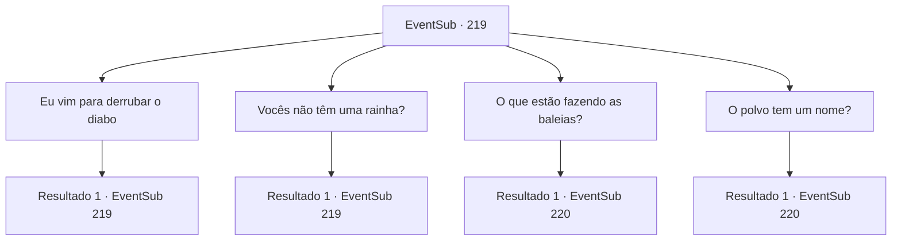

# Eventos secundários · 219

[Índice da tabela](index.md) · [Índice geral](../index.md)

ID: `pt:EventSub:219` · Fonte: `EventSub4` · Versão: 1.2.47.

Mapeamento estático dos arquivos; a disponibilidade e a execução dependem do estado da run.

## Texto do evento

*Sem texto no arquivo.*

## Dados de entrada

```json
{
  "id": 219,
  "grade": 1,
  "subEvent": "",
  "required": ""
}
```

## Mapa das escolhas



## Escolhas e resultados

### Escolha 1

Eu vim para derrubar o diabo

Requisitos e outros campos da escolha:

```json
{
  "required": "5_212_0"
}
```

#### Resultado 1.1

Você conta aos seres do mar o que aconteceu, incluindo seu encontro com a Rainha Madellin. Mas o ser do mar balança a cabeça firmemente, falando. 

 "Hmph. Pare com essa bobagem. Não há demônio aqui, nem rainha. Insulte nosso Grande Kraken 'Entirilano' mais uma vez, não podemos garantir sua vida. Retorne imediatamente para sua casa na terra."


Continuação registrada: [Evento 219](0219.md) na mesma tabela.

```json
{
  "required": "",
  "chance": "1",
  "nextEvent": 219,
  "type": 2,
  "reward": "5_212_1"
}
```

### Escolha 2

Vocês não têm uma rainha?

Requisitos e outros campos da escolha:

```json
{
  "required": "5_212_1"
}
```

#### Resultado 2.1

Provavelmente ele estava entediado, pois está respondendo suas perguntas com muito entusiasmo. 

 "Isso mesmo. A rainha foi deposta. Nós, os seres do mar, prosperaremos sob a orientação do Grande Entirilano e da Sociedade do Kraken. Alguns leais tolos ainda tentam devolver o trono para ela... mas aparentemente a rainha enlouqueceu, vagando por aí... haha.."

 Então, você percebe atrás dele outros seres do mar liderando as baleias em direção à pirâmide.

Continuação registrada: [Evento 219](0219.md) na mesma tabela.

```json
{
  "required": "",
  "chance": "1",
  "nextEvent": 219,
  "type": 2,
  "reward": "5_212_2"
}
```

### Escolha 3

O que estão fazendo as baleias?

Requisitos e outros campos da escolha:

```json
{
  "required": "5_212_2"
}
```

#### Resultado 3.1

Você o questiona, olhando para os tritões e as baleias atrás dele. Ele responde como se fosse algo normal. 

 "Eles são tributos para Entirilano, obviamente. Nós os sacrificamos uma vez a cada quinze dias. Tritões, focas, baleias, tubarões e às vezes coisas da terra.. O QUÊ!?"

 Você percebe que há algo atrás de você, julgando pela expressão do guarda. Quando você se vira, a Rainha Madellin e seus guarda-costas aparecem. 

 "Agora, eu, Rainha Madellin, vou recuperar meu trono e repelir o culto maligno que adora um demônio! AVANÇAR!"

 Ela nada à frente com seus soldados. Uma batalha se desenrola entre os tritões e os adoradores do Kraken.

Continuação registrada: [Evento 220](0220.md) na mesma tabela.

```json
{
  "required": "",
  "chance": "1",
  "nextEvent": 220,
  "type": 2,
  "reward": ""
}
```

### Escolha 4

O polvo tem um nome?

Requisitos e outros campos da escolha:

```json
{
  "required": "5_212_2|2_3_15"
}
```

#### Resultado 4.1

O tritão à sua frente não reage bem ao seu cinismo. Ele aponta seu tridente para o seu rosto, gritando. 

 "Você se atreve...! Eu vou te matar.. O QUÊ!!"

 Você percebe que há algo atrás de você, julgando pela expressão do guarda. Quando você se vira, a Rainha Madellin e seus guarda-costas aparecem. 

 "Agora mesmo, eu, Rainha Madellin, vou recuperar meu trono e repelir o culto maligno que adora um demônio! AVANÇAR!"

 Ela nada à frente com seus soldados. Uma batalha se desenrola, entre os tritões e os adoradores do Kraken.

Continuação registrada: [Evento 220](0220.md) na mesma tabela.

```json
{
  "required": "",
  "chance": "1",
  "nextEvent": 220,
  "type": 2,
  "reward": ""
}
```

## Referências que chegam a este evento

- [Evento 218 · escolha 1 · resultado 1](0218.md#escolha-1)
- [Evento 218 · escolha 2 · resultado 1](0218.md#escolha-2)
- [Evento 218 · escolha 3 · resultado 1](0218.md#escolha-3)
- [Evento 218 · escolha 3 · resultado 2](0218.md#escolha-3)
- [Evento 219 · escolha 1 · resultado 1](0219.md#escolha-1)
- [Evento 219 · escolha 2 · resultado 1](0219.md#escolha-2)
