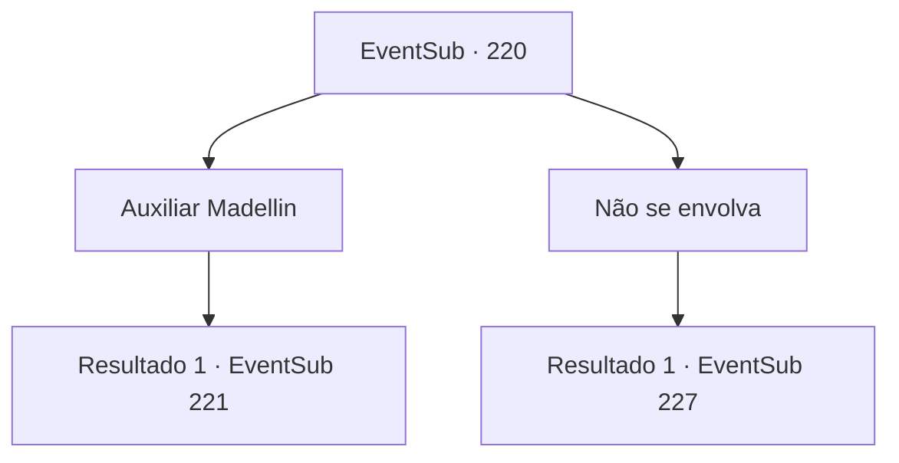

# Eventos secundários · 220

[Índice da tabela](index.md) · [Índice geral](../index.md)

ID: `pt:EventSub:220` · Fonte: `EventSub4` · Versão: 1.2.47.

Mapeamento estático dos arquivos; a disponibilidade e a execução dependem do estado da run.

## Texto do evento

*Sem texto no arquivo.*

## Dados de entrada

```json
{
  "id": 220,
  "grade": 1,
  "subEvent": "",
  "required": ""
}
```

## Mapa das escolhas



## Escolhas e resultados

### Escolha 1

Auxiliar Madellin

Requisitos e outros campos da escolha:

```json
{
  "required": ""
}
```

#### Resultado 1.1

Você decide ajudar Madellin. Os guardas de Madellin estão usando armaduras turquesa, então é fácil distingui-los. A Rainha Sereia abaixa sua pequena cabeça, agradecendo a você. Você faz o mesmo e alcança sua arma.

Continuação registrada: [Evento 221](0221.md) na mesma tabela.

```json
{
  "required": "",
  "chance": "1",
  "nextEvent": 221,
  "type": 2,
  "reward": "6_0_111",
  "place": 3
}
```

### Escolha 2

Não se envolva

Requisitos e outros campos da escolha:

```json
{
  "required": ""
}
```

#### Resultado 2.1

A sua tarefa é derrotar o Kraken, então você decide não se envolver na luta. Você nada diretamente até a pirâmide, chegando à sua frente. A pirâmide é gigantesca, com uma única pedra colocada em sua base mais alta do que você. E há como centenas dessas pedras. Conforme você se aproxima da pirâmide, você sente um olhar repentino, de alguém te encarando. Você olha para cima, de onde acha que o olhar está vindo, e vê uma enorme pupila, olhando para você através de uma pequena abertura na pirâmide.

Continuação registrada: [Evento 227](0227.md) na mesma tabela.

```json
{
  "required": "",
  "chance": "1",
  "nextEvent": 227,
  "type": 2,
  "reward": ""
}
```

## Referências que chegam a este evento

- [Evento 219 · escolha 3 · resultado 1](0219.md#escolha-3)
- [Evento 219 · escolha 4 · resultado 1](0219.md#escolha-4)
