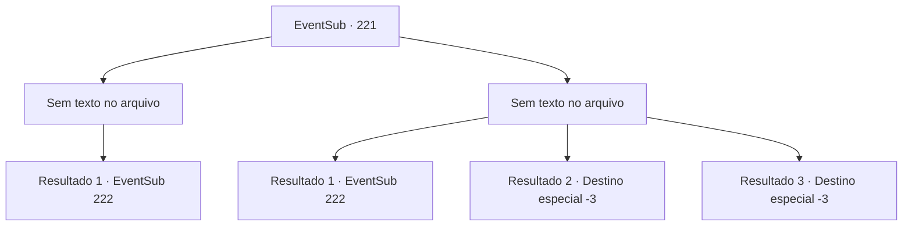

# Eventos secundários · 221

[Índice da tabela](index.md) · [Índice geral](../index.md)

ID: `pt:EventSub:221` · Fonte: `EventSub4` · Versão: 1.2.47.

Mapeamento estático dos arquivos; a disponibilidade e a execução dependem do estado da run.

## Texto do evento

*Sem texto no arquivo.*

## Dados de entrada

```json
{
  "id": 221,
  "grade": 1,
  "subEvent": "",
  "required": ""
}
```

## Mapa das escolhas



## Escolhas e resultados

### Escolha 1

*Sem texto no arquivo; o papel dessa opção depende da interface do jogo.*

Requisitos e outros campos da escolha:

```json
{
  "required": ""
}
```

#### Resultado 1.1

Você derrota o Kraken que adora Merfolk. Os morfolk mortos flutuam ao redor da água, derramando sangue azul e os sobreviventes agora são prisioneiros. Então, um velho Merfolk grita. 

 "Seus tolos..!! Como você está planejando proteger nossas vidas sem a proteção do grande entirilano!"

 Então Madellin se aproxima do antigo merfolk e fala. 

 "Devemos nos proteger, é claro. Você não deveria dizer essas coisas, quando seu tipo tributou nossos parentes como sacrifícios. Você ama tanto o diabo, você pode encontrá -lo no inferno."

 O velho Merfolk olha para baixo, como se toda a esperança fosse perdida. E logo, sua cabeça puxa de volta e começa a falar, com os olhos de cabeça para baixo. 

 "Agora, eu estava me perguntando por que o tributo não estava chegando ..."

 Todo o santuário começa a tremer. A ruptura do fundo se espalha, cobrindo toda a superfície. Então, quando o piso desmorona, o 'diabo' do tamanho colossal aparece. |drawing_kraken| Sua perna relativamente curta sozinha é do tamanho de um edifício e tem mais dois tentáculos mais longos. Madellin nervosamente aperta o aperto em torno de sua arma. Então ela solta uma ruptura. 

 "Todo mundo cobra !!"

 Com seu battlecry como a sugestão, começa uma batalha do enorme Kraken e o Merfolk.

Continuação registrada: [Evento 222](0222.md) na mesma tabela.

```json
{
  "required": "",
  "chance": "1",
  "nextEvent": 222,
  "type": 2,
  "reward": "6_0_112",
  "place": 3
}
```

### Escolha 2

*Sem texto no arquivo; o papel dessa opção depende da interface do jogo.*

Requisitos e outros campos da escolha:

```json
{
  "required": ""
}
```

#### Resultado 2.1

Você faz o seu melhor lutando contra os adoradores de Kraken, mas debaixo d'água, você está em desvantagem. Ferido, você consegue se retirar das linhas de frente. A feroz batalha termina com a vitória de Madellin e seus guardas, e os mortos mortos flutuam ao redor da água, derramando sangue azul. Os guardas capturam os adoradores de Kraken. Madellin olha para a cena se desenrolar com um rosto triste. 

 "A perda é ... muito significativa."

 Depois de se perder em pensamento por um segundo, Madellin recupera sua compostura, preparando seu exército novamente. Então, um velho Merfolk grita. 

 "Seus tolos..!! Como você está planejando proteger nossas vidas sem a proteção do grande entirilano!"

 Então Madellin se aproxima do antigo merfolk e fala. 

 "Devemos nos proteger, é claro. Você não deveria dizer essas coisas, quando seu tipo tributou nossos parentes como sacrifícios. Você ama tanto o diabo, você pode encontrá -lo no inferno."

 O velho Merfolk olha para baixo, como se toda a esperança fosse perdida. E logo, sua cabeça puxa de volta e começa a falar, com os olhos de cabeça para baixo. 

 "Agora, eu estava me perguntando por que o tributo não estava chegando ..."

 Todo o santuário começa a tremer. A ruptura do fundo se espalha, cobrindo toda a superfície. Então, quando o piso desmorona, o 'diabo' do tamanho colossal aparece. |drawing_kraken| Sua perna relativamente curta sozinha é do tamanho de um edifício e tem mais dois tentáculos mais longos. Madellin nervosamente aperta o aperto em torno de sua arma. Então ela solta uma ruptura. 

 "Todo mundo cobra !!"

 Com seu battlecry como a sugestão, começa uma batalha do enorme Kraken e o Merfolk.

Continuação registrada: [Evento 222](0222.md) na mesma tabela.

```json
{
  "required": "1_0_2|1_1_2",
  "chance": "1",
  "nextEvent": 222,
  "type": 2,
  "reward": "0_0_-1|0_1_-1|6_0_112|5_213_1",
  "place": 3
}
```

#### Resultado 2.2

Você faz o seu melhor lutando contra os adoradores do Kraken, mas debaixo d'água, você está destinado a estar em desvantagem. Um arpão perfura seus ossos, voando através da água. Você cede à dor aguda e perde a consciência.

Continuação registrada: [Destino especial `-3`](../destinos-especiais.md).

```json
{
  "required": "2_0_2",
  "chance": "1",
  "nextEvent": -3,
  "type": 2,
  "reward": "0_0_-1|0_1_-1"
}
```

#### Resultado 2.3

Você faz o seu melhor lutando contra os adoradores do Kraken, mas debaixo d'água, você está destinado a estar em desvantagem. Um arpão perfura seus ossos, voando através da água. Você cede à dor aguda e perde a consciência.

Continuação registrada: [Destino especial `-3`](../destinos-especiais.md).

```json
{
  "required": "2_1_2",
  "chance": "1",
  "nextEvent": -3,
  "type": 2,
  "reward": "0_0_-1|0_1_-1"
}
```

## Referências que chegam a este evento

- [Evento 220 · escolha 1 · resultado 1](0220.md#escolha-1)
