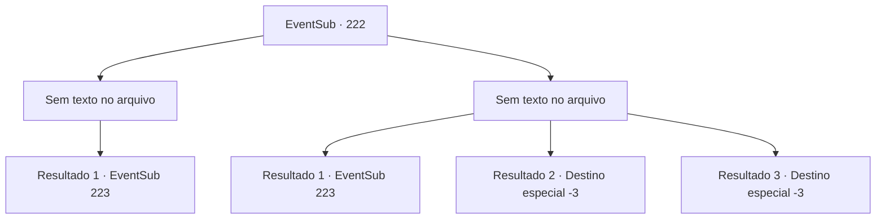

# Eventos secundários · 222

[Índice da tabela](index.md) · [Índice geral](../index.md)

ID: `pt:EventSub:222` · Fonte: `EventSub4` · Versão: 1.2.47.

Mapeamento estático dos arquivos; a disponibilidade e a execução dependem do estado da run.

## Texto do evento

*Sem texto no arquivo.*

## Dados de entrada

```json
{
  "id": 222,
  "grade": 1,
  "subEvent": "",
  "required": ""
}
```

## Mapa das escolhas



## Escolhas e resultados

### Escolha 1

*Sem texto no arquivo; o papel dessa opção depende da interface do jogo.*

Requisitos e outros campos da escolha:

```json
{
  "required": ""
}
```

#### Resultado 1.1

Ao cortar os tentáculos gigantes do Kraken, isso solta um rugido doloroso. Em seguida, excreta uma enorme quantidade de tinta, envolvendo todo o seu corpo. Madellin, respirando pesadamente, olha para você e fala. 

 "*Uff*..*Uf*... parece que está tentando escapar. Mas não podemos deixar isso assim. O diabo voltará a qualquer momento. Ajude -me um pouco mais, aqui."

 Assim que ela termina, a água do mar começa a girar. É uma evidência do Kraken escapando, vomitando água.

Continuação registrada: [Evento 223](0223.md) na mesma tabela.

```json
{
  "required": "",
  "chance": "1",
  "nextEvent": 223,
  "type": 2,
  "reward": ""
}
```

### Escolha 2

*Sem texto no arquivo; o papel dessa opção depende da interface do jogo.*

Requisitos e outros campos da escolha:

```json
{
  "required": ""
}
```

#### Resultado 2.1

Enquanto você está enredado pelo tentáculo, Madellin rapidamente chega em seu ajuda e o corta. O Kraken solta um rugido doloroso. Em seguida, excreta uma enorme quantidade de tinta, envolvendo todo o seu corpo. Madellin, respirando pesadamente, olha para você e fala. 

 "*Uff*..*Uf*... parece que está tentando escapar. Mas não podemos deixar isso assim. O diabo voltará a qualquer momento. Ajude -me um pouco mais, aqui."

 Assim que ela termina, a água do mar começa a girar. É uma evidência do Kraken escapando, vomitando água.

Continuação registrada: [Evento 223](0223.md) na mesma tabela.

```json
{
  "required": "1_0_2|1_1_2",
  "chance": "1",
  "nextEvent": 223,
  "type": 2,
  "reward": "0_0_-1|0_1_-1|5_213_1"
}
```

#### Resultado 2.2

Você está enredado pelo tentáculo gigante. Ele esmaga seu corpo num piscar de olhos, e você desmaia sob a dor quebradora de ossos.

Continuação registrada: [Destino especial `-3`](../destinos-especiais.md).

```json
{
  "required": "2_0_2",
  "chance": "1",
  "nextEvent": -3,
  "type": 2,
  "reward": "0_0_-1|0_1_-1"
}
```

#### Resultado 2.3

Você está enredado pelo tentáculo gigante. Ele esmaga seu corpo num piscar de olhos, e você desmaia sob a dor quebradora de ossos.

Continuação registrada: [Destino especial `-3`](../destinos-especiais.md).

```json
{
  "required": "2_1_2",
  "chance": "1",
  "nextEvent": -3,
  "type": 2,
  "reward": "0_0_-1|0_1_-1"
}
```

## Referências que chegam a este evento

- [Evento 221 · escolha 1 · resultado 1](0221.md#escolha-1)
- [Evento 221 · escolha 2 · resultado 1](0221.md#escolha-2)
