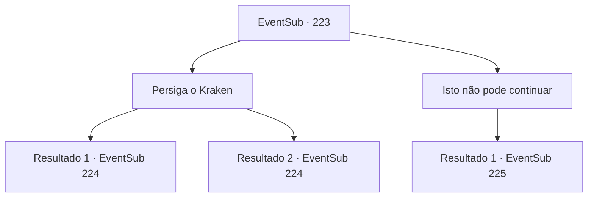

# Eventos secundários · 223

[Índice da tabela](index.md) · [Índice geral](../index.md)

ID: `pt:EventSub:223` · Fonte: `EventSub4` · Versão: 1.2.47.

Mapeamento estático dos arquivos; a disponibilidade e a execução dependem do estado da run.

## Texto do evento

*Sem texto no arquivo.*

## Dados de entrada

```json
{
  "id": 223,
  "grade": 1,
  "subEvent": "",
  "required": ""
}
```

## Mapa das escolhas



## Escolhas e resultados

### Escolha 1

Persiga o Kraken

Requisitos e outros campos da escolha:

```json
{
  "required": ""
}
```

#### Resultado 1.1

Você persegue o Kraken, junto com Madellin e os seres do mar que ainda estão em boa saúde. Ele está se escondendo dentro do santuário, devorando baleias. E assim que ele te avista, ele espalha seus seis tentáculos.

Continuação registrada: [Evento 224](0224.md) na mesma tabela.

```json
{
  "required": "18_213_1",
  "chance": "1",
  "nextEvent": 224,
  "type": 2,
  "reward": "6_2_113",
  "place": 3
}
```

#### Resultado 1.2

Você persegue o Kraken com Madellin. Ele está se escondendo dentro do santuário, devorando baleias. E assim que ele te avista, ele espalha seus seis tentáculos.

Continuação registrada: [Evento 224](0224.md) na mesma tabela.

```json
{
  "required": "5_213_1",
  "chance": "1",
  "nextEvent": 224,
  "type": 2,
  "reward": "6_0_113",
  "place": 3
}
```

### Escolha 2

Isto não pode continuar

Requisitos e outros campos da escolha:

```json
{
  "required": "5_213_1"
}
```

#### Resultado 2.1

Você diz a Madellin para olhar ao redor Ela olha para os tritões feridos e solta um gemido de dor. Então ela assente, tendo chegado a sua conclusão. 

 "Certo... Você está certo."

 Ela guia os feridos para fora da caverna. Você também segue os tritões para onde o golem de gelo estava guardando. Mas então, uma das pernas do Kraken se estende e pega Madellin. 

 "A... Vossa Alteza!!!"

 Os rostos dos tritões ficam pálidos, agarrando Madellin, e a disputa entre o Kraken e eles começa.

Continuação registrada: [Evento 225](0225.md) na mesma tabela.

```json
{
  "required": "",
  "chance": "1",
  "nextEvent": 225,
  "type": 2,
  "reward": ""
}
```

## Referências que chegam a este evento

- [Evento 222 · escolha 1 · resultado 1](0222.md#escolha-1)
- [Evento 222 · escolha 2 · resultado 1](0222.md#escolha-2)
