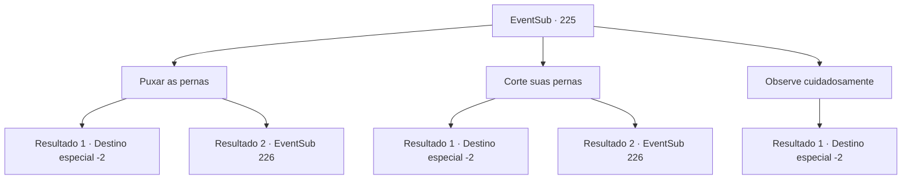

# Eventos secundários · 225

[Índice da tabela](index.md) · [Índice geral](../index.md)

ID: `pt:EventSub:225` · Fonte: `EventSub4` · Versão: 1.2.47.

Mapeamento estático dos arquivos; a disponibilidade e a execução dependem do estado da run.

## Texto do evento

*Sem texto no arquivo.*

## Dados de entrada

```json
{
  "id": 225,
  "grade": 1,
  "subEvent": "",
  "required": ""
}
```

## Mapa das escolhas



## Escolhas e resultados

### Escolha 1

Puxar as pernas

Requisitos e outros campos da escolha:

```json
{
  "required": ""
}
```

#### Resultado 1.1

Você puxa rapidamente a tentáculo do Kraken com toda a sua força. A força do Kraken é incrível, mas sua resistência não é tão boa. Percebendo que o poder do Kraken está enfraquecendo, você consegue arrancar o tentáculo do corpo. Você está puxando tão forte que sente como se o sangue estivesse prestes a sair pela garganta. Perdendo outro tentáculo, o Kraken foge e Madellin consegue escapar. Ela e os outros seres do mar suspiram aliviados. 

 "Ufa... obrigada... não teria conseguido sem você."

 Então ela te entrega o tridente que estava usando. 

 "Este é meu presente pessoal. Um artefato ancestral, passado por gerações. Nunca vou esquecer o que você fez. Obrigada novamente."

 Você segura o tridente de Madellin em suas mãos e os seres do mar te escoltam até a superfície. Todos os seres do mar acenam para você, até que você não seja mais visível.

Continuação registrada: [Destino especial `-2`](../destinos-especiais.md).

```json
{
  "required": "",
  "chance": "1|0_5_1",
  "nextEvent": -2,
  "type": 0,
  "reward": "12_6_-1|14_6_3|3_214_1|0_5_1"
}
```

#### Resultado 1.2

Você puxa a perna do Kraken com todas as suas forças. Mas o Kraken é muito mais forte do que você, e você é levado junto com Madellin. Logo você se depara com o Kraken, agora preso em um passagem estreita. Agora você deve lutar contra ele, para garantir sua sobrevivência.

Continuação registrada: [Evento 226](0226.md) na mesma tabela.

```json
{
  "required": "",
  "chance": "25",
  "nextEvent": 226,
  "type": 1,
  "reward": "6_2_113",
  "place": 3
}
```

### Escolha 2

Corte suas pernas

Requisitos e outros campos da escolha:

```json
{
  "required": ""
}
```

#### Resultado 2.1

Você ataca o tentáculo que segura Madellin. O ataque preciso dá a Madellin espaço para escapar do tentáculo. O tritão rapidamente puxa Madellin para fora e recua apressadamente. Assim que todos estão seguros dos tentáculos, Madellin e os outros tritões suspiram aliviados. 

 "Ufa... obrigado... não teria conseguido sem você."

 Ela então te entrega o tridente que estava usando. 

 "Este é meu presente pessoal. Nunca esquecerei o que você fez."

 Você segura o tridente de Madellin em suas mãos, e os tritões te escoltam até a superfície. Todos os tritões acenam para você, até que você não seja mais visível.

Continuação registrada: [Destino especial `-2`](../destinos-especiais.md).

```json
{
  "required": "",
  "chance": "1|0_6_1",
  "nextEvent": -2,
  "type": 0,
  "reward": "12_6_-1|14_6_3|3_214_1|0_6_1"
}
```

#### Resultado 2.2

Tentas cortar o tentáculo do Kraken. Mas o seu movimento rápido faz com que falhes, e és levado juntamente com Madellin. Em breve, ficas cara a cara com o Kraken, agora preso num corredor estreito. Agora tens de lutar contra ele, para garantir a tua sobrevivência.

Continuação registrada: [Evento 226](0226.md) na mesma tabela.

```json
{
  "required": "",
  "chance": "25",
  "nextEvent": 226,
  "type": 1,
  "reward": "6_2_113",
  "place": 3
}
```

### Escolha 3

Observe cuidadosamente

Requisitos e outros campos da escolha:

```json
{
  "required": ""
}
```

#### Resultado 3.1

Você observa cuidadosamente a cena se desenrolar. Os tritões tentam salvar sua Rainha do Kraken, mas estão muito exaustos para conseguir. O tentáculo agarra Madellin junto com alguns outros tritões e desaparece. Os tritões restantes caem no chão, percebendo que acabaram de perder sua rainha. É claro que não há nada que você possa fazer por eles, então você rapidamente se retira para a superfície, rastreando o caminho de volta. Você observa as ondas por um momento e depois se afasta.

Continuação registrada: [Destino especial `-2`](../destinos-especiais.md).

```json
{
  "required": "",
  "chance": "1",
  "nextEvent": -2,
  "type": 2,
  "reward": "12_6_-1|14_6_4|0_0_-1|0_1_-1"
}
```

## Referências que chegam a este evento

- [Evento 223 · escolha 2 · resultado 1](0223.md#escolha-2)
