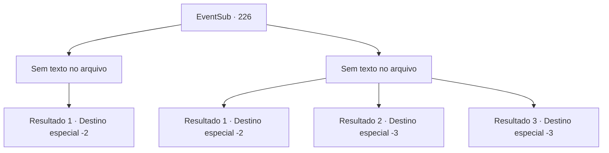

# Eventos secundários · 226

[Índice da tabela](index.md) · [Índice geral](../index.md)

ID: `pt:EventSub:226` · Fonte: `EventSub4` · Versão: 1.2.47.

Mapeamento estático dos arquivos; a disponibilidade e a execução dependem do estado da run.

## Texto do evento

*Sem texto no arquivo.*

## Dados de entrada

```json
{
  "id": 226,
  "grade": 1,
  "subEvent": "",
  "required": ""
}
```

## Mapa das escolhas



## Escolhas e resultados

### Escolha 1

*Sem texto no arquivo; o papel dessa opção depende da interface do jogo.*

Requisitos e outros campos da escolha:

```json
{
  "required": ""
}
```

#### Resultado 1.1

No meio da batalha sangrenta e tenebrosa, você desfere o golpe decisivo no Kraken. A grande besta desmorona, é arrastada pelo rio nebuloso e cai pela cachoeira. Livre do domínio do Kraken, Madellin agradece a você. 

 "Ufa... obrigada... não teria conseguido sem você."

 Ela então lhe entrega o tridente que estava usando. 

 "Este é meu presente pessoal. Nunca esquecerei o que você fez."

 Você segura o tridente de Madellin em suas mãos, e os seres do mar o escoltam até a superfície. Todos os seres do mar acenam para você, até que você não seja mais visível.

Continuação registrada: [Destino especial `-2`](../destinos-especiais.md).

```json
{
  "required": "",
  "chance": "1",
  "nextEvent": -2,
  "type": 2,
  "reward": "12_6_-1|14_6_2|3_214_1"
}
```

### Escolha 2

*Sem texto no arquivo; o papel dessa opção depende da interface do jogo.*

Requisitos e outros campos da escolha:

```json
{
  "required": ""
}
```

#### Resultado 2.1

Você luta contra o kraken, mas é impossível derrotar a grande besta. O Kraken envolve você com seus tentáculos, jogando você inconsciente em uma parede próxima. 

 Depois de algum tempo se passou, você acorda em terra. Você descobre uma carta colocada na sua cabeça.
Agradecemos você por lutar ao nosso lado. Mas parece que estávamos errados em arrastá -lo para esse tipo de conflito. Lamentamos. Aparentemente, um dos Merfolk o trouxe de volta à superfície. Você olha para as ondas por um tempo antes de se afastar.

Continuação registrada: [Destino especial `-2`](../destinos-especiais.md).

```json
{
  "required": "1_0_2|1_1_2|18_213_1",
  "chance": "1",
  "nextEvent": -2,
  "type": 2,
  "reward": "12_6_-1|14_6_4|0_0_-1|0_1_-1"
}
```

#### Resultado 2.2

Você luta contra o Kraken, mas é impossível derrotar a grande besta. O Kraken te envolve com seus tentáculos, te jogando inconsciente contra uma parede próxima.

Continuação registrada: [Destino especial `-3`](../destinos-especiais.md).

```json
{
  "required": "2_0_2",
  "chance": "1",
  "nextEvent": -3,
  "type": 2,
  "reward": "0_0_-1|0_1_-1"
}
```

#### Resultado 2.3

Você luta contra o Kraken, mas é impossível derrotar a grande besta. O Kraken te envolve com seus tentáculos, te jogando inconsciente contra uma parede próxima.

Continuação registrada: [Destino especial `-3`](../destinos-especiais.md).

```json
{
  "required": "2_1_2",
  "chance": "1",
  "nextEvent": -3,
  "type": 2,
  "reward": "0_0_-1|0_1_-1"
}
```

## Referências que chegam a este evento

- [Evento 225 · escolha 1 · resultado 2](0225.md#escolha-1)
- [Evento 225 · escolha 2 · resultado 2](0225.md#escolha-2)
