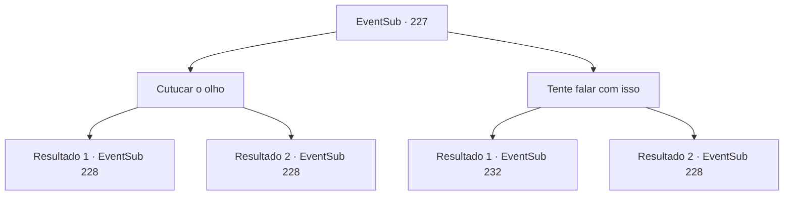

# Eventos secundários · 227

[Índice da tabela](index.md) · [Índice geral](../index.md)

ID: `pt:EventSub:227` · Fonte: `EventSub4` · Versão: 1.2.47.

Mapeamento estático dos arquivos; a disponibilidade e a execução dependem do estado da run.

## Texto do evento

*Sem texto no arquivo.*

## Dados de entrada

```json
{
  "id": 227,
  "grade": 1,
  "subEvent": "",
  "required": ""
}
```

## Mapa das escolhas



## Escolhas e resultados

### Escolha 1

Cutucar o olho

Requisitos e outros campos da escolha:

```json
{
  "required": ""
}
```

#### Resultado 1.1

Você nada em direção ao globo ocular. Você então esfaqueou com toda a sua força com sua arma. <color=red><link=shake>

 "CAAAAARRGGHHH!!"

</link></color> Deixou escapar um rugido doloroso, voltar para trás e o sangue azul vomita como tinta. Então todo o santuário começa a tremer. A ruptura do fundo se espalha, cobrindo toda a superfície. Então, quando o piso desmorona, o 'diabo' do tamanho colossal aparece. |drawing_kraken| Sua perna relativamente curta sozinha é do tamanho de um edifício e tem mais dois tentáculos mais longos. <link=shake>

 "EU VOU TE MATAR!!"

</link> O Kraken olha para você com o outro olho, e você pode sentir sua raiva perfurando através da pele, como lâminas de ódio.

Continuação registrada: [Evento 228](0228.md) na mesma tabela.

```json
{
  "required": "",
  "chance": "1|0_14_1",
  "nextEvent": 228,
  "type": 0,
  "reward": "6_0_112",
  "place": 3
}
```

#### Resultado 1.2

Você nada em direção ao globo ocular. Você então esfaqueou com toda a sua força com sua arma. <color=red><link=shake>

 "CAAAAARRGGHHH!!"

</link></color> Deixou escapar um rugido doloroso, voltar para trás e o sangue azul vomita como tinta. Então todo o santuário começa a tremer. A ruptura do fundo se espalha, cobrindo toda a superfície. Então, quando o piso desmorona, o 'diabo' do tamanho colossal aparece. |drawing_kraken| Sua perna relativamente curta sozinha é do tamanho de um edifício e tem mais dois tentáculos mais longos. <link=shake>

 "EU VOU TE MATAR!!"

</link> O Kraken olha para você com o outro olho, e você pode sentir sua raiva perfurando através da pele, como lâminas de ódio. Você começa a tremer do puro medo.

Continuação registrada: [Evento 228](0228.md) na mesma tabela.

```json
{
  "required": "",
  "chance": "18",
  "nextEvent": 228,
  "type": 1,
  "reward": "6_3_112",
  "place": 3
}
```

### Escolha 2

Tente falar com isso

Requisitos e outros campos da escolha:

```json
{
  "required": ""
}
```

#### Resultado 2.1

Tentas falar com o globo ocular. O enorme globo ocular pisca uma vez. Em seguida, olha fixamente para ti. Sentes o seu olhar penetrar a tua carne e osso. 

 "Um humano. Definitivamente não é comum... deixe-me fazer-te uma proposta, humano."

 Depois de uma breve pausa, o globo ocular continua. 

 "Elimina todos os tritões que me desafiam. Promete isso, e eu te concederei poder."


Continuação registrada: [Evento 232](0232.md) na mesma tabela.

```json
{
  "required": "2_3_-14",
  "chance": "1",
  "nextEvent": 232,
  "type": 2,
  "reward": "0_2_1"
}
```

#### Resultado 2.2

Você tenta conversar com o globo ocular. O enorme globo ocular pisca uma vez. Então olha para você. Você sente que seu olhar perfurando sua carne e osso. 

 "Um humano."

 Depois de parar brevemente, o globo ocular continua. 

 "Você é chato. Você não merece ser meu campeão."

 Então todo o santuário começa a tremer. A ruptura do fundo se espalha, cobrindo toda a superfície. Então, quando o piso desmorona, o 'diabo' do tamanho colossal aparece. |drawing_kraken|

Continuação registrada: [Evento 228](0228.md) na mesma tabela.

```json
{
  "required": "1_3_-14",
  "chance": "1",
  "nextEvent": 228,
  "type": 2,
  "reward": "6_0_112",
  "place": 3
}
```

## Referências que chegam a este evento

- [Evento 220 · escolha 2 · resultado 1](0220.md#escolha-2)
