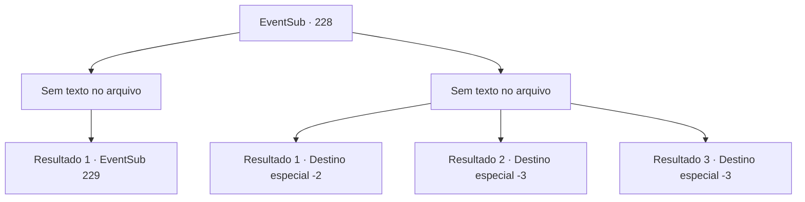

# Eventos secundários · 228

[Índice da tabela](index.md) · [Índice geral](../index.md)

ID: `pt:EventSub:228` · Fonte: `EventSub4` · Versão: 1.2.47.

Mapeamento estático dos arquivos; a disponibilidade e a execução dependem do estado da run.

## Texto do evento

*Sem texto no arquivo.*

## Dados de entrada

```json
{
  "id": 228,
  "grade": 1,
  "subEvent": "",
  "required": ""
}
```

## Mapa das escolhas



## Escolhas e resultados

### Escolha 1

*Sem texto no arquivo; o papel dessa opção depende da interface do jogo.*

Requisitos e outros campos da escolha:

```json
{
  "required": ""
}
```

#### Resultado 1.1

Você corta os dois tentáculos do corpo. O Kraken se contorce de dor e seu olho fica vermelho. Ele começa a expelir uma quantidade considerável de tinta preta, envolvendo todo o seu corpo. A tinta afeta a batalha dos seres do mar. Mas a batalha não havia terminado. Os adoradores do Kraken parecem não ser afetados pela tinta e se movem livremente. A batalha estava cada vez mais se afastando a favor de Madellin.

Continuação registrada: [Evento 229](0229.md) na mesma tabela.

```json
{
  "required": "",
  "chance": "1",
  "nextEvent": 229,
  "type": 2,
  "reward": ""
}
```

### Escolha 2

*Sem texto no arquivo; o papel dessa opção depende da interface do jogo.*

Requisitos e outros campos da escolha:

```json
{
  "required": ""
}
```

#### Resultado 2.1

Você luta contra o tentáculo gigante, mas nem chega perto. O Kraken te chicoteia com seus tentáculos e você perde a consciência pela dor que faz os ossos se quebrarem. Quando você acorda, está fugindo com uma sereia em armadura turquesa. 

 "Você está acordado."

 Quando você olha ao redor, Madellin e algumas outras sereias estão nadando ao seu lado. Elas estão carregando os feridos, mas parecem tão feridas quanto aqueles em suas costas. Somente depois de correr por muito tempo, Madellin e as sereias conseguem recuperar o fôlego. 

 "Hu...!"

 Madellin morde os lábios tão forte que sangra. Sem nem mesmo olhar para você, ela ordena que as outras sereias te levem de volta à superfície. Uma sereia de rosto sombrio te acompanha até a terra. Depois de te colocar na praia, a sereia vai embora com um pequeno agradecimento.

Continuação registrada: [Destino especial `-2`](../destinos-especiais.md).

```json
{
  "required": "1_0_2|1_1_2",
  "chance": "1",
  "nextEvent": -2,
  "type": 2,
  "reward": "12_6_-1|0_0_-1|0_1_-1|14_6_9"
}
```

#### Resultado 2.2

Você luta contra o tentáculo gigante, mas não está nem perto. O Kraken te chicoteia com seus tentáculos e você perde a consciência pela dor que faz seus ossos se despedaçarem.

Continuação registrada: [Destino especial `-3`](../destinos-especiais.md).

```json
{
  "required": "2_0_2",
  "chance": "1",
  "nextEvent": -3,
  "type": 2,
  "reward": "0_0_-1|0_1_-1"
}
```

#### Resultado 2.3

Você luta contra o tentáculo gigante, mas não chega nem perto. O Kraken te chicoteia com seus tentáculos e você perde a consciência pela dor que faz seus ossos se despedaçarem.

Continuação registrada: [Destino especial `-3`](../destinos-especiais.md).

```json
{
  "required": "2_1_2",
  "chance": "1",
  "nextEvent": -3,
  "type": 2,
  "reward": "0_0_-1|0_1_-1"
}
```

## Referências que chegam a este evento

- [Evento 227 · escolha 1 · resultado 1](0227.md#escolha-1)
- [Evento 227 · escolha 1 · resultado 2](0227.md#escolha-1)
- [Evento 227 · escolha 2 · resultado 2](0227.md#escolha-2)
- [Evento 232 · escolha 2 · resultado 1](0232.md#escolha-2)
- [Evento 232 · escolha 2 · resultado 2](0232.md#escolha-2)
- [Evento 232 · escolha 3 · resultado 3](0232.md#escolha-3)
