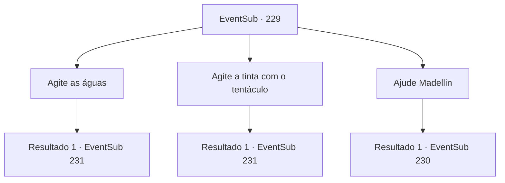

# Eventos secundários · 229

[Índice da tabela](index.md) · [Índice geral](../index.md)

ID: `pt:EventSub:229` · Fonte: `EventSub4` · Versão: 1.2.47.

Mapeamento estático dos arquivos; a disponibilidade e a execução dependem do estado da run.

## Texto do evento

*Sem texto no arquivo.*

## Dados de entrada

```json
{
  "id": 229,
  "grade": 1,
  "subEvent": "",
  "required": ""
}
```

## Mapa das escolhas



## Escolhas e resultados

### Escolha 1

Agite as águas

Requisitos e outros campos da escolha:

```json
{
  "required": "20_0_3|1_1_2"
}
```

#### Resultado 1.1

Você concentra sua magia na água do mar. É para ser um feitiço simples, criando movimento, mas com tamanho e peso maiores surgiram custos maiores. Empurrando sua vontade para o limite, você consegue girar a água do mar, removendo a tinta. com o nariz já sangrando com força. 

 Logo, Madellin derrota os fiéis Kraken restantes. Ela mostra brevemente a tristeza em seu rosto, mas logo se torna vigilante, gritando com o Kraken, seu tridente apontou para o Kraken. 

 "Não seremos controlados por um diabo como você! Hoje, vamos tirar sua vida e recuperar nossa liberdade!"

 Assim que ela termina a cobrança de merfolk no Kraken, E o Kraken responde deixando escapar um rugido monstruoso e sacudindo seus tentáculos.

Continuação registrada: [Evento 231](0231.md) na mesma tabela.

```json
{
  "required": "",
  "chance": "1",
  "nextEvent": 231,
  "type": 2,
  "reward": "0_1_-1|6_2_113",
  "place": 3
}
```

### Escolha 2

Agite a tinta com o tentáculo

Requisitos e outros campos da escolha:

```json
{
  "required": "1_5_25"
}
```

#### Resultado 2.1

Você pega o Kraken's Tentalce, que se separou com sua força monstruosa. Você consegue girar a água do mar com isso, limpando a tinta da água. Isso levanta o moral de Madellin e seus soldados, quando eles começam a vencer os adoradores de Kraken, um por um, deixando escapar batalhas. 

 Logo, Madellin derrota os fiéis Kraken restantes. Ela mostra brevemente a tristeza em seu rosto, mas logo se torna vigilante, gritando com o Kraken, seu tridente apontou para o Kraken. 

 "Não seremos controlados por um diabo como você! Hoje, vamos tirar sua vida e recuperar nossa liberdade!"

 Assim que ela termina a cobrança de merfolk no Kraken, E o Kraken responde deixando escapar um rugido monstruoso e sacudindo seus tentáculos.

Continuação registrada: [Evento 231](0231.md) na mesma tabela.

```json
{
  "required": "",
  "chance": "1",
  "nextEvent": 231,
  "type": 2,
  "reward": "6_2_113",
  "place": 3
}
```

### Escolha 3

Ajude Madellin

Requisitos e outros campos da escolha:

```json
{
  "required": ""
}
```

#### Resultado 3.1

Você segue cegamente para o campo de batalha, com ajudar Madellin sendo a primeira coisa que veio à sua mente. No meio da tinta preta, você encontra um tritão cujos olhos se tornaram vazios. Ele ataca sua arma em você, soltando um grito horrível.

Continuação registrada: [Evento 230](0230.md) na mesma tabela.

```json
{
  "required": "",
  "chance": "1",
  "nextEvent": 230,
  "type": 2,
  "reward": "6_3_111",
  "place": 3
}
```

## Referências que chegam a este evento

- [Evento 228 · escolha 1 · resultado 1](0228.md#escolha-1)
