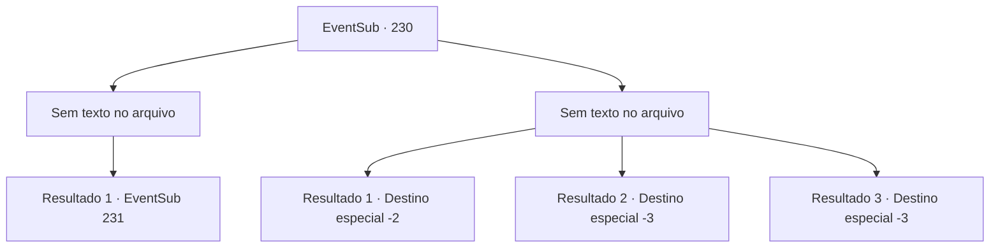

# Eventos secundários · 230

[Índice da tabela](index.md) · [Índice geral](../index.md)

ID: `pt:EventSub:230` · Fonte: `EventSub4` · Versão: 1.2.47.

Mapeamento estático dos arquivos; a disponibilidade e a execução dependem do estado da run.

## Texto do evento

*Sem texto no arquivo.*

## Dados de entrada

```json
{
  "id": 230,
  "grade": 1,
  "subEvent": "",
  "required": ""
}
```

## Mapa das escolhas



## Escolhas e resultados

### Escolha 1

*Sem texto no arquivo; o papel dessa opção depende da interface do jogo.*

Requisitos e outros campos da escolha:

```json
{
  "required": ""
}
```

#### Resultado 1.1

Você cuida dos tritões bloqueando seu caminho. E à medida que a tinta se dissipa, corpos de guarda-costas mortos e o Kraken encarando seus adoradores podem ser vistos. Madellin olha ao redor triste, possivelmente pela perda que seus exércitos sofreram. Mas logo ela se torna vigilante, gritando para o Kraken, seu tridente apontado para o Kraken. 

 "Não seremos controlados por um demônio como você! Hoje, tiraremos sua vida e recuperaremos nossa liberdade!"

 Assim que ela termina, os tritões avançam contra o Kraken, e o Kraken responde soltando um rugido monstruoso e sacudindo seus tentáculos.

Continuação registrada: [Evento 231](0231.md) na mesma tabela.

```json
{
  "required": "",
  "chance": "1",
  "nextEvent": 231,
  "type": 2,
  "reward": "6_2_113",
  "place": 3
}
```

### Escolha 2

*Sem texto no arquivo; o papel dessa opção depende da interface do jogo.*

Requisitos e outros campos da escolha:

```json
{
  "required": ""
}
```

#### Resultado 2.1

Você imediatamente se arrepende de pular na tinta, descobrindo que seu corpo foi perfurado por um tridente. Quando você acorda, está fugindo com uma sereia de armadura turquesa. 

 "Você está acordado."

 Quando você olha ao redor, Madellin e algumas outras sereias estão nadando ao seu lado. Elas estão carregando os feridos, mas parecem tão feridas quanto aqueles em suas costas. Somente depois de correr por muito tempo, Madellin e as sereias conseguem recuperar o fôlego. 

 "Maldição...!"

 Madellin morde os lábios tão forte que sangra. Sem nem mesmo olhar para você, ela ordena que outras sereias te levem de volta à superfície. Uma sereia de rosto sombrio te acompanha até a terra. Depois de te colocar na praia, a sereia vai embora com um pequeno agradecimento.

Continuação registrada: [Destino especial `-2`](../destinos-especiais.md).

```json
{
  "required": "1_0_2|1_1_2",
  "chance": "1",
  "nextEvent": -2,
  "type": 2,
  "reward": "12_6_-1|0_0_-1|0_1_-1|14_6_9"
}
```

#### Resultado 2.2

Você imediatamente se arrepende de pular na tinta, descobrindo que seu corpo foi perfurado por um tridente. Mas é tarde demais, e seu corpo está enterrado sob o oceano.

Continuação registrada: [Destino especial `-3`](../destinos-especiais.md).

```json
{
  "required": "2_0_2",
  "chance": "1",
  "nextEvent": -3,
  "type": 2,
  "reward": "0_0_-1|0_1_-1"
}
```

#### Resultado 2.3

Você imediatamente se arrepende de pular na tinta, descobrindo que seu corpo foi perfurado por um tridente. Mas é tarde demais, e seu corpo está enterrado sob o oceano.

Continuação registrada: [Destino especial `-3`](../destinos-especiais.md).

```json
{
  "required": "2_1_2",
  "chance": "1",
  "nextEvent": -3,
  "type": 2,
  "reward": "0_0_-1|0_1_-1"
}
```

## Referências que chegam a este evento

- [Evento 229 · escolha 3 · resultado 1](0229.md#escolha-3)
