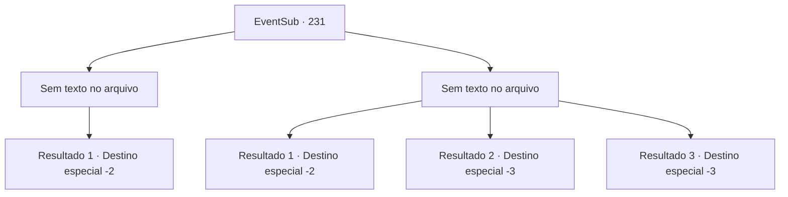

# Eventos secundários · 231

[Índice da tabela](index.md) · [Índice geral](../index.md)

ID: `pt:EventSub:231` · Fonte: `EventSub4` · Versão: 1.2.47.

Mapeamento estático dos arquivos; a disponibilidade e a execução dependem do estado da run.

## Texto do evento

*Sem texto no arquivo.*

## Dados de entrada

```json
{
  "id": 231,
  "grade": 1,
  "subEvent": "",
  "required": ""
}
```

## Mapa das escolhas



## Escolhas e resultados

### Escolha 1

*Sem texto no arquivo; o papel dessa opção depende da interface do jogo.*

Requisitos e outros campos da escolha:

```json
{
  "required": ""
}
```

#### Resultado 1.1

No meio da batalha sangrenta e tenebrosa, você desfere o golpe decisivo no Kraken. A grande besta cospe sangue azul e desmorona. Madellin usa seu tridente como uma bengala e murmura para si mesma, ainda sem acreditar em sua vitória. 

 "Ha..hah.... nós... vencemos..! Bom trabalho, pessoal. Vamos mover os feridos."

 Você escolta os feridos com outros tritões capazes, e retorna ao lugar que o golem de gelo estava protegendo, através das formações geográficas. Então ela te entrega o tridente que estava usando, falando. 

 "Muito obrigada. Não teríamos sido capazes de derrotar o demônio se não fosse por você. Este é meu presente pessoal. Um artefato ancestral, passado por gerações. Nunca vou esquecer o que você fez. Obrigada novamente."

 Você segura o tridente de Madellin em suas mãos, e os tritões te escoltam até a superfície. Todos os tritões acenam para você, até que você não seja mais visível.

Continuação registrada: [Destino especial `-2`](../destinos-especiais.md).

```json
{
  "required": "",
  "chance": "1",
  "nextEvent": -2,
  "type": 2,
  "reward": "12_6_-1|14_6_2|3_214_1"
}
```

### Escolha 2

*Sem texto no arquivo; o papel dessa opção depende da interface do jogo.*

Requisitos e outros campos da escolha:

```json
{
  "required": ""
}
```

#### Resultado 2.1

A resistência do Kraken é considerável. Você é atingido por seu tentáculo gigante, quase perdendo a consciência. Madellin e os outros seres do mar estão exaustos. O Kraken destrói as paredes com seus tentáculos. À medida que o vazio e o santuário desmoronam, a poeira cinza se eleva. Depois que a poeira assenta, o Kraken não está mais à vista. 

 "Ha..hah....Bom trabalho, pessoal. Vamos mover os feridos."

 Você escolta os feridos com outros seres do mar capazes, e você retorna ao lugar onde o golem de gelo estava protegendo, através das formações geográficas. Então ela lhe entrega o tridente que estava usando. 

 "Muito obrigado. Não teríamos sido capazes de repelir o demônio se não fosse por você. Este é meu presente pessoal. Um artefato ancestral, transmitido por gerações. Nunca esquecerei o que você fez. Obrigado novamente."

 Você segura o tridente de Madellin em suas mãos, e os seres do mar o escoltam até a superfície. Todos os seres do mar acenam para você, até que você não seja mais visível.

Continuação registrada: [Destino especial `-2`](../destinos-especiais.md).

```json
{
  "required": "1_0_2|1_1_2",
  "chance": "1",
  "nextEvent": -2,
  "type": 2,
  "reward": "12_6_-1|14_6_3|3_214_1|0_0_-1|0_1_-1"
}
```

#### Resultado 2.2

A resistência do Kraken é considerável. Você é atingido por seu tentáculo gigante, sendo arremessado contra uma parede próxima. Isso leva sua consciência para o abismo.

Continuação registrada: [Destino especial `-3`](../destinos-especiais.md).

```json
{
  "required": "2_0_2",
  "chance": "1",
  "nextEvent": -3,
  "type": 2,
  "reward": "0_0_-1|0_1_-1"
}
```

#### Resultado 2.3

A resistência do Kraken é considerável. Você é atingido por seu tentáculo gigante, sendo arremessado contra uma parede próxima. Isso leva sua consciência para o abismo.

Continuação registrada: [Destino especial `-3`](../destinos-especiais.md).

```json
{
  "required": "2_1_2",
  "chance": "1",
  "nextEvent": -3,
  "type": 2,
  "reward": "0_0_-1|0_1_-1"
}
```

## Referências que chegam a este evento

- [Evento 229 · escolha 1 · resultado 1](0229.md#escolha-1)
- [Evento 229 · escolha 2 · resultado 1](0229.md#escolha-2)
- [Evento 230 · escolha 1 · resultado 1](0230.md#escolha-1)
