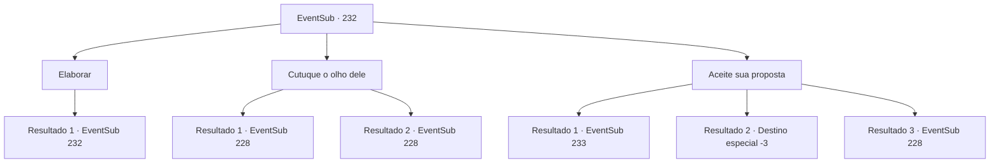

# Eventos secundários · 232

[Índice da tabela](index.md) · [Índice geral](../index.md)

ID: `pt:EventSub:232` · Fonte: `EventSub4` · Versão: 1.2.47.

Mapeamento estático dos arquivos; a disponibilidade e a execução dependem do estado da run.

## Texto do evento

*Sem texto no arquivo.*

## Dados de entrada

```json
{
  "id": 232,
  "grade": 1,
  "subEvent": "",
  "required": ""
}
```

## Mapa das escolhas



## Escolhas e resultados

### Escolha 1

Elaborar

Requisitos e outros campos da escolha:

```json
{
  "required": "5_220_0"
}
```

#### Resultado 1.1

Você encara o olho gigante, exigindo uma descrição mais detalhada. O dono do olho ri com uma voz baixa. 

 "Ahaha... você é interessante... Eu desejo alcançar a divindade. A cidade dos tritões é apenas o primeiro passo. Se você jurar ser meu campeão, eu lhe concederei uma parte do meu poder. Mas eu tenho que te avisar, o processo pode ser um pouco doloroso."


Continuação registrada: [Evento 232](0232.md) na mesma tabela.

```json
{
  "required": "",
  "chance": "1",
  "nextEvent": 232,
  "type": 2,
  "reward": "5_220_1"
}
```

### Escolha 2

Cutuque o olho dele

Requisitos e outros campos da escolha:

```json
{
  "required": "5_220_1"
}
```

#### Resultado 2.1

Você nada em direção ao globo ocular. Você então esfaqueou com toda a sua força com sua arma. <color=red><link=shake>

 "CAAAAARRGGHHH!!"

</link></color> Deixou escapar um rugido doloroso, voltar para trás e o sangue azul vomita como tinta. Então todo o santuário começa a tremer. A ruptura do fundo se espalha, cobrindo toda a superfície. Então, quando o piso desmorona, o 'diabo' do tamanho colossal aparece. |drawing_kraken| Sua perna relativamente curta sozinha é do tamanho de um edifício e tem mais dois tentáculos mais longos. <link=shake>

 "EU VOU TE MATAR!!"

</link> O Kraken olha para você com o outro olho, e você pode sentir sua raiva perfurando através da pele, como lâminas de ódio.

Continuação registrada: [Evento 228](0228.md) na mesma tabela.

```json
{
  "required": "",
  "chance": "1|0_14_1",
  "nextEvent": 228,
  "type": 0,
  "reward": "6_0_112",
  "place": 3
}
```

#### Resultado 2.2

Você nada em direção ao globo ocular. Você então esfaqueou com toda a sua força com sua arma. <color=red><link=shake>

 "CAAAAARRGGHHH!!"

</link></color> Deixou escapar um rugido doloroso, voltar para trás e o sangue azul vomita como tinta. Então todo o santuário começa a tremer. A ruptura do fundo se espalha, cobrindo toda a superfície. Então, quando o piso desmorona, o 'diabo' do tamanho colossal aparece. |drawing_kraken| Sua perna relativamente curta sozinha é do tamanho de um edifício e tem mais dois tentáculos mais longos. <link=shake>

 "EU VOU TE MATAR!!"

</link> O Kraken olha para você com o outro olho, e você pode sentir sua raiva perfurando através da pele, como lâminas de ódio. Você começa a tremer do puro medo.

Continuação registrada: [Evento 228](0228.md) na mesma tabela.

```json
{
  "required": "",
  "chance": "18",
  "nextEvent": 228,
  "type": 1,
  "reward": "6_3_112",
  "place": 3
}
```

### Escolha 3

Aceite sua proposta

Requisitos e outros campos da escolha:

```json
{
  "required": "5_220_1"
}
```

#### Resultado 3.1

Você decide aceitar a oferta do Diabo do Mar. O olho gigante desaparece na escuridão e um enorme tentáculo o substitui. Ao tocar sua cabeça, o tentáculo causa uma dor aguda, como se um prego estivesse sendo martelado em sua cabeça. E logo você sente seus sentidos se separando da realidade. Você sacode seu corpo, como se tivesse sido eletrocutado, e logo começa a atacar Madellin e seus guardas. Seu ataque os pega de surpresa, mas logo eles resistem com muita força.

Continuação registrada: [Evento 233](0233.md) na mesma tabela.

```json
{
  "required": "24_7_1|1_1_2",
  "chance": "1",
  "nextEvent": 233,
  "type": 2,
  "reward": "0_3_-10|0_5_3|0_6_3|0_13_-2|0_14_-2|0_1_-1|6_0_114|5_222_1",
  "place": 3
}
```

#### Resultado 3.2

Você decide aceitar a oferta do Diabo do Mar. O olho gigante desaparece na escuridão e um enorme tentáculo o substitui. Ao tocar sua cabeça, o tentáculo causa uma dor aguda, como se um prego estivesse sendo martelado em sua cabeça. Você sacode seu corpo como se estivesse sendo eletrocutado e logo desmaia.

Continuação registrada: [Destino especial `-3`](../destinos-especiais.md).

```json
{
  "required": "24_7_1|2_1_2",
  "chance": "1",
  "nextEvent": -3,
  "type": 2,
  "reward": "0_1_-1"
}
```

#### Resultado 3.3

Você decide aceitar a oferta do diabo do mar. O globo ocular gigante desaparece no escuro, e um enorme tentáculo o substitui. O tentáculo toca sua cabeça. Mas nada acontece, e o Kraken agora está chateado. <link=shake> 

 "seu insignificante humano ...! Você se atreve a fazer uma brincadeira em mim !!?"

 </link> Sua resistência provavelmente prejudicou o que o Kraken tentou fazer. O tentáculo se retira dentro do buraco. Então todo o santuário começa a tremer. A ruptura do fundo se espalha, cobrindo toda a superfície. Então, quando o piso desmorona, o 'diabo' do tamanho colossal aparece. |drawing_kraken| Sua perna relativamente curta sozinha é do tamanho de um edifício e tem mais dois tentáculos mais longos. <link=shake> 

 "eu vou te matar !!"

 </link>

Continuação registrada: [Evento 228](0228.md) na mesma tabela.

```json
{
  "required": "23_7_1",
  "chance": "1",
  "nextEvent": 228,
  "type": 2,
  "reward": "6_0_112",
  "place": 3
}
```

## Referências que chegam a este evento

- [Evento 227 · escolha 2 · resultado 1](0227.md#escolha-2)
- [Evento 232 · escolha 1 · resultado 1](0232.md#escolha-1)
