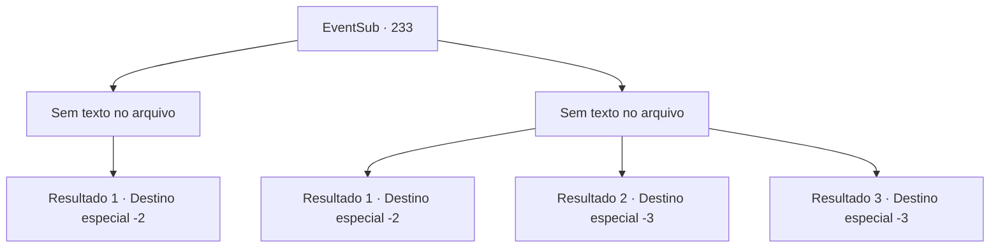

# Eventos secundários · 233

[Índice da tabela](index.md) · [Índice geral](../index.md)

ID: `pt:EventSub:233` · Fonte: `EventSub4` · Versão: 1.2.47.

Mapeamento estático dos arquivos; a disponibilidade e a execução dependem do estado da run.

## Texto do evento

*Sem texto no arquivo.*

## Dados de entrada

```json
{
  "id": 233,
  "grade": 1,
  "subEvent": "",
  "required": ""
}
```

## Mapa das escolhas



## Escolhas e resultados

### Escolha 1

*Sem texto no arquivo; o papel dessa opção depende da interface do jogo.*

Requisitos e outros campos da escolha:

```json
{
  "required": ""
}
```

#### Resultado 1.1

Você mata todos os guarda-costas de Madellin. Os adoradores do Kraken também fortalecem seus ataques. Infelizmente, agora exausta, Madellin é capturada e arrastada pelos tentáculos do Kraken. Os soldados restantes caem no chão, recusando-se a acreditar que acabaram de perder sua rainha. O 'Diabo' dentro do santuário solta uma risada satisfatória e fala. 

 "Vocês tolos, sirvam ao seu verdadeiro dono!"

 Com isso, você perde a consciência. Você acorda na praia. Ainda se sente sonolento, como se tivesse acabado de acordar de um sonho, enquanto você se afasta.

Continuação registrada: [Destino especial `-2`](../destinos-especiais.md).

```json
{
  "required": "",
  "chance": "1",
  "nextEvent": -2,
  "type": 2,
  "reward": "12_6_-1|14_6_4"
}
```

### Escolha 2

*Sem texto no arquivo; o papel dessa opção depende da interface do jogo.*

Requisitos e outros campos da escolha:

```json
{
  "required": ""
}
```

#### Resultado 2.1

Como os outros adoradores do Kraken, você é espancado pelos guarda -costas de Madellin. Madellin fala com você, pegando você mesma. 

 "Você está sendo controlado por esse diabo. TS ..."

 Ela clica em sua língua, franzindo a testa. Ela coloca a mão na testa. Enquanto os guardas de Madellin ainda estão lutando contra o Kraken, ela concentra sua mente, liberando você do sigilo do Kraken. Você sente o poder se afastando do seu corpo, como acordar de um sonho, e você nem consegue mover um dedo. Então, o chão começa a tremer e o santuário desmorona. |drawing_kraken| Você perde a consciência, com o Kraken se revelando e o Merfolk cobrando por ser a última coisa que você se lembra. Depois de algum tempo se passou, você acorda em terra. Você descobre uma carta colocada na sua cabeça. 
'Agradecemos você por lutar ao nosso lado. Mas parece que estávamos errados em arrastá -lo para esse tipo de conflito. Lamentamos.'
 Aparentemente, um dos Merfolk o trouxe de volta à superfície. Você olha para as ondas por um tempo antes de se afastar.

Continuação registrada: [Destino especial `-2`](../destinos-especiais.md).

```json
{
  "required": "1_0_2|1_1_2",
  "chance": "1",
  "nextEvent": -2,
  "type": 2,
  "reward": "0_5_-3|0_6_-3|0_13_2|0_14_2|0_0_-1|0_1_-1|12_6_-1|14_6_9|5_222_0"
}
```

#### Resultado 2.2

Um tridente encontra seu caminho em seu peito, e você sente como se estivesse acordando de um sonho pela dor aguda, espalhando-se por todo o seu corpo. Você perde a consciência e começa a cair no oceano.

Continuação registrada: [Destino especial `-3`](../destinos-especiais.md).

```json
{
  "required": "2_0_2",
  "chance": "1",
  "nextEvent": -3,
  "type": 2,
  "reward": "0_0_-1|0_1_-1"
}
```

#### Resultado 2.3

Um tridente encontra seu caminho em seu peito, e você sente como se estivesse acordando de um sonho pela dor aguda, espalhando-se por todo o seu corpo. Você perde a consciência e começa a cair no oceano.

Continuação registrada: [Destino especial `-3`](../destinos-especiais.md).

```json
{
  "required": "2_1_2",
  "chance": "1",
  "nextEvent": -3,
  "type": 2,
  "reward": "0_0_-1|0_1_-1"
}
```

## Referências que chegam a este evento

- [Evento 232 · escolha 3 · resultado 1](0232.md#escolha-3)
